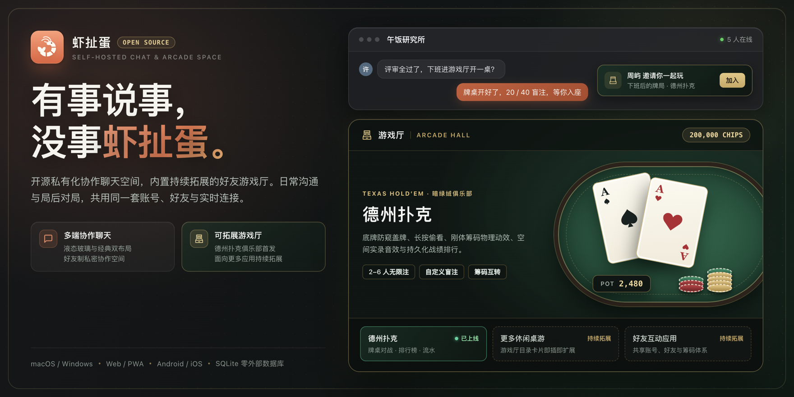
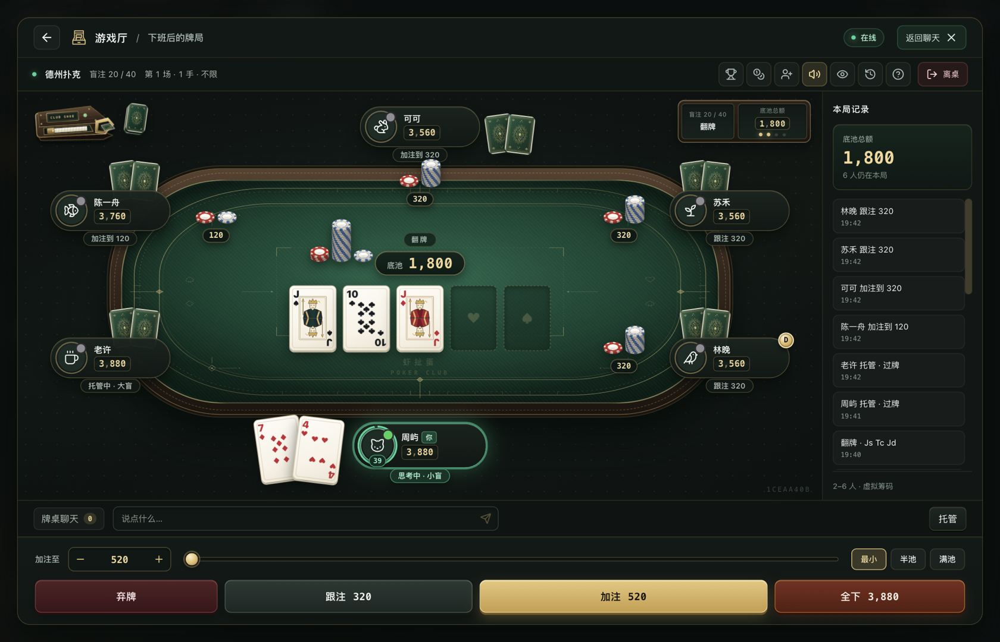
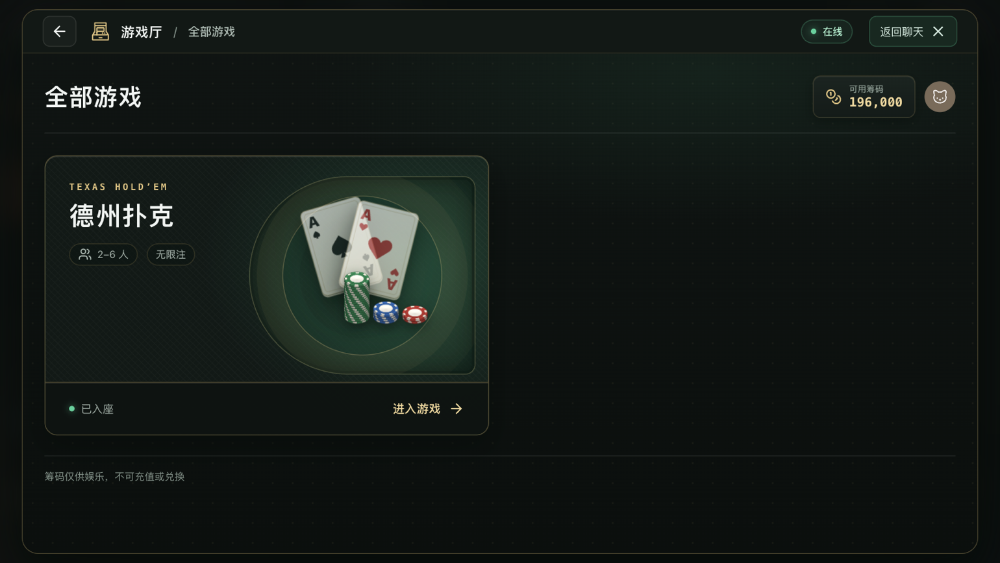
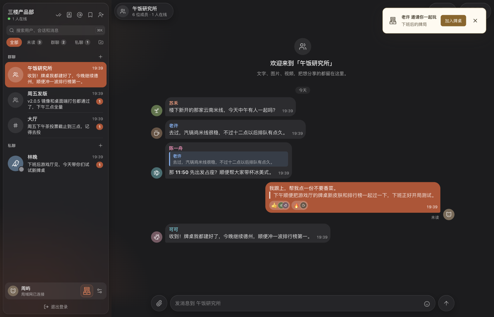

<div align="center">



# Xiachedan (虾扯蛋)

**Talk business when it matters; hang out when it doesn't.**

An open-source, self-hosted lightweight team chat space with an expandable **Arcade Hall** built right in.<br />
Zero external database (single-file SQLite), running across macOS, Windows, Web / PWA, Android, and iOS.

[](https://github.com/ayogggua/xiachedan/actions/workflows/build.yml)
[](https://github.com/ayogggua/xiachedan/releases)
[](package.json)
[](LICENSE)

<p>
  <a href="README.md">简体中文</a> · <strong>English</strong> · <a href="README.ja.md">日本語</a> · <a href="README.ko.md">한국어</a> · <a href="README.zh-TW.md">繁體中文</a>
</p>

[Highlights](#highlights) · [Arcade Hall](#arcade-hall-an-expandable-interactive-space) · [Screenshots](#screenshots) · [Chat Features](#chat-and-collaboration) · [Self-Hosting Guide](#quick-self-hosting-guide) · [Client Builds](#building-clients) · [Project Structure](#project-structure)

</div>

---

## Highlights

<table>
  <tr>
    <td width="50%" valign="top">
      <strong>Clone &amp; Deploy, Zero External Database</strong><br />
      Powered by Node.js native <code>node:sqlite</code>. Messages, friends, chip wallets, and player stats live in a single SQLite database with local attachment storage. No MySQL, PostgreSQL, or Redis required — deploy to your own server or LAN in minutes.
    </td>
    <td width="50%" valign="top">
      <strong>Chat &amp; Arcade, Natively Connected</strong><br />
      Daily conversations and after-work games share the same accounts, friend graph, and live WebSocket connection. Chat messages keep arriving while you play, live table invites pop up right inside chat, and closing the Arcade returns straight to your active thread and draft.
    </td>
  </tr>
  <tr>
    <td width="50%" valign="top">
      <strong>Built as an Expandable Arcade Platform</strong><br />
      Two-level catalog architecture (All Games → Room Lobby → Live Table), launching with a dark-emerald club <b>No-Limit Texas Hold'em</b> experience. Shared virtual chip bank, friend transfers, leaderboards, and live invites are ready for more multiplayer games and mini-apps to plug in.
    </td>
    <td width="50%" valign="top">
      <strong>Refined Multi-Platform Craft</strong><br />
      Switch anytime between <b>Liquid Glass</b> and <b>Classic 3-Column</b> layouts with Light, Dark, and System themes. Ships for macOS / Windows (Tauri 2), Web / PWA (with Web Push &amp; Share Target), and Android / iOS (Capacitor).
    </td>
  </tr>
</table>

> Prebuilt desktop and Android packages are available on [Releases](https://github.com/ayogggua/xiachedan/releases). Ready to host your own instance? Jump to [Quick Self-Hosting Guide](#quick-self-hosting-guide).

---

## Arcade Hall: An Expandable Interactive Space

The Arcade Hall is a flagship pillar of Xiachedan, accessible via a dedicated arcade cabinet icon (next to Settings in Liquid Glass, below the left nav rail in Classic, or top-right of Messages and the Me tab on mobile) without disrupting the default chat-first workflow.

### Extensible Platform Foundation

- **Two-Level Catalog Architecture**: Opening the Arcade Hall displays the **All Games** card catalog, drilling into each app's room list and live session. Upcoming tabletop games and lightweight friend apps plug directly into this catalog while inheriting the same auth, friend graph, and real-time transport.
- **Persistent Virtual Chip Bank (`server/arcadeBank.js`)**: Every member starts with **200,000** virtual chips. Balances, in-table escrow, and ledger history persist in SQLite. Supports **peer-to-peer chip transfers between friends** and super-admin minting; if the server restarts mid-hand, escrowed chips automatically recover back to players' wallets.
- **Multi-Dimensional Leaderboards & Stat Cards**: Sort players by **Net Profit, Total Chips, Win Rate, Hands Played, or Total Won**. Click any player to inspect detailed stats (total won/wagered, biggest single-hand profit, VPIP, raises, all-ins, showdowns, folds, split pots, and best win streak).
- **Live In-Chat Table Invites**: Invite friends straight from a table — they receive a live invitation toast inside their chat window and join with one click.

### Launch Title: No-Limit Texas Hold'em (Dark Emerald Club)

- **Club-Grade Visuals & Tactile Physics**: Dark emerald velvet felt, stitched walnut-leather rail, brushed brass card shoe and mechanical counters, guilloche card backs, court-card linework, rigid-body chip throw physics, and spatial poker audio (independently toggleable).
- **Hole-Card Privacy Cover**: Click any hole card to flip it face-down; hold to peek and release to cover back up. A persistent top-bar privacy toggle auto-covers new hands and automatically reveals at showdown.
- **Authoritative Server Engine**: 2–6 players No-Limit Hold'em with customizable **blinds (small blind 1–1,000,000)** and **hand limits (0 for unlimited)**. The server handles cryptographic shuffling, minimum raises, all-in side pots, split pots, and uncalled bet returns; opponents' hole cards are only sent when showdown requires reveal.
- **Smooth Multiplayer Flow**: 40-second turn clock with timeout autoplay, 5-second auto-continue between hands, live spectating, seamless mid-hand join (auto-dealt next hand), scheduled "leave after hand" or instant leave with automatic post-hand chip refund, and in-table chat bubbles.

| Arcade Module | Status | Overview |
| --- | --- | --- |
| **No-Limit Texas Hold'em** | Live | 2–6 player emerald club table, card privacy cover, chip physics, spatial audio, rankings |
| **More Tabletop Games** | Expanding | Plugs into the catalog card grid, reusing lobbies, spectating, invites, and chip bank |
| **Interactive Friend Mini-Apps** | Expanding | Shares accounts and friend graph to grow a curated suite of lightweight group apps |

> **Note**: Virtual chips are strictly for entertainment and cannot be purchased, traded, or redeemed. Chip balances, ledgers, and stats persist in SQLite; active table state lives in server memory (restarts clear active tables and automatically refund escrowed chips). All players at a table must connect to the same server process; multi-instance shared tables are not yet supported.

---

## Screenshots

### Arcade Hall · Dark Emerald Texas Hold'em Club



### Arcade Hall · Expandable Game Catalog



### Liquid Glass Chat & Live Table Invitation



> Switch freely between **Liquid Glass** and **Classic** 3-column layouts in Settings; narrow viewports and mobile devices automatically adapt to a clean Messages / Contacts / Me flow.

---

## Chat and Collaboration

<details open>
<summary><strong>Friend Graph &amp; Privacy Boundaries</strong></summary>

- **Friend-Request Model**: Contacts display friends by default. Search by nickname, exact phone number, or email to send friend requests before starting DMs, creating friend groups, or transferring Arcade chips. Full user directories are restricted to admins only.
- **Controlled Public Lobby**: Approved members are no longer auto-added to the public lobby; admins explicitly invite or remove lobby members.
- **Profiles &amp; Presence**: Custom nicknames, croppable avatars, name colors, departments, bios, private personal notes, and auto-expiring custom statuses.

</details>

<details open>
<summary><strong>Conversations &amp; Fast Navigation</strong></summary>

- **Real-Time Rooms**: Public lobby, group chats, and 1-on-1 DMs over WebSocket with automatic gap sync on reconnect.
- **Full Group Governance**: Owner transfer, up to 10 group admins, custom group avatars, announcements, mute-all, per-group nicknames, member removal, and invite links with optional approval.
- **Workflow Speed**: Drag-to-reorder pinned chats, mute, mark read/unread, cross-device custom folders, per-room auto-delete timers (1 day / 1 week / 1 month), draft indicators, `⌘K` quick switcher, `⌘1–9` jump, and `⌘/` shortcut reference.
- **Search &amp; Organization**: Global multi-filter search (sender, media type, date range) jumping straight to source messages, Mentions inbox, jump-by-date, pinned messages, threaded replies, favorites, scheduled send, reminders, room media gallery, and pop-out windows on desktop.

</details>

<details>
<summary><strong>Rich Messaging &amp; Interactions (Click to expand)</strong></summary>

- **Media &amp; Previews**: Text, images (compressed or original, built-in crop &amp; brush annotation, album grids, fullscreen zoom viewer), videos, files, and inline previews for text, code, and PDFs.
- **Full Markdown**: Headings, tables, task lists, quotes, syntax-highlighted code blocks with copy button, `/` slash formatting menu, automatic HTML-to-Markdown paste conversion, and configurable `Enter` / `⌘Enter` send key.
- **Quotes, Spoilers &amp; Burn-After-Reading**: Quote selected text snippets, `@mentions` and `@all`; wrap spoilers in `||text||` or mark images/videos as spoilers (hidden across notifications, previews, search, and exports); DM burn-after-reading messages (5s–1m countdown after opening, server-side deletion of content and attachments).
- **Interactive Tools**: Message editing with edit history, recall with dust animation &amp; re-edit, polls, group chains, link previews, nudge, contact cards, direct message links, arbitrary emoji reactions with responder avatars, saved custom stickers &amp; `:shortcode:` expansion, synced quick phrases, multi-select forward &amp; merged chat-record cards (up to 100 messages / 9 rooms), offline outbox auto-resend, and text transcript export.

</details>

<details>
<summary><strong>Appearance, Privacy, Mobile &amp; Bots (Click to expand)</strong></summary>

- **Appearance &amp; Security**: Liquid Glass and Classic layouts, Light / Dark / System themes, independent per-style accent colors &amp; chat wallpapers (6 built-in or custom), Privacy Mode (hover to reveal and mark read), local App Lock passcode (desktop &amp; HTTPS web), and skippable startup opening animation respecting `prefers-reduced-motion`.
- **Desktop &amp; Mobile**: Menu bar / tray resident mode, click-to-open native notifications, sounds, synced keyword alerts, quiet hours, Dock unread badge, native context menus; installable HTTPS PWA with Web Push notifications and Android Share Target; native Android client with attachment download &amp; system share.
- **Admin &amp; Bots**: Registration review, password reset, login device management, member muting, message moderation, storage quotas &amp; audit logs; group Webhook bots and dedicated Bot Accounts (signed JSON callbacks + token reply API — see [`docs/bots.md`](docs/bots.md)).

</details>

---

## Quick Self-Hosting Guide

Clone the repository and pick the deployment path that fits your environment:

| Method | Best For | Requirements | Time |
| --- | --- | --- | --- |
| **Option 1: Local / LAN Mode** | Instant office, dorm, or home LAN chat with invite codes | Node.js ≥ 22.13 | ~1 min |
| **Option 2: Single-Server Cloud (Node.js)** | Lightweight VPS hosting with account registration &amp; review | Node.js ≥ 22.13 + Nginx / Caddy | ~3 min |
| **Option 3: Docker + Nginx Production** | Long-term public hosting with container isolation &amp; split frontend | Docker + Nginx | ~5 min |

### 0. Clone the Repository

```bash
git clone https://github.com/ayogggua/xiachedan.git
cd xiachedan
```

---

### Option 1: Local / LAN Quick Start (Zero Config)

Requires **Node.js 22.13.0+** and npm:

```bash
npm ci
npm run build
CHAT_MODE=local CHAT_SERVE_WEB=true npm start
```

The terminal prints a local initialization link containing `#setup=...` (default port `4318`):

1. Open that link in a browser on the host machine to create your space and admin profile.
2. Copy the LAN address and invite code from inside the app and share it with friends on the same network.

---

### Option 2: Single-Server Public Hosting (Cloud Account Mode)

Production deployments use phone/email + password authentication with admin approval for new registrations.

#### 1. Set Your Super Admin Phone (Recommended)

Edit line 8 of [`server/auth.js`](server/auth.js) and set `ADMIN_PHONE` to your own phone number before first initialization:

```js
const ADMIN_PHONE = '13800138000';
```

#### 2. Create the Initial Admin Password File

Write an initial password (10–128 characters, must contain both letters and digits) outside the repo. After first initialization, subsequent restarts no longer require this file:

```bash
mkdir -p /etc/xiachedan
printf '%s\n' 'YourStrongPass2026' > /etc/xiachedan/admin-password
chmod 600 /etc/xiachedan/admin-password
```

#### 3. Install Dependencies & Build Web / PWA Assets

```bash
npm ci
npm run build:pwa
```

#### 4. Start the Server

**Production HTTPS** (behind Nginx or Caddy):

```bash
NODE_ENV=production \
CHAT_MODE=cloud \
CHAT_SERVE_WEB=true \
HOST=127.0.0.1 \
PORT=4318 \
CHAT_DATA_DIR=/var/lib/xiachedan \
CHAT_SPACE_NAME=Xiachedan \
CHAT_PUBLIC_URL=https://chat.example.com \
CHAT_ALLOWED_ORIGINS=https://chat.example.com \
CHAT_TRUST_PROXY=1 \
CHAT_ADMIN_PASSWORD_FILE=/etc/xiachedan/admin-password \
npm start
```

> **Previewing Cloud Mode over local HTTP?** `NODE_ENV=production` enforces `__Host-` + `Secure` cookies (HTTPS only). For local HTTP testing on `127.0.0.1`, simply omit `NODE_ENV=production` and `CHAT_TRUST_PROXY`:
> ```bash
> CHAT_MODE=cloud CHAT_SERVE_WEB=true \
> CHAT_PUBLIC_URL=http://127.0.0.1:4318 \
> CHAT_ALLOWED_ORIGINS=http://127.0.0.1:4318 \
> CHAT_ADMIN_PASSWORD_FILE=/path/to/admin-password.txt \
> npm start
> ```

#### 5. Configure HTTPS Reverse Proxy (Caddy or Nginx)

Make sure your reverse proxy supports WebSocket upgrade on `/socket` and allows file uploads (`client_max_body_size 101m`).

<details>
<summary><strong>Caddy (Simplest — Automatic TLS)</strong></summary>

```caddyfile
chat.example.com {
    reverse_proxy 127.0.0.1:4318
}
```

</details>

<details>
<summary><strong>Nginx (Minimal Snippet)</strong></summary>

```nginx
server {
    listen 443 ssl http2;
    server_name chat.example.com;
    # Replace with your SSL certificate paths
    client_max_body_size 101m;

    location = /socket {
        proxy_pass http://127.0.0.1:4318;
        proxy_http_version 1.1;
        proxy_set_header Host $host;
        proxy_set_header Origin $http_origin;
        proxy_set_header X-Forwarded-Proto $scheme;
        proxy_set_header X-Forwarded-For $remote_addr;
        proxy_set_header Upgrade $http_upgrade;
        proxy_set_header Connection "upgrade";
        proxy_read_timeout 75s;
    }

    location / {
        proxy_pass http://127.0.0.1:4318;
        proxy_http_version 1.1;
        proxy_set_header Host $host;
        proxy_set_header X-Forwarded-Proto $scheme;
        proxy_set_header X-Forwarded-For $remote_addr;
        proxy_read_timeout 90s;
    }
}
```

</details>

#### 6. Verify & First Login

```bash
curl -s https://chat.example.com/api/health
# Expect: {"app":"linliao","version":"...","mode":"cloud","ok":true,...}
```

Visit `https://chat.example.com`, log in with `ADMIN_PHONE` and the initial password, and change your password as prompted. Use `systemd` or `pm2` to keep `node server/index.js` running persistently.

---

### Option 3: Docker + Nginx Production Deployment

The [`deploy/`](deploy/) directory ships with a hardened, least-privilege backend container and Nginx config for decoupled frontend/backend releases:

1. **Optionally update `ADMIN_PHONE` in [`server/auth.js`](server/auth.js)**, then build the backend image:
   ```bash
   docker build -f deploy/Dockerfile.backend -t xiachedan-backend:latest .
   ```
2. **Prepare host config, secret, and data directories** (container runs read-only as `uid 1000`):
   ```bash
   sudo mkdir -p /etc/xiachedan /var/lib/xiachedan /opt/xiachedan/frontend/current
   sudo cp deploy/backend.env.example /etc/xiachedan/backend.env
   # Edit /etc/xiachedan/backend.env and replace chat.example.com with your domain
   printf '%s\n' 'YourStrongPass2026' | sudo tee /etc/xiachedan/admin-password >/dev/null
   sudo chmod 600 /etc/xiachedan/admin-password
   sudo chown -R 1000:1000 /var/lib/xiachedan
   ```
3. **Start the backend container**:
   ```bash
   BACKEND_IMAGE=xiachedan-backend:latest RELEASE_SHA=local \
     docker compose -f deploy/compose.yml up -d
   ```
4. **Build & deploy PWA static assets**:
   ```bash
   npm ci && npm run build:pwa
   sudo cp -r dist/* /opt/xiachedan/frontend/current/
   ```
5. **Apply [`deploy/nginx.conf`](deploy/nginx.conf)**: replace `chat.example.com` (including `wss://chat.example.com` in the CSP header) and SSL certificate paths, then reload Nginx.

---

### Environment Variables Reference

| Variable | Default | Description |
| --- | --- | --- |
| `CHAT_MODE` | `local` (`cloud` when `NODE_ENV=production`) | `cloud` (account approval mode) or `local` (LAN invite-code mode) |
| `NODE_ENV` | — | Set to `production` for HTTPS-only `__Host-` session cookies and strict origin checks |
| `CHAT_SERVE_WEB` | `true` in `local`, `false` in `cloud` | Serve built `dist/` frontend directly from Node (set `true` for single-process deploys) |
| `HOST` / `PORT` | `0.0.0.0` / `4318` | Bind host and port (`127.0.0.1` recommended behind a local reverse proxy) |
| `CHAT_DATA_DIR` | `./.data` | Directory storing SQLite database and uploaded attachments |
| `CHAT_SPACE_NAME` | `虾扯蛋` | Default workspace name on first bootstrap (max 32 chars) |
| `CHAT_PUBLIC_URL` | — | Public HTTPS origin without trailing slash (required in production; must be in `CHAT_ALLOWED_ORIGINS`) |
| `CHAT_ALLOWED_ORIGINS` | Same as `CHAT_PUBLIC_URL` | Comma-separated exact allowed origins |
| `CHAT_TRUST_PROXY` | — | Proxy hop count or trusted IPs (set `1` behind a single Nginx / Caddy layer) |
| `CHAT_COOKIE_SAME_SITE` | `lax` | Session cookie `SameSite` policy (`lax` / `strict` / `none`) |
| `CHAT_ADMIN_PASSWORD_FILE` | — | Path to initial super-admin password file (takes precedence over `CHAT_ADMIN_INITIAL_PASSWORD`) |
| `CHAT_LINK_PREVIEW` | Enabled | Set `off` to disable server-side link previews |
| `CHAT_MAX_STORAGE_BYTES` | `10737418240` (10 GB) | Total workspace attachment storage cap in bytes |
| `CHAT_MAX_USER_BYTES` | Unlimited | Per-user attachment storage cap in bytes |

### Data Storage & Backups

- **Web / Self-Hosted Server**: `./.data/` by default (or `CHAT_DATA_DIR`; `/var/lib/xiachedan` in Docker).
- **Desktop Local Space**: `~/Library/Application Support/邻聊/space/` on macOS, `%APPDATA%\邻聊\space\` on Windows.
- **Backup**: Stop the server or quit the desktop app before archiving the entire data directory (including `chat.sqlite*` and attachments).

---

## Building Clients

Point desktop and mobile builds directly to your own self-hosted HTTPS server.

### macOS & Windows Desktop (Tauri 2)

Requires [Rust](https://www.rust-lang.org/tools/install) (1.90+), Xcode Command Line Tools on macOS, or Visual Studio C++ Build Tools + WebView2 on Windows.

```bash
# Local desktop dev (downloads & SHA-256 verifies bundled Node.js runtime on first run)
npm run desktop

# Package desktop installers bound to your own HTTPS server
LINLIAO_CLOUD_URL=https://chat.example.com npm run package:mac
LINLIAO_CLOUD_URL=https://chat.example.com npm run package:win
```

Artifacts output to `src-tauri/target/release/bundle/`. Omit `LINLIAO_CLOUD_URL` to build in LAN mode. For cross-architecture macOS builds:

```bash
npm run build
node scripts/prepare-desktop.mjs x86_64-apple-darwin
npx tauri build --target x86_64-apple-darwin --bundles app,dmg
```

### PWA & Web Push

Build with `npm run build:pwa` (plain `npm run build` omits the manifest and Service Worker). Over HTTPS, add to the Home Screen in iOS Safari or Android Chrome and enable **Phone Push** in Settings.

### Android & iOS (Capacitor)

Android packaging requires JDK 21, Android SDK 36, and Build Tools 36.0.0:

```bash
VITE_API_BASE_URL=https://chat.example.com npm run package:android
```

Generates `release/xiachedan-mobile-<version>-debug.apk`. Run `npm run mobile:android` or `npm run mobile:ios` to open Android Studio or Xcode (iOS device distribution requires your own Apple signing; background push is currently PWA-only).

---

## CI/CD Workflows

Four independent GitHub Actions workflows live in `.github/workflows/`:

| Workflow | Purpose &amp; Artifacts |
| --- | --- |
| [Build Desktop](.github/workflows/build.yml) | Lint, test, build web &amp; package macOS arm64/x64 and Windows x64 installers + signed update manifest |
| [Build Android](.github/workflows/build-mobile.yml) | Build `xiachedan-android` APK; publishes pre-releases on `mobile-v*` tags or manual dispatch |
| [Deploy Web and PWA](.github/workflows/deploy-frontend.yml) | Build `production-web` and deploy static web/PWA bundle when configured |
| [Deploy Backend](.github/workflows/deploy-backend.yml) | Check and deploy backend independently |

Modifying README files or `assets/` alone does not trigger automated builds or deployments.

---

## Project Structure

| Path | Description |
| --- | --- |
| `src/` | React 19 UI, chat interactions, Liquid Glass / Classic skins, friend graph, mobile &amp; PWA |
| `src/arcade/` | Expandable Arcade Hall: two-level game catalog (`ArcadeLobby.jsx`), leaderboards &amp; wallet (`ArcadePanels.jsx`), dark emerald Texas Hold'em club (`Arcade.jsx`), rigid-body chip physics &amp; spatial audio |
| `src/ArcadeEntry.jsx` / `ArcadeInvitation.jsx` | Arcade launcher icon and live in-chat table invitation toast |
| `src/Opening.jsx` | Skippable application startup opening animation |
| `server/` | Express 5, WebSocket server, authentication (`auth.js`), SQLite persistence (`store.js`), Web Push &amp; bot delivery |
| `server/poker.js` / `arcadeBank.js` | Authoritative Texas Hold'em engine and persistent SQLite chip wallet / stats bank |
| `src-tauri/` | Tauri 2 desktop shell: bundled Node sidecar, tray/menubar, native notifications, `window.desktop` bridge |
| `mobile/` | Capacitor Android and iOS native projects |
| `deploy/` | Production backend Dockerfile, Compose config, hardened Nginx config, atomic release script |
| `scripts/` | Desktop runtime preparation, versioning, updater manifest, PWA &amp; mobile build scripts |
| `shared/` | Shared invite parsing and preset avatar helpers |
| `docs/bots.md` | Bot Account webhook &amp; API integration guide |
| `tests/` | Automated server test suite (`npm test`, covering local, cloud, friends &amp; arcade flows) |
| `assets/` | README brand poster and application screenshots |

---

## Security Scope & License

- Use `local` mode only on trusted LANs; public deployments should always run `cloud` mode behind HTTPS / WSS.
- Neither mode implements end-to-end encryption (E2EE); messages, attachments, and chip ledgers are stored on your self-hosted server. Privacy Mode and App Lock protect on-screen access only and do not encrypt local disk data.
- Burn-after-reading messages delete content and media from the server upon expiry, but cannot prevent screenshots or external cameras.

Licensed under the [MIT License](LICENSE). Issues, Pull Requests, and ideas for new **Arcade Hall** games and mini-apps are warmly welcome.
