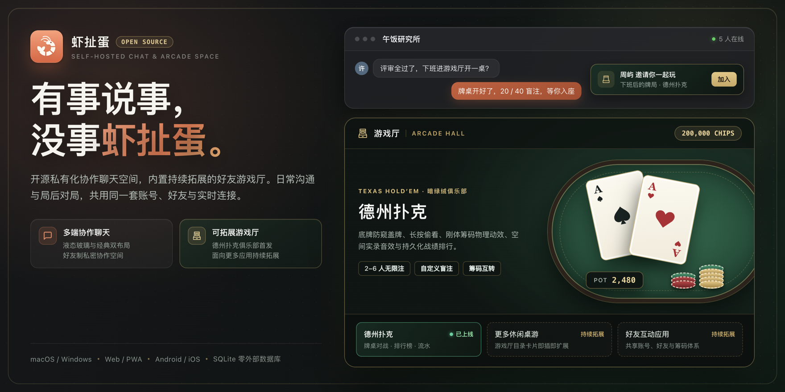
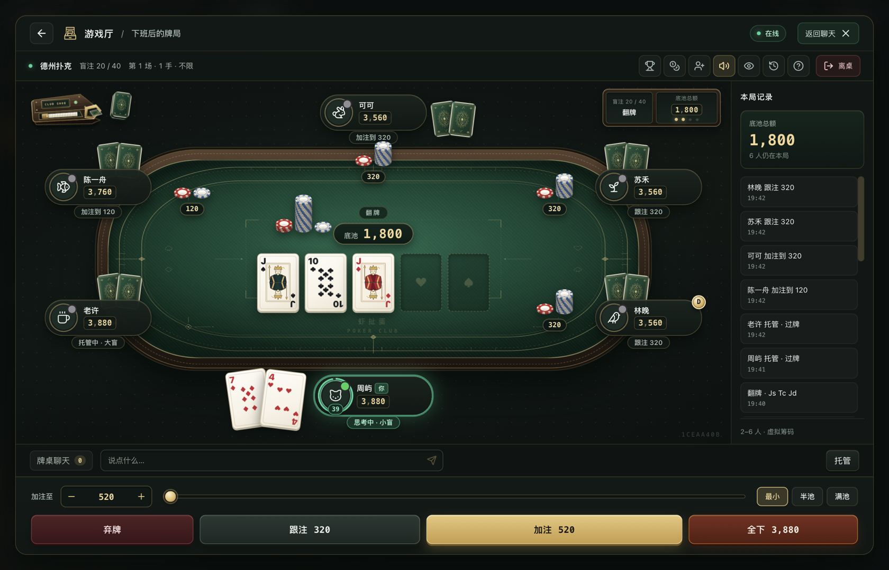
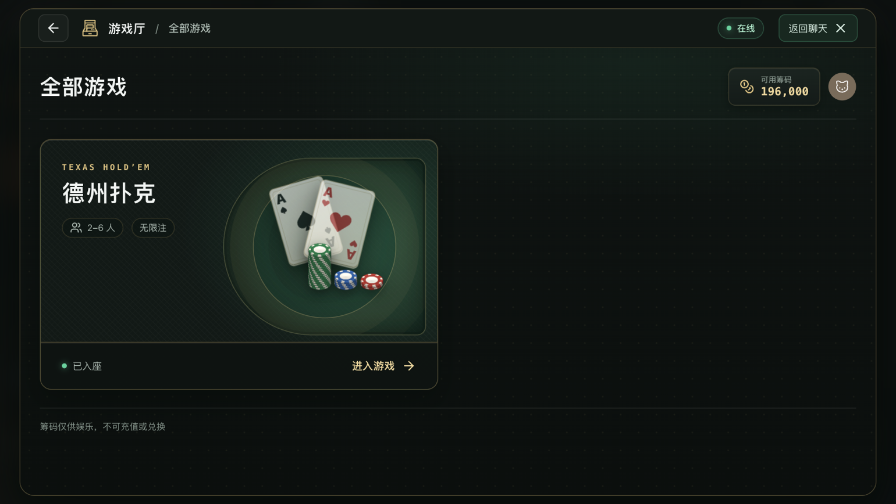
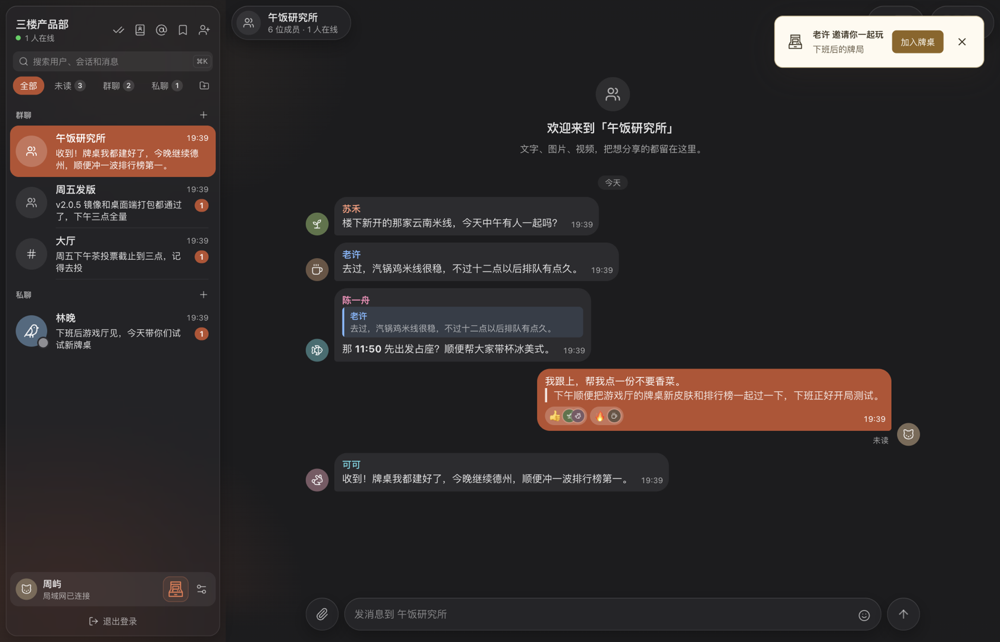

<div align="center">



# 虾扯蛋（Xiachedan）

**用があるときは本題を、用がないときは気軽に雑談を。**

拡張可能なフレンド向け**ゲームホール**を内蔵した、オープンソースのセルフホスト型軽量チャット空間。<br />
外部データベース不要（単一 SQLite ファイル）で動作し、macOS / Windows デスクトップ、Web / PWA、Android / iOS に対応しています。

[](https://github.com/ayogggua/xiachedan/actions/workflows/build.yml)
[](https://github.com/ayogggua/xiachedan/releases)
[](package.json)
[](LICENSE)

<p>
  <a href="README.md">简体中文</a> · <a href="README.en.md">English</a> · <strong>日本語</strong> · <a href="README.ko.md">한국어</a> · <a href="README.zh-TW.md">繁體中文</a>
</p>

[特徴](#特徴) · [ゲームホール](#ゲームホール拡張し続けるインタラクティブ空間) · [スクリーンショット](#スクリーンショット) · [チャット機能](#チャットコラボレーション機能) · [セルフホスト手順](#セルフホスト導入ガイド) · [クライアントビルド](#クライアント開発ビルド) · [プロジェクト構成](#プロジェクト構成)

</div>

---

## 特徴

<table>
  <tr>
    <td width="50%" valign="top">
      <strong>クローンして即デプロイ・外部 DB 不要</strong><br />
      Node.js 標準の <code>node:sqlite</code> を採用。メッセージ、フレンド関係、仮想チップ残高、戦績はすべて単一の SQLite ファイルに保存され、添付ファイルもローカルディレクトリに格納されます。MySQL や Redis なしで数分で自分のサーバーに構築できます。
    </td>
    <td width="50%" valign="top">
      <strong>チャットとゲームホールのシームレスな融合</strong><br />
      普段の会話と仕事終わりの対戦が、同じアカウント・フレンド関係・WebSocket 接続を共有。プレイ中もチャット通知は届き、テーブル招待はチャット画面上部にリアルタイム表示され、閉じれば元の会話と下書きにそのまま戻れます。
    </td>
  </tr>
  <tr>
    <td width="50%" valign="top">
      <strong>アプリを追加拡張できるゲームホール基盤</strong><br />
      2 階層カタログ構造（全ゲーム → ルーム一覧 → リアルタイム対局）を採用し、第 1 弾としてダークエメラルド・クラブ仕様の<b>ノーリミット・テキサスホールデム</b>を搭載。チップ銀行・送金・ランキング・招待基盤を共通化し、今後もボードゲームやミニアプリを継続拡張します。
    </td>
    <td width="50%" valign="top">
      <strong>洗練されたマルチプラットフォーム体験</strong><br />
      <b>リキッドグラス</b>と<b>クラシック 3 カラム</b>の 2 スタイルを自由に切替可能（ライト／ダーク／システム連動）。macOS / Windows（Tauri 2）、Web / PWA（Web Push・共有ターゲット対応）、Android / iOS（Capacitor）を網羅します。
    </td>
  </tr>
</table>

> ビルド済みデスクトップ版・Android 版は [Releases](https://github.com/ayogggua/xiachedan/releases) から入手できます。自前サーバーへ導入したい方は [セルフホスト導入ガイド](#セルフホスト導入ガイド) をご覧ください。

---

## ゲームホール：拡張し続けるインタラクティブ空間

ゲームホールは本プロジェクトの中核機能です。専用のアーケードアイコン（リキッドグラスでは左下設定横、クラシックでは左ナビ下部、モバイルではメッセージ右上および「マイページ」）からいつでも起動でき、チャット中心の体験を妨げません。

### 拡張可能なプラットフォーム基盤

- **2 階層ゲームカタログ**：まずは「全ゲーム」カード一覧を表示し、カードから各アプリのルーム一覧・対局へ遷移します。今後追加するカジュアルゲームやフレンド向けミニアプリも、カードを追加するだけで認証・フレンド関係・チップ基盤をそのまま共有できます。
- **永続化仮想チップ銀行（`server/arcadeBank.js`）**：各メンバーに初期 **200,000** 仮想チップを付与。残高・テーブル預かり分・取引履歴はすべて SQLite に永続保存されます。**フレンド間のチップ送金**や管理者による付与に対応し、サーバー再起動時も未完了ハンドの預かりチップを自動返還します。
- **多軸ランキング＆戦績カード**：**純利益・総チップ・勝率・プレイ数・累計獲得**で並び替え可能。任意のプレイヤーをクリックすると詳細戦績（累計獲得／投入、最大単局純利益、VPIP、レイズ数、オールイン、ショーダウン、フォールド、スプリットポット、最大連勝）を確認できます。
- **チャット内リアルタイム招待**：テーブルからフレンドを招待すると、相手のチャット画面上部に招待カードが即座に表示され、ワンクリックで着席できます。

### 第 1 弾タイトル：ノーリミット・テキサスホールデム（ダークエメラルド・クラブ）

- **質感と物理演出**：深緑のクラブフェルト、ステッチ入りウォールナット調レール、真鍮カードシュー＆機械式カウンター、精巧なカード背面・絵札デザインに加え、剛体チップ物理アニメーションと空間オーディオを搭載（音声は個別オン／オフ可能）。
- **ハンド覗き見防止（カバー＆長押しピーク）**：自分の手札をタップして個別に伏せ、長押しで一時確認・離すと自動で伏せ戻しが可能。上部バーの防窺モードをオンにすると毎ハンド自動カバー＆ショーダウン時に自動公開されます。
- **サーバー権威の本格ルール**：2〜6 人対応、**ブラインド（スモールブラインド 1〜1,000,000）**および**ハンド上限（0 で無制限）**を自在に設定可能。暗号学的シャッフル、最小レイズ、オールイン時のサイドポット分配、スプリットポットをすべてサーバー側で厳密に処理します。
- **快適な対局テンポ**：40 秒アクションタイマーと自動代行、5 秒後の連続ハンド自動開始、リアルタイム観戦、途中着席（次ハンドから参加）、ハンド終了後の離席予約および即時離席（清算後に自動返金）、テーブル内チャット吹き出しに対応。

| ゲームホールモジュール | ステータス | 内容 |
| --- | --- | --- |
| **ノーリミット・テキサスホールデム** | 公開中 | 2〜6 人ダークエメラルド卓、防窺カバー、チップ物理演出、空間効果音、ランキング |
| **新作ボード・カードゲーム** | 順次拡張予定 | カタログカードへ直接追加し、ルーム・観戦・招待・チップ基盤を共通利用 |
| **フレンド向けミニアプリ** | 順次拡張予定 | チャットのアカウントとフレンド関係を活用した軽量インタラクティブ空間 |

> **補足**：仮想チップは娯楽専用であり、課金・売買・換金はできません。チップ残高・履歴・戦績は SQLite に永続保存されますが、進行中のテーブル状態はサーバープロセスのメモリ上に保持されます（再起動時は未完了分の預かりチップが自動返還されます）。同一テーブルの参加者は同じサーバープロセスへ接続する必要があります。

---

## スクリーンショット

### ゲームホール · ダークエメラルド・テキサスホールデム



### ゲームホール · 拡張可能なゲームカタログ



### リキッドグラス・チャット画面とリアルタイム招待



> 設定画面から「リキッドグラス」と「クラシック 3 カラム」をいつでも切り替え可能。スマートフォンや狭い画面では「メッセージ・連絡先・マイページ」構成へ自動最適化されます。

---

## チャット・コラボレーション機能

<details open>
<summary><strong>フレンド制とプライバシー境界</strong></summary>

- **フレンド申請モデル**：連絡先はデフォルトでフレンドのみ表示。ニックネーム、完全一致の電話番号またはメールアドレスで検索してフレンド申請でき、承認後に DM・グループ招待・チップ送金が可能になります。全ユーザー一覧は管理者のみ閲覧可能です。
- **制御されたパブリックロビー**：新規登録承認後に自動でロビーへ追加されず、管理者が招待・退出を管理します。
- **プロフィール＆ステータス**：ニックネーム、トリミング対応アバター、名前カラー、部署、自己紹介、自分だけのメモ、期限付きカスタムステータスを設定できます。

</details>

<details open>
<summary><strong>ルーム管理と高速ナビゲーション</strong></summary>

- **リアルタイム通信**：パブリックロビー、グループチャット、1対1 DM を WebSocket で送受信し、再接続時に未取得メッセージを自動補完。
- **グループ権限管理**：オーナー移譲、最大 10 名の管理者、グループアイコン、お知らせ、全体ミュート、グループ専用ニックネーム、メンバー削除、承認有無を選べる招待リンク。
- **操作効率**：ピン留めドラッグ並び替え、ミュート、既読／未読切替、デバイス間同期フォルダ、ルーム別自動削除（1日／1週間／1ヶ月）、下書き表示、`⌘K` クイックスイッチャー、`⌘1–9` 切替、`⌘/` ショートカット一覧。
- **検索・整理**：送信者／種別／日付で絞り込める全体検索、メンション一覧、日付ジャンプ、ピン留めメッセージ、スレッド返信、お気に入り、予約送信、リマインダー、メディア一覧、デスクトップ版での別ウィンドウ表示。

</details>

<details>
<summary><strong>リッチメッセージ＆インタラクション（クリックで展開）</strong></summary>

- **メディアとプレビュー**：テキスト、画像（圧縮／原画選択、トリミング＆ペン注釈、アルバムグリッド、全画面ビューア）、動画、各種ファイル、およびテキスト・コード・PDF のインラインプレビュー。
- **フル Markdown**：見出し、テーブル、チェックリスト、引用、シンタックスハイライト＋コピーボタン付きコードブロック、`/` 入力メニュー、Web からのリッチテキスト貼り付け時の自動 Markdown 変換、`Enter`／`⌘Enter` 送信切替。
- **引用・スポイラー・閲覧後消滅**：選択箇所のみの引用返信、`@メンション`／`@全員`、`||テキスト||` や画像・動画のスポイラー保護（通知・検索・エクスポートでも非表示）、DM 専用の閲覧後消滅メッセージ（5秒〜1分、期限後に本文と添付をサーバーから削除）。
- **インタラクション**：編集＆編集履歴、パーティクル演出付き取り消し＆再編集、投票、グループリレー、リンクプレビュー、ナッジ、連絡先カード、メッセージ直リンク、自由な絵文字リアクション、画像のスタンプ登録＆`:shortcode:` 展開、同期定型文、複数選択転送＆まとめ転送（最大 100 件・9 ルーム）、オフライン送信キュー自動再送、テキストエクスポート。

</details>

<details>
<summary><strong>外観・プライバシー・モバイル・Bot（クリックで展開）</strong></summary>

- **外観と保護**：リキッドグラス／クラシック切替、ライト／ダーク／システム、スタイル別のアクセントカラーと背景設定（内蔵 6 種または任意画像）、プライバシーモード（ホバー時のみ表示＆既読化）、ローカルアプリロック（デスクトップおよび HTTPS Web）、スキップ＆視差効果軽減対応の起動画面アニメーション。
- **デスクトップ＆モバイル**：メニューバー／トレイ常駐、通知クリックで該当ルーム起動、通知音、キーワード通知、おやすみ時間、Dock 未読数、ネイティブ右クリックメニュー。HTTPS 環境の PWA ではホーム画面追加・Web Push バックグラウンド通知・Android 共有受け取りに対応。Android ネイティブ版は添付ダウンロード・システム共有に対応。
- **管理と Bot**：新規登録審査、パスワード初期化、ログイン端末管理、ミュート・メッセージ削除・保存期間設定・監査ログ。グループ Webhook および署名付き JSON コールバック対応の独立 Bot アカウント（詳細は [`docs/bots.md`](docs/bots.md)）。

</details>

---

## セルフホスト導入ガイド

リポジトリをクローン後、用途に合うデプロイ方式を選んでください。

| 方式 | おすすめ用途 | 必要な環境 | 目安時間 |
| --- | --- | --- | --- |
| **方式 1：ローカル／LAN モード** | 社内・自宅 LAN での即時利用（招待コード参加） | Node.js ≥ 22.13 | 約 1 分 |
| **方式 2：単体サーバー公開（Cloud + Node.js）** | VPS 1 台でアカウント承認制の公開運用 | Node.js ≥ 22.13 + Nginx / Caddy | 約 3 分 |
| **方式 3：Docker + Nginx 本番構成** | コンテナ分離・フロント／バック独立デプロイ | Docker + Nginx | 約 5 分 |

### 0. リポジトリをクローン

```bash
git clone https://github.com/ayogggua/xiachedan.git
cd xiachedan
```

---

### 方式 1：ローカル／LAN で今すぐ試す（設定不要）

**Node.js 22.13.0 以上** と npm が必要です：

```bash
npm ci
npm run build
CHAT_MODE=local CHAT_SERVE_WEB=true npm start
```

起動すると `#setup=...` を含む初期設定 URL（既定ポート `4318`）が表示されます。

1. ホスト PC のブラウザでその URL を開き、空間名と管理者名を設定します。
2. アプリ内で表示される LAN アドレスと招待コードを同じネットワークの仲間に共有すれば、すぐチャットとゲームホールを始められます。

---

### 方式 2：単体サーバーでセルフホスト（Cloud アカウントモード）

#### 1. 初期スーパー管理者の電話番号を変更（推奨）

初回起動前に [`server/auth.js`](server/auth.js) の 8 行目 `ADMIN_PHONE` をご自身の電話番号へ書き換えてください：

```js
const ADMIN_PHONE = '13800138000';
```

#### 2. 初期管理者パスワードファイルを作成

英字と数字を含む 10〜128 文字の初期パスワードをリポジトリ外に保存します（初回初期化後、2 回目以降の起動では不要です）：

```bash
mkdir -p /etc/xiachedan
printf '%s\n' 'YourStrongPass2026' > /etc/xiachedan/admin-password
chmod 600 /etc/xiachedan/admin-password
```

#### 3. 依存導入と PWA 対応フロントエンドのビルド

```bash
npm ci
npm run build:pwa
```

#### 4. サーバー起動

**本番 HTTPS 環境**（Nginx / Caddy リバースプロキシ配下）：

```bash
NODE_ENV=production \
CHAT_MODE=cloud \
CHAT_SERVE_WEB=true \
HOST=127.0.0.1 \
PORT=4318 \
CHAT_DATA_DIR=/var/lib/xiachedan \
CHAT_SPACE_NAME=虾扯蛋 \
CHAT_PUBLIC_URL=https://chat.example.com \
CHAT_ALLOWED_ORIGINS=https://chat.example.com \
CHAT_TRUST_PROXY=1 \
CHAT_ADMIN_PASSWORD_FILE=/etc/xiachedan/admin-password \
npm start
```

> **ローカル HTTP でアカウントモードを確認したい場合**：`NODE_ENV=production` は HTTPS 専用の `__Host-` + `Secure` Cookie を有効化するため、ローカル検証時は `NODE_ENV=production` と `CHAT_TRUST_PROXY` を外して起動してください。

#### 5. HTTPS リバースプロキシ設定（Caddy または Nginx）

`/socket` の WebSocket アップグレードとファイルアップロード上限（`101m`）を設定します。

<details>
<summary><strong>Caddy（最短・自動 HTTPS）</strong></summary>

```caddyfile
chat.example.com {
    reverse_proxy 127.0.0.1:4318
}
```

</details>

<details>
<summary><strong>Nginx（最小構成例）</strong></summary>

```nginx
server {
    listen 443 ssl http2;
    server_name chat.example.com;
    # SSL 証明書パスを設定してください
    client_max_body_size 101m;

    location = /socket {
        proxy_pass http://127.0.0.1:4318;
        proxy_http_version 1.1;
        proxy_set_header Host $host;
        proxy_set_header Origin $http_origin;
        proxy_set_header X-Forwarded-Proto $scheme;
        proxy_set_header X-Forwarded-For $remote_addr;
        proxy_set_header Upgrade $http_upgrade;
        proxy_set_header Connection "upgrade";
        proxy_read_timeout 75s;
    }

    location / {
        proxy_pass http://127.0.0.1:4318;
        proxy_http_version 1.1;
        proxy_set_header Host $host;
        proxy_set_header X-Forwarded-Proto $scheme;
        proxy_set_header X-Forwarded-For $remote_addr;
        proxy_read_timeout 90s;
    }
}
```

</details>

#### 6. 疎通確認と初回ログイン

```bash
curl -s https://chat.example.com/api/health
# {"app":"linliao","version":"...","mode":"cloud","ok":true,...} が返れば起動完了
```

`https://chat.example.com` を開き、`ADMIN_PHONE` と初期パスワードでログインしてパスワード変更を行ってください。常駐運用には `systemd` や `pm2` の利用を推奨します。

---

### 方式 3：Docker + Nginx 本番デプロイ（フロント／バック分離）

[`deploy/`](deploy/) に本番向けの最小権限 Dockerfile・Compose・Nginx 設定を同梱しています。

1. **必要に応じて [`server/auth.js`](server/auth.js) の `ADMIN_PHONE` を編集**し、バックエンドイメージをビルド：
   ```bash
   docker build -f deploy/Dockerfile.backend -t xiachedan-backend:latest .
   ```
2. **ホスト側の設定・シークレット・データディレクトリを準備**（コンテナは `uid 1000` の読み取り専用で実行）：
   ```bash
   sudo mkdir -p /etc/xiachedan /var/lib/xiachedan /opt/xiachedan/frontend/current
   sudo cp deploy/backend.env.example /etc/xiachedan/backend.env
   # /etc/xiachedan/backend.env 内の chat.example.com を自身のドメインへ置換
   printf '%s\n' 'YourStrongPass2026' | sudo tee /etc/xiachedan/admin-password >/dev/null
   sudo chmod 600 /etc/xiachedan/admin-password
   sudo chown -R 1000:1000 /var/lib/xiachedan
   ```
3. **バックエンドコンテナを起動**：
   ```bash
   BACKEND_IMAGE=xiachedan-backend:latest RELEASE_SHA=local \
     docker compose -f deploy/compose.yml up -d
   ```
4. **PWA フロントエンドをビルドして配置**：
   ```bash
   npm ci && npm run build:pwa
   sudo cp -r dist/* /opt/xiachedan/frontend/current/
   ```
5. **[`deploy/nginx.conf`](deploy/nginx.conf) を適用**：`chat.example.com`（CSP ヘッダー内の `wss://chat.example.com` を含む）と証明書パスを置換して Nginx をリロードします。

---

### 環境変数一覧

| 変数名 | 既定値 | 説明 |
| --- | --- | --- |
| `CHAT_MODE` | `local`（`NODE_ENV=production` 時は `cloud`） | `cloud`（アカウント承認制）または `local`（LAN 招待コード制） |
| `NODE_ENV` | — | `production` 指定で HTTPS 専用 Cookie（`__Host-`）と厳格な Origin 検証を有効化 |
| `CHAT_SERVE_WEB` | `local` は `true`、`cloud` は `false` | Node サーバーから `dist/` 静的ファイルを直接配信するか（単体運用時は `true`） |
| `HOST` / `PORT` | `0.0.0.0` / `4318` | バインドアドレスとポート（リバースプロキシ併用時は `127.0.0.1` 推奨） |
| `CHAT_DATA_DIR` | `./.data` | SQLite データベースおよび添付ファイルの保存ディレクトリ |
| `CHAT_SPACE_NAME` | `虾扯蛋` | 初回初期化時のスペース名（最大 32 文字） |
| `CHAT_PUBLIC_URL` | — | 公開 HTTPS ルート URL（末尾 `/` なし、本番必須かつ `CHAT_ALLOWED_ORIGINS` に含めること） |
| `CHAT_ALLOWED_ORIGINS` | `CHAT_PUBLIC_URL` と同じ | 許可する正確な Origin（カンマ区切り） |
| `CHAT_TRUST_PROXY` | — | 信頼するプロキシ段数または IP（Nginx / Caddy 1 段の場合は `1`） |
| `CHAT_COOKIE_SAME_SITE` | `lax` | セッション Cookie の `SameSite` 属性（`lax` / `strict` / `none`） |
| `CHAT_ADMIN_PASSWORD_FILE` | — | 初回スーパー管理者パスワードファイルのパス（`CHAT_ADMIN_INITIAL_PASSWORD` より優先） |
| `CHAT_LINK_PREVIEW` | 有効 | `off` でリンクプレビューを無効化 |
| `CHAT_MAX_STORAGE_BYTES` | `10737418240`（10 GB） | スペース全体の添付ファイル容量上限（バイト） |
| `CHAT_MAX_USER_BYTES` | 無制限 | メンバーごとの添付ファイル容量上限（バイト） |

### データ保存先とバックアップ

- **Web／セルフホスト**：既定 `./.data/`（または `CHAT_DATA_DIR`、Docker は `/var/lib/xiachedan`）。
- **デスクトップ版ローカル空間**：macOS は `~/Library/Application Support/邻聊/space/`、Windows は `%APPDATA%\邻聊\space\`。
- **バックアップ**：必ずサービスまたはデスクトップアプリを停止してから、データディレクトリ全体（`chat.sqlite*` と添付フォルダ）をコピーしてください。

---

## クライアント開発・ビルド

デスクトップ版およびモバイル版を、ご自身のセルフホストサーバーに向けてビルドできます。

### macOS / Windows デスクトップ（Tauri 2）

[Rust](https://www.rust-lang.org/tools/install)（1.90 以上）、macOS は Xcode Command Line Tools、Windows は Visual Studio C++ ビルドツールと WebView2 が必要です。

```bash
# ローカル開発（初回のみ公式 Node.js ランタイムを自動取得・SHA-256 検証）
npm run desktop

# 自分の HTTPS サーバーに接続するインストーラーをビルド
LINLIAO_CLOUD_URL=https://chat.example.com npm run package:mac
LINLIAO_CLOUD_URL=https://chat.example.com npm run package:win
```

成果物は `src-tauri/target/release/bundle/` に生成されます。

### PWA / Android / iOS

- **PWA**：`npm run build:pwa` でビルドし HTTPS 配信すると、iOS Safari / Android Chrome からホーム画面へインストールおよび Web Push 通知が利用可能です。
- **Android APK**（JDK 21・Android SDK 36・Build Tools 36.0.0 が必要）：
  ```bash
  VITE_API_BASE_URL=https://chat.example.com npm run package:android
  ```
- **IDE 起動**：`npm run mobile:android`（Android Studio）、`npm run mobile:ios`（Xcode）。

---

## プロジェクト構成

| ディレクトリ / ファイル | 内容 |
| --- | --- |
| `src/` | React 19 UI、チャット機能、リキッドグラス／クラシック切替、フレンド機能、モバイル＆PWA |
| `src/arcade/` | 拡張型ゲームホール：2階層カタログ（`ArcadeLobby.jsx`）、ランキング＆ウォレット（`ArcadePanels.jsx`）、ダークエメラルド・テキサスホールデム（`Arcade.jsx`）、チップ物理演出＆空間オーディオ |
| `src/ArcadeEntry.jsx` / `ArcadeInvitation.jsx` | ゲームホール入口ボタンおよびチャット内テーブル招待通知 |
| `src/Opening.jsx` | アプリ起動アニメーション |
| `server/` | Express 5、WebSocket、認証（`auth.js`）、SQLite 永続化（`store.js`）、Web Push、Bot 配信 |
| `server/poker.js` / `arcadeBank.js` | テキサスホールデム権威エンジンおよび SQLite 永続チップ・戦績銀行 |
| `src-tauri/` | Tauri 2 デスクトップシェル（Node サイドカー、トレイ常駐、システム通知） |
| `mobile/` | Capacitor Android / iOS ネイティブプロジェクト |
| `deploy/` | 本番用 Dockerfile、Docker Compose、Nginx 設定、リリーススクリプト |
| `docs/bots.md` | Bot アカウント開発・連携ドキュメント |
| `tests/` | サーバー自動テスト（`npm test`） |
| `assets/` | README ブランドポスターおよびスクリーンショット |

---

## セキュリティ範囲とライセンス

- LAN モードは信頼できるローカルネットワーク専用です。公開運用時は必ず `cloud` モード + HTTPS / WSS を使用してください。
- エンドツーエンド暗号化（E2EE）は実装しておらず、メッセージや添付ファイルはホストサーバーに保存されます。プライバシーモードやアプリロックは画面表示のみを保護します。
- 閲覧後消滅メッセージは期限後にサーバーから削除されますが、スクリーンショットや外部撮影を防ぐことはできません。

本プロジェクトは [MIT License](LICENSE) の下で公開されています。不具合報告、機能提案、**ゲームホールに追加してほしい新アプリ**のアイデア、Pull Request を歓迎します。
