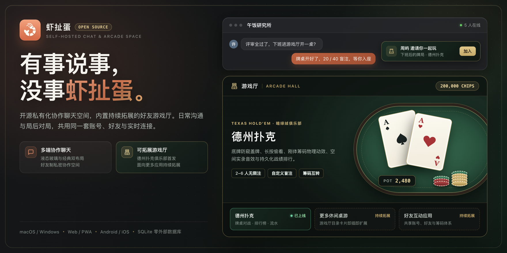
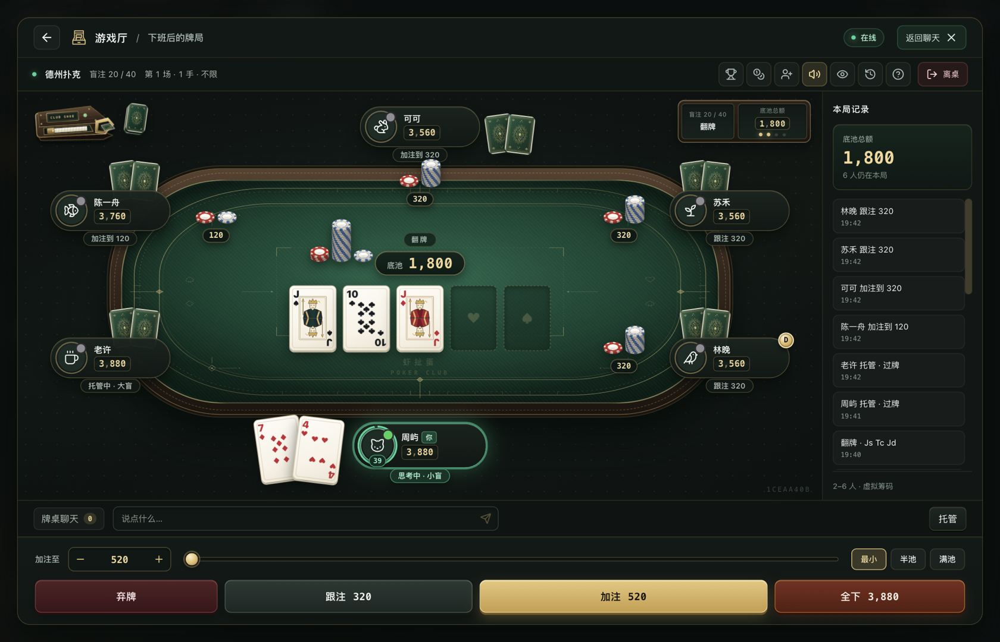
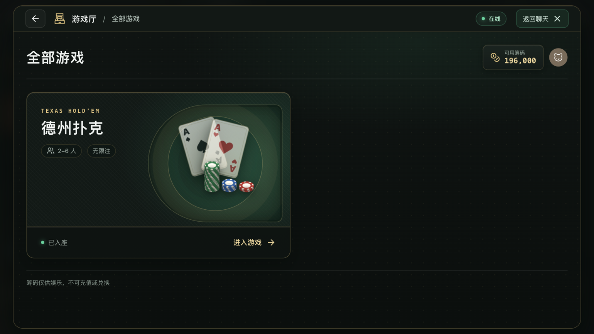
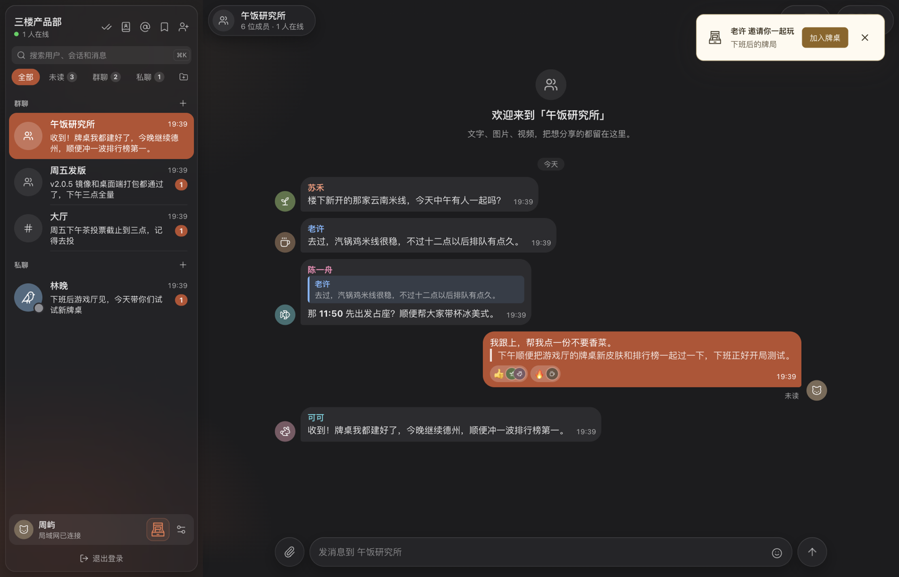

<div align="center">



# 虾扯蛋 (Xiachedan)

**할 일 있을 땐 본론만, 여유 있을 땐 가볍게 수다와 한 판.**

확장 가능한 친구 전용 **게임 홀(Arcade Hall)** 을 내장한 오픈소스 셀프 호스팅 경량 협업 메신저입니다.<br />
외부 데이터베이스 없이 단일 SQLite 파일로 동작하며 macOS / Windows 데스크톱, Web / PWA, Android / iOS를 지원합니다.

[](https://github.com/ayogggua/xiachedan/actions/workflows/build.yml)
[](https://github.com/ayogggua/xiachedan/releases)
[](package.json)
[](LICENSE)

<p>
  <a href="README.md">简体中文</a> · <a href="README.en.md">English</a> · <a href="README.ja.md">日本語</a> · <strong>한국어</strong> · <a href="README.zh-TW.md">繁體中文</a>
</p>

[핵심 특징](#핵심-특징) · [게임 홀](#게임-홀-계속-확장되는-인터랙티브-공간) · [스크린샷](#스크린샷) · [채팅 기능](#채팅-및-협업-기능) · [셀프 호스팅 가이드](#빠른-셀프-호스팅-배포) · [클라이언트 빌드](#클라이언트-개발-및-패키징) · [프로젝트 구조](#프로젝트-구조)

</div>

---

## 핵심 특징

<table>
  <tr>
    <td width="50%" valign="top">
      <strong>클론 즉시 배포, 외부 DB 불필요</strong><br />
      Node.js 내장 <code>node:sqlite</code> 기반으로 메시지, 친구 목록, 가상 칩 계좌, 전적이 모두 단일 SQLite 파일에 저장되며 첨부 파일은 로컬 디렉터리에 보관됩니다. MySQL이나 Redis 없이 몇 분 만에 직접 배포할 수 있습니다.
    </td>
    <td width="50%" valign="top">
      <strong>채팅과 게임 홀의 자연스러운 통합</strong><br />
      일상 대화와 퇴근 후 한 판이 동일한 계정, 친구 관계, WebSocket 연결을 공유합니다. 게임 중에도 채팅 메시지가 실시간 수신되며 테이블 초대가 채팅창 상단에 즉시 표시되고, 닫으면 기존 대화와 초안으로 바로 돌아갑니다.
    </td>
  </tr>
  <tr>
    <td width="50%" valign="top">
      <strong>다중 앱 확장을 위한 게임 홀 아키텍처</strong><br />
      2단계 카탈로그 구조(전체 게임 → 방 목록 → 실시간 테이블)로 설계되었으며 첫 번째 타이틀로 다크 에메랄드 클럽 <b>노리밋 텍사스 홀덤</b>을 제공합니다. 공용 칩 은행·송금·랭킹·초대 기반 위에 더 많은 보드게임과 미니 앱을 계속 확장할 예정입니다.
    </td>
    <td width="50%" valign="top">
      <strong>절제되고 완성도 높은 멀티 플랫폼 UI</strong><br />
      <b>리퀴드 글래스</b>와 <b>클래식 3단</b> 레이아웃을 자유롭게 전환할 수 있으며 라이트 / 다크 / 시스템 테마를 지원합니다. macOS / Windows(Tauri 2), Web / PWA(Web Push 및 공유 타겟), Android / iOS(Capacitor)를 모두 지원합니다.
    </td>
  </tr>
</table>

> 미리 빌드된 데스크톱 및 Android 설치 파일은 [Releases](https://github.com/ayogggua/xiachedan/releases)에서 다운로드할 수 있습니다. 직접 서버를 구축하려면 [빠른 셀프 호스팅 배포](#빠른-셀프-호스팅-배포)로 이동하세요.

---

## 게임 홀: 계속 확장되는 인터랙티브 공간

게임 홀은 Xiachedan의 핵심 인터랙티브 공간입니다. 전용 아케이드 아이콘(리퀴드 글래스 좌측 하단 설정 옆, 클래식 좌측 네비게이션 하단, 모바일 메시지 우측 상단 및 '나' 탭)으로 기본 채팅 흐름을 해치지 않고 언제든 입장할 수 있습니다.

### 확장 가능한 플랫폼 기반

- **2단계 게임 카탈로그**: 입장 시 '전체 게임' 카드 목록이 표시되며, 각 카드를 통해 해당 앱의 방 목록과 실시간 대국으로 이동합니다. 앞으로 추가되는 캐주얼 보드게임과 친구용 미니 앱은 새 카드로 손쉽게 플러그인되며 계정·친구·칩·랭킹 인프라를 그대로 공유합니다.
- **영구 가상 칩 은행 (`server/arcadeBank.js`)**: 모든 멤버에게 기본 **200,000** 가상 칩이 지급되며 잔액, 테이블 예치 칩, 전체 거래 내역이 SQLite에 영구 저장됩니다. **친구 간 칩 송금** 및 최고 관리자 칩 지급을 지원하며, 서버 재시작 시 미완료 핸드의 예치 칩을 자동으로 환불합니다.
- **다차원 랭킹 및 전적 카드**: **순이익, 총 칩, 승률, 플레이 수, 누적 획득** 기준으로 정렬할 수 있으며, 플레이어를 클릭하면 누적 획득/투입, 단일 핸드 최대 순이익, VPIP, 레이즈, 올인, 쇼다운, 폴드, 스플릿 팟, 최다 연승 등 상세 지표를 확인할 수 있습니다.
- **채팅창 실시간 테이블 초대**: 테이블에서 친구를 초대하면 상대방의 채팅창 상단에 초대 배너가 즉시 표시되어 원클릭으로 착석할 수 있습니다.

### 첫 번째 타이틀: 노리밋 텍사스 홀덤 (다크 에메랄드 클럽)

- **클럽 감성과 물리적 손맛**: 짙은 에메랄드 펠트, 스티치 월넛 레더 레일, 브러시드 황동 카드 슈와 기계식 카운터, 정교한 카드 뒷면·코트 카드 아트워크, 강체 칩 투척 물리 애니메이션 및 공간 오디오(개별 토글 가능)를 제공합니다.
- **홀카드 훔쳐보기 방지(커버 & 길게 눌러 엿보기)**: 내 홀카드를 클릭해 개별적으로 덮을 수 있고, 길게 누르면 잠깐 확인했다가 손을 떼면 자동으로 다시 덮입니다. 상단 바의 프라이버시 스위치를 켜면 매 핸드 자동 커버되며 쇼다운 시 자동 공개됩니다.
- **서버 권한 기반 정식 규칙 엔진**: 2–6인 노리밋 홀덤, **블라인드(스몰 블라인드 1–1,000,000)** 및 **매치 핸드 수(0은 무제한)** 커스텀 설정, 암호학적 셔플, 최소 레이즈, 올인 사이드 팟, 스플릿 팟 계산을 모두 서버가 처리합니다.
- **매끄러운 멀티플레이 흐름**: 40초 턴 타이머 및 타임아웃 자동 대행, 핸드 종료 후 5초 자동 연속 시작, 실시간 관전, 중도 착석(다음 핸드 자동 참가), '이번 핸드 후 퇴장' 예약 또는 즉시 퇴장(정산 후 자동 칩 환불), 테이블 내 말풍선 채팅 지원.

| 게임 홀 모듈 | 상태 | 설명 |
| --- | --- | --- |
| **노리밋 텍사스 홀덤** | 출시됨 | 2–6인 다크 에메랄드 클럽, 카드 프라이버시 커버, 칩 물리 효과, 공간 오디오, 랭킹 |
| **추가 보드/카드 게임** | 확장 예정 | 게임 홀 카탈로그 카드에 플러그인하여 로비·관전·초대·칩 시스템 공유 |
| **친구 인터랙티브 미니 앱** | 확장 예정 | 메신저 계정과 친구 관계를 기반으로 가벼운 그룹 인터랙션 앱 확장 |

> **안내**: 가상 칩은 오락 전용이며 충전·거래·현금화가 불가능합니다. 칩 잔액·거래 내역·전적은 SQLite에 영구 저장되며, 진행 중인 테이블 상태는 서버 프로세스 메모리에 유지됩니다(재시작 시 미완료 예치 칩은 자동 환불).

---

## 스크린샷

### 게임 홀 · 다크 에메랄드 텍사스 홀덤 클럽



### 게임 홀 · 확장형 게임 카탈로그



### 리퀴드 글래스 채팅 및 실시간 테이블 초대



> 설정에서 '리퀴드 글래스'와 '클래식 3단' 레이아웃을 언제든 전환할 수 있으며, 모바일에서는 메시지 / 연락처 / 나 3단 구성으로 자동 최적화됩니다.

---

## 채팅 및 협업 기능

<details open>
<summary><strong>친구 관계 및 프라이버시 경계</strong></summary>

- **친구 신청 모델**: 연락처는 기본적으로 친구만 표시하며 닉네임, 정확한 전화번호 또는 이메일로 검색해 친구 요청을 보낼 수 있습니다. 전체 사용자 목록 조회는 관리자에게만 허용됩니다.
- **관리형 공용 로비**: 가입 승인 후 자동으로 로비에 입장하지 않으며 관리자가 초대 및 제거를 관리합니다.
- **프로필 및 상태**: 닉네임, 아바타 크롭, 이름 색상, 부서, 소개, 나만 보는 메모, 자동 만료 커스텀 상태 지원.

</details>

<details open>
<summary><strong>대화방 구성 및 빠른 탐색</strong></summary>

- **실시간 대화방**: 공용 로비, 그룹 채팅, 1:1 DM을 WebSocket으로 실시간 송수신하며 재연결 시 누락 메시지를 자동 동기화합니다.
- **그룹 관리**: 방장 위임, 최대 10명의 관리자, 그룹 아바타, 공지, 전체 음소거, 그룹별 닉네임, 멤버 강퇴, 승인 여부 설정 가능한 초대 링크.
- **생산성 도구**: 고정 대화 드래그 정렬, 알림 끄기, 읽음/안읽음 표시, 기기 간 동기화 커스텀 폴더, 대화방별 메시지 자동 삭제(1일/1주/1개월), 초안 표시, `⌘K` 빠른 전환, `⌘1–9` 이동, `⌘/` 단축키 안내.
- **검색 및 정리**: 보낸 사람/유형/기간 필터 기반 전체 검색, 멘션 모아보기, 날짜별 이동, 공지 고정, 스레드 답장, 즐겨찾기, 예약 전송, 리마인더, 미디어 모아보기, 데스크톱 독립 팝아웃 창.

</details>

<details>
<summary><strong>리치 메시지 및 인터랙션 (펼치기)</strong></summary>

- **미디어 및 미리보기**: 텍스트, 이미지(압축/원본 선택, 크롭 및 브러시 주석, 앨범 그리드, 전체화면 뷰어), 동영상, 일반 파일, 텍스트/코드/PDF 인라인 미리보기.
- **완전한 Markdown**: 제목, 표, 체크리스트, 인용, 구문 강조 및 복사 버튼이 있는 코드 블록, `/` 서식 메뉴, 웹 리치 텍스트 붙여넣기 시 자동 Markdown 변환, `Enter` / `⌘Enter` 전송 키 설정.
- **인용·스포일러·열람 후 파기**: 일부 문장 선택 인용, `@멘션` / `@전체`, `||스포일러||` 및 이미지/동영상 스포일러 마스킹, 1:1 DM 전용 열람 후 파기 메시지(5초–1분, 만료 시 서버에서 본문 및 첨부 삭제).
- **협업 인터랙션**: 메시지 수정 및 이력, 분쇄 애니메이션 회수 및 재편집, 투표, 그룹 릴레이, 링크 미리보기, 톡톡(Nudge), 연락처 카드, 메시지 직접 링크, 자유 이모지 리액션, 이미지 스티커 저장 및 `:shortcode:`, 동기화 상용구, 다중 선택/병합 전달(최대 100건·9개 방), 오프라인 자동 재전송 큐, 텍스트 내보내기.

</details>

<details>
<summary><strong>테마, 보안, 모바일 및 봇 (펼치기)</strong></summary>

- **외관 및 보안**: 리퀴드 글래스 / 클래식 전환, 라이트 / 다크 / 시스템 테마, 스타일별 강조 색상 및 배경 이미지, 프라이버시 모드(마우스 오버 시 표시 및 읽음 처리), 로컬 앱 잠금 비밀번호, 스킵 가능한 오프닝 애니메이션.
- **데스크톱 및 모바일**: 메뉴바/트레이 상주, 시스템 알림, 키워드 알림, 방해 금지 시간, Dock 배지; HTTPS 환경 PWA 홈 화면 설치, Web Push 백그라운드 알림, Android 시스템 공유 수신; Android 네이티브 앱 첨부 다운로드 및 공유.
- **관리 및 봇**: 가입 승인, 비밀번호 초기화, 로그인 기기 관리, 음소거/감사 로그; 그룹 Webhook 봇 및 서명된 JSON 콜백 기반 독립 봇 계정(자세한 내용은 [`docs/bots.md`](docs/bots.md)).

</details>

---

## 빠른 셀프 호스팅 배포

저장소를 클론한 뒤 환경에 맞는 방식을 선택해 배포하세요.

| 배포 방식 | 추천 환경 | 필수 요구 사항 | 소요 시간 |
| --- | --- | --- | --- |
| **방식 1: 로컬 / LAN 모드** | 사무실·가정 내부망 즉시 체험(초대 코드 입장) | Node.js ≥ 22.13 | 약 1분 |
| **방식 2: 단일 서버 공개 배포 (Cloud + Node.js)** | 단일 VPS에서 계정 승인제 서비스 운영 | Node.js ≥ 22.13 + Nginx / Caddy | 약 3분 |
| **방식 3: Docker + Nginx 프로덕션 배포** | 컨테이너 격리 및 프론트/백엔드 분리 운영 | Docker + Nginx | 약 5분 |

### 0. 저장소 클론

```bash
git clone https://github.com/ayogggua/xiachedan.git
cd xiachedan
```

---

### 방식 1: 로컬 / LAN 30초 시작 (설정 불필요)

**Node.js 22.13.0 이상**과 npm이 필요합니다:

```bash
npm ci
npm run build
CHAT_MODE=local CHAT_SERVE_WEB=true npm start
```

터미널에 출력되는 `#setup=...` 포함 로컬 URL(기본 포트 `4318`)을 브라우저에서 열어 공간을 생성하고, 앱 내부의 LAN 주소와 초대 코드를 같은 네트워크 친구들에게 공유하세요.

---

### 방식 2: 단일 서버 공개 배포 (Cloud 계정 모드)

#### 1. 초기 최고 관리자 전화번호 변경 (권장)

최초 초기화 전에 [`server/auth.js`](server/auth.js) 8번째 줄의 `ADMIN_PHONE`을 본인 번호로 변경하세요:

```js
const ADMIN_PHONE = '13800138000';
```

#### 2. 초기 관리자 비밀번호 파일 준비

영문과 숫자를 모두 포함한 10–128자 비밀번호를 저장소 외부에 저장합니다(초기화 완료 후 재시작 시에는 필요 없음):

```bash
mkdir -p /etc/xiachedan
printf '%s\n' 'YourStrongPass2026' > /etc/xiachedan/admin-password
chmod 600 /etc/xiachedan/admin-password
```

#### 3. 의존성 설치 및 PWA 프론트엔드 빌드

```bash
npm ci
npm run build:pwa
```

#### 4. 서버 실행

**프로덕션 HTTPS 환경** (Nginx / Caddy 리버스 프록시 뒤에서 실행):

```bash
NODE_ENV=production \
CHAT_MODE=cloud \
CHAT_SERVE_WEB=true \
HOST=127.0.0.1 \
PORT=4318 \
CHAT_DATA_DIR=/var/lib/xiachedan \
CHAT_SPACE_NAME=虾扯蛋 \
CHAT_PUBLIC_URL=https://chat.example.com \
CHAT_ALLOWED_ORIGINS=https://chat.example.com \
CHAT_TRUST_PROXY=1 \
CHAT_ADMIN_PASSWORD_FILE=/etc/xiachedan/admin-password \
npm start
```

> **로컬 HTTP로 계정 모드를 테스트하려면**: `NODE_ENV=production`은 HTTPS 전용 `__Host-` + `Secure` 쿠키를 강제하므로 로컬 테스트 시 `NODE_ENV=production`과 `CHAT_TRUST_PROXY`를 제외하고 실행하세요.

#### 5. HTTPS 리버스 프록시 설정 (Caddy 또는 Nginx)

`/socket` WebSocket 업그레이드와 업로드 크기(`client_max_body_size 101m`)를 허용해야 합니다.

<details>
<summary><strong>Caddy (가장 간단 · 자동 HTTPS)</strong></summary>

```caddyfile
chat.example.com {
    reverse_proxy 127.0.0.1:4318
}
```

</details>

<details>
<summary><strong>Nginx (핵심 설정 예시)</strong></summary>

```nginx
server {
    listen 443 ssl http2;
    server_name chat.example.com;
    # SSL 인증서 경로를 입력하세요
    client_max_body_size 101m;

    location = /socket {
        proxy_pass http://127.0.0.1:4318;
        proxy_http_version 1.1;
        proxy_set_header Host $host;
        proxy_set_header Origin $http_origin;
        proxy_set_header X-Forwarded-Proto $scheme;
        proxy_set_header X-Forwarded-For $remote_addr;
        proxy_set_header Upgrade $http_upgrade;
        proxy_set_header Connection "upgrade";
        proxy_read_timeout 75s;
    }

    location / {
        proxy_pass http://127.0.0.1:4318;
        proxy_http_version 1.1;
        proxy_set_header Host $host;
        proxy_set_header X-Forwarded-Proto $scheme;
        proxy_set_header X-Forwarded-For $remote_addr;
        proxy_read_timeout 90s;
    }
}
```

</details>

#### 6. 헬스체크 및 첫 로그인

```bash
curl -s https://chat.example.com/api/health
# {"app":"linliao","version":"...","mode":"cloud","ok":true,...} 확인
```

`https://chat.example.com`에서 설정한 `ADMIN_PHONE`과 초기 비밀번호로 로그인 후 비밀번호를 변경하세요. 상시 운영에는 `systemd` 또는 `pm2` 사용을 권장합니다.

---

### 방식 3: Docker + Nginx 프로덕션 배포

[`deploy/`](deploy/) 디렉터리에 최소 권한 백엔드 Docker 설정과 강화된 Nginx 설정이 포함되어 있습니다.

1. **필요 시 [`server/auth.js`](server/auth.js)의 `ADMIN_PHONE`을 수정**하고 백엔드 이미지 빌드:
   ```bash
   docker build -f deploy/Dockerfile.backend -t xiachedan-backend:latest .
   ```
2. **호스트 설정, 비밀번호 파일 및 데이터 디렉터리 준비** (`uid 1000` 읽기 전용 컨테이너):
   ```bash
   sudo mkdir -p /etc/xiachedan /var/lib/xiachedan /opt/xiachedan/frontend/current
   sudo cp deploy/backend.env.example /etc/xiachedan/backend.env
   # /etc/xiachedan/backend.env에서 chat.example.com을 실제 도메인으로 변경
   printf '%s\n' 'YourStrongPass2026' | sudo tee /etc/xiachedan/admin-password >/dev/null
   sudo chmod 600 /etc/xiachedan/admin-password
   sudo chown -R 1000:1000 /var/lib/xiachedan
   ```
3. **백엔드 컨테이너 실행**:
   ```bash
   BACKEND_IMAGE=xiachedan-backend:latest RELEASE_SHA=local \
     docker compose -f deploy/compose.yml up -d
   ```
4. **PWA 정적 파일 빌드 및 배포**:
   ```bash
   npm ci && npm run build:pwa
   sudo cp -r dist/* /opt/xiachedan/frontend/current/
   ```
5. **[`deploy/nginx.conf`](deploy/nginx.conf) 적용**: `chat.example.com`(CSP의 `wss://chat.example.com` 포함)과 인증서 경로를 수정한 뒤 Nginx를 리로드합니다.

---

### 환경 변수 참고표

| 변수명 | 기본값 | 설명 |
| --- | --- | --- |
| `CHAT_MODE` | `local` (`NODE_ENV=production` 시 `cloud`) | `cloud`(계정 승인 모드) 또는 `local`(LAN 초대 코드 모드) |
| `NODE_ENV` | — | `production` 설정 시 HTTPS 전용 `__Host-` 쿠키 및 엄격한 Origin 검증 활성화 |
| `CHAT_SERVE_WEB` | `local`은 `true`, `cloud`는 `false` | Node 서버가 `dist/` 정적 파일을 직접 제공할지 여부 |
| `HOST` / `PORT` | `0.0.0.0` / `4318` | 바인딩 주소 및 포트(리버스 프록시 뒤에서는 `127.0.0.1` 권장) |
| `CHAT_DATA_DIR` | `./.data` | SQLite DB 및 첨부 파일 저장 경로 |
| `CHAT_SPACE_NAME` | `虾扯蛋` | 초기 공간 이름(최대 32자) |
| `CHAT_PUBLIC_URL` | — | 공개 HTTPS 루트 URL(끝 `/` 제외, 프로덕션 필수) |
| `CHAT_ALLOWED_ORIGINS` | `CHAT_PUBLIC_URL`과 동일 | 허용 Origin 목록(쉼표 구분) |
| `CHAT_TRUST_PROXY` | — | 신뢰할 프록시 홉 수 또는 IP(단일 Nginx/Caddy 환경은 `1`) |
| `CHAT_COOKIE_SAME_SITE` | `lax` | 세션 쿠키 `SameSite` 정책 (`lax` / `strict` / `none`) |
| `CHAT_ADMIN_PASSWORD_FILE` | — | 초기 관리자 비밀번호 파일 경로 |
| `CHAT_LINK_PREVIEW` | 활성화 | `off` 설정 시 링크 미리보기 비활성화 |
| `CHAT_MAX_STORAGE_BYTES` | `10737418240` (10 GB) | 전체 첨부 파일 용량 상한(바이트) |
| `CHAT_MAX_USER_BYTES` | 무제한 | 사용자별 첨부 파일 용량 상한(바이트) |

---

## 클라이언트 개발 및 패키징

- **macOS / Windows 데스크톱 (Tauri 2 · Rust 1.90+)**:
  ```bash
  npm run desktop
  LINLIAO_CLOUD_URL=https://chat.example.com npm run package:mac
  LINLIAO_CLOUD_URL=https://chat.example.com npm run package:win
  ```
- **PWA**: `npm run build:pwa`로 빌드 후 HTTPS 도메인에 배포하면 iOS Safari / Android Chrome 홈 화면 추가 및 Web Push를 지원합니다.
- **Android / iOS (Capacitor)**:
  ```bash
  VITE_API_BASE_URL=https://chat.example.com npm run package:android
  # 또는 IDE 열기: npm run mobile:android / npm run mobile:ios
  ```

---

## 프로젝트 구조

| 경로 | 설명 |
| --- | --- |
| `src/` | React 19 UI, 채팅, 리퀴드 글래스/클래식 스킨, 친구 시스템, 모바일 & PWA |
| `src/arcade/` | 확장형 게임 홀: 2단계 카탈로그(`ArcadeLobby.jsx`), 랭킹/지갑(`ArcadePanels.jsx`), 다크 에메랄드 텍사스 홀덤(`Arcade.jsx`), 칩 물리 & 공간 오디오 |
| `src/ArcadeEntry.jsx` / `ArcadeInvitation.jsx` | 게임 홀 런처 아이콘 및 실시간 채팅 내 테이블 초대 토스트 |
| `server/` | Express 5, WebSocket, 인증(`auth.js`), SQLite(`store.js`), Web Push, 봇 전송 |
| `server/poker.js` / `arcadeBank.js` | 텍사스 홀덤 서버 엔진 및 영구 가상 칩/전적 은행 |
| `src-tauri/` / `mobile/` | Tauri 2 데스크톱 셸 및 Capacitor Android / iOS 네이티브 프로젝트 |
| `deploy/` | 프로덕션 Docker, Compose, 강화 Nginx 설정 및 배포 스크립트 |
| `docs/bots.md` | 봇 계정 연동 개발 가이드 |
| `tests/` | 서버 자동화 테스트 (`npm test`) |

---

## 보안 범위 및 라이선스

- LAN 모드는 신뢰할 수 있는 내부망 전용이며, 외부 공개 배포 시 반드시 `cloud` 모드와 HTTPS / WSS를 사용하세요.
- 종단간 암호화(E2EE)는 제공하지 않으며 메시지·첨부·칩 데이터는 직접 운영하는 서버에 저장됩니다.

[MIT License](LICENSE)로 배포됩니다. 버그 제보, Pull Request, **게임 홀에 추가하고 싶은 새로운 게임/앱 아이디어**를 언제든 환영합니다.
