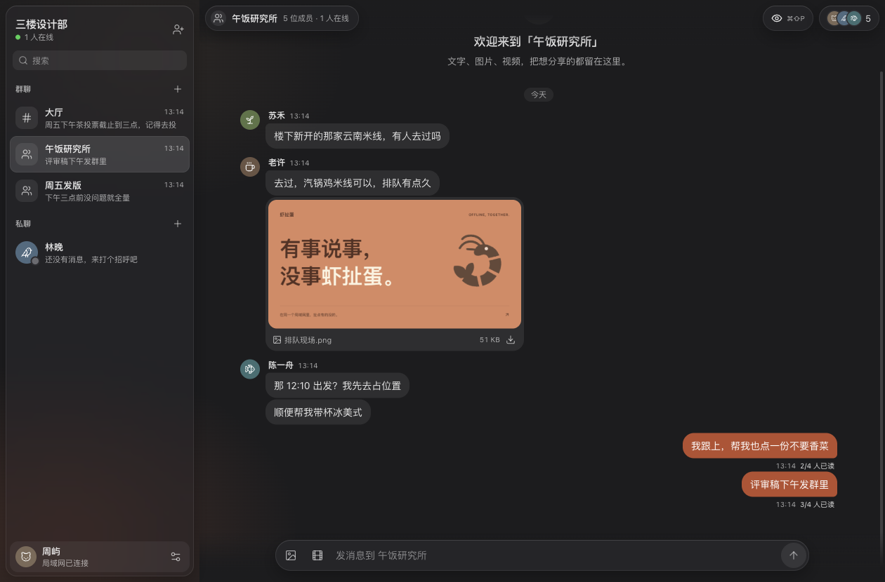

<p align="center">
  
</p>

# 虾扯蛋

[](https://github.com/ayogggua/xiachedan/actions/workflows/build.yml)

有事说事，没事虾扯蛋。

一个面向局域网的轻量聊天工具。由一台电脑创建空间，同一网络里的朋友通过邀请加入，聊工作、发图片、分享视频。提供 React 网页界面和基于 Tauri 的桌面端，支持 macOS 与 Windows。

## 能做什么

**会话**
- 公共大厅、群聊和一对一私聊，使用 WebSocket 实时收发；断线重连后自动补齐期间漏掉的消息。
- 群聊有群主和群头像，群主可以转让群主、任命最多 10 位管理员。群主和管理员可以改群名、发群公告、移出成员、开启全员禁言，也可以发邀请链接拉人，并选择是否需要审批。每个人可以设一个只在本群显示的群昵称；所有成员都可以退出群聊。
- 会话可以置顶（拖动调整顺序）、免打扰、标为已读 / 未读，也可以按文件夹筛选：未读、群聊、私聊或自建文件夹，文件夹跨设备同步。没发出的草稿会在会话列表显示「[草稿]」。
- 可以按会话设置消息在 1 天、1 周或 1 个月后自动删除（阅后即焚）。
- 快捷键：⌘K 快速切换会话，⌘1–9 按侧栏顺序打开，⌘/ 查看全部快捷键。
- 会话内置顶消息、收藏、定时发送、「提醒我」、话题回复，以及汇总查看图片与文件。
- 全局搜索所有会话的消息和文件名，可按发送人、类型、时间筛选；结果点击后跳到原消息。

**消息**
- 文字、图片、视频和普通文件；一条消息里的多张图片排成相册网格。图片先显示本机生成的缩略图，全屏查看器可以翻看、缩放、复制和下载。
- 发图前可以选择压缩或原图，也可以先裁剪、用画笔标注。
- 完整 Markdown：标题、表格、待办、列表、引用、链接，代码块带语法高亮和复制按钮。输入框里打 `/` 可以插入格式；从网页或文档复制的带格式内容，粘贴时自动转成 Markdown。发送键可选 Enter 或 ⌘Enter。
- 引用回复（可以只引用选中的一段）、@ 成员或 @所有人，会话里一键跳到 @我 的消息。
- 编辑已发送的消息并查看编辑历史；撤回（带粉碎动画），撤回后可以重新编辑。
- 投票（投过不能改）、链接预览、拍一拍；复制消息链接，点链接直接跳到原消息。
- 任意表情回应，回应显示在气泡内并带回应者头像；常用表情排在前面，双击消息直接点 👍。
- 逐条转发或合并转发（多条消息合成一张聊天记录卡片），转发时可以附一句话。
- 未读角标、已读状态（群里可以查看谁已读、谁未读）、正在输入。
- 断网时也能发送：未发出的消息排在会话底部，连上后按顺序自动重发，失败的可以重试或删除。
- 导出会话聊天记录为文本文件。

**成员**
- 自定义昵称、头像、名字颜色、部门和签名；显示在线状态和最后在线时间。
- 自定义状态（表情加一句话，如「🏖 休假中」），可以设定到期自动清除。
- 通讯录按部门分组，可以搜索；空间创建者（账号模式下为管理员）可以修改成员的部门。
- 点头像或名字打开资料卡，可以直接发消息，还可以写只有自己看得到的备注；群聊里双击头像直接发起私聊。

**外观与桌面端**
- 浅色、深色与跟随系统三种外观，可以自选主题色、消息字号和聊天背景（6 种内置或自己的图片）；界面参考 Telegram 的 macOS 版。
- 头像可以跟随消息滚动，也可以固定在连续消息的第一条旁边；群聊里自己的头像和名字、私聊里双方的头像和名字都可以单独开关。
- 隐私模式隐藏聊天内容，鼠标停留在消息上才显示并计为已读。
- 菜单栏 / 托盘常驻、系统通知（点击直达对应会话）、新消息提示音、关键词提醒（跨设备同步）、勿扰时段、Dock 未读数和原生右键菜单。
- 手机浏览器可以把网页版添加到主屏幕，像 App 一样全屏打开（PWA）。浏览器只允许 HTTPS 或 localhost 安装，局域网的 http 地址只能添加为普通快捷方式。

**管理**
- 空间创建者（账号模式下为管理员）可以禁言成员、删除任何人的消息、设置消息保留期限、查看存储占用、清空聊天记录和附件，管理操作记入操作日志。
- 局域网模式下空间创建者可以移除成员，移除后自动更新邀请码。
- 账号模式下管理员审核新成员、重置成员密码；成员可以查看并下线自己的登录设备。
- 群机器人（Webhook）：外部系统可以往群聊或大厅发消息。

使用 SQLite 保存消息，附件存储在空间主机上，无需外部数据库。

## 界面预览



上图为运行中的应用截图，使用示例消息。界面采用深色液态玻璃风格，窄屏（如手机浏览器）下会切换为会话列表与聊天两级页面。

## 本地运行

需要 Node.js **22.13.0 或以上**及 npm。克隆仓库并进入项目目录后安装依赖：

```bash
git clone https://github.com/ayogggua/xiachedan.git
cd xiachedan
npm ci
```

### 桌面端

桌面端基于 [Tauri 2](https://v2.tauri.app/)，还需要安装 [Rust](https://www.rust-lang.org/tools/install)（1.90 或以上）。macOS 需安装 Xcode 命令行工具，Windows 需安装 Visual Studio C++ 生成工具与 WebView2（Windows 11 已预装）。

```bash
npm run desktop
```

首次运行会下载随应用分发的 Node.js 运行时（校验官方 SHA-256）。

在应用内创建空间，复制完整邀请给同一局域网内的朋友。对方打开应用，选择「加入空间」，粘贴邀请即可连接。提供空间的电脑需要保持应用运行。

### 网页端

```bash
npm run build
npm start
```

默认端口为 `4318`。首次创建空间时，在服务所在电脑上打开终端输出的完整本机链接（包含 `#setup=...`）。其他设备在浏览器中打开邀请里的局域网地址，使用邀请码加入。

可通过 `PORT` 修改端口，通过 `CHAT_DATA_DIR` 指定数据目录：

```bash
PORT=4318 CHAT_DATA_DIR=./.data npm start
```

网页版默认数据目录为 `.data/`；桌面端为兼容已有版本，继续使用 `~/Library/Application Support/邻聊/space/`（Windows 为 `%APPDATA%\邻聊\space\`）。备份时请先退出应用或停止服务，再复制整个数据目录。

### 账号模式

除了局域网空间，服务端也可以以账号模式部署在服务器上：成员注册账号，由管理员审核后加入。设置 `CHAT_MODE=cloud` 启用（`NODE_ENV=production` 时默认就是账号模式），完整配置见 [`deploy/backend.env.example`](deploy/backend.env.example)，Nginx、Docker 等部署文件也在 `deploy/` 目录。

### 可选设置

| 环境变量 | 作用 |
| --- | --- |
| `CHAT_LINK_PREVIEW=off` | 关闭链接预览（默认开启，服务端只访问公网地址，不抓图片） |
| `CHAT_MAX_STORAGE_BYTES` | 空间附件总容量上限，默认 10 GB |
| `CHAT_MAX_USER_BYTES` | 每位成员的附件容量上限，默认不限制 |

## 构建安装包

在 macOS 上构建本机架构的 `.app` 与 `.dmg`，在 Windows 上构建 NSIS 安装程序：

```bash
npm run package:mac
npm run package:win
```

产物位于 `src-tauri/target/release/bundle/`。交叉构建其他架构时先准备对应的运行时，再指定目标：

```bash
npm run build
node scripts/prepare-desktop.mjs x86_64-apple-darwin
npx tauri build --target x86_64-apple-darwin --bundles app,dmg
```

macOS 安装包使用本地临时签名，不包含 Apple 开发者签名或公证流程。

## 自动构建与发布

[GitHub Actions](https://github.com/ayogggua/xiachedan/actions/workflows/build.yml) 在提交到 `main` 时自动检查代码、构建网页端，并分别生成 Apple Silicon（`arm64`）、Intel（`x64`）Mac 安装包与 Windows（`x64`）安装程序。Pull Request 运行检查和网页构建，也可以从 Actions 页面手动运行完整构建。

运行成功后，在对应任务的 Artifacts 中下载 `xiachedan-mac-arm64`、`xiachedan-mac-x64`（DMG）或 `xiachedan-windows-x64`（安装程序），保留 14 天。`web-dist` 是网页静态资源，需要配合本项目服务端运行。

发布正式版本时，先更新 `package.json` 和 `package-lock.json` 中的版本，再推送对应的 `v版本号` 标签（如 `v1.3.0`）。工作流会校验版本号，打包成功后自动创建 [GitHub Release](https://github.com/ayogggua/xiachedan/releases) 并上传全部安装包。

## 项目结构

| 目录 | 内容 |
| --- | --- |
| `src/` | React 界面、聊天交互与品牌样式 |
| `server/` | Express、WebSocket 服务与 SQLite 存储 |
| `src-tauri/` | Tauri 桌面外壳：本机服务进程、菜单栏 / 托盘、系统通知与 `window.desktop` 接口 |
| `scripts/` | 桌面打包前准备 Node 运行时与服务资源 |
| `tests/` | 服务端测试（`npm test`，覆盖局域网与账号两种模式） |
| `deploy/` | 账号模式的服务器部署配置 |
| `shared/` | 邀请信息解析等共用逻辑 |
| `designs/xiachedan-preview/` | 独立设计预览和界面素材 |
| `assets/` | README 品牌海报 |

## 使用范围

适用于可信局域网。当前使用 HTTP 和 WebSocket，未实现端到端加密；隐私模式仅控制界面内容显示。聊天数据由空间主机保存，请勿直接将服务暴露到公网。

## 开源许可

采用 [MIT License](LICENSE)。欢迎通过 Issue 反馈问题，通过 Pull Request 改进项目。
