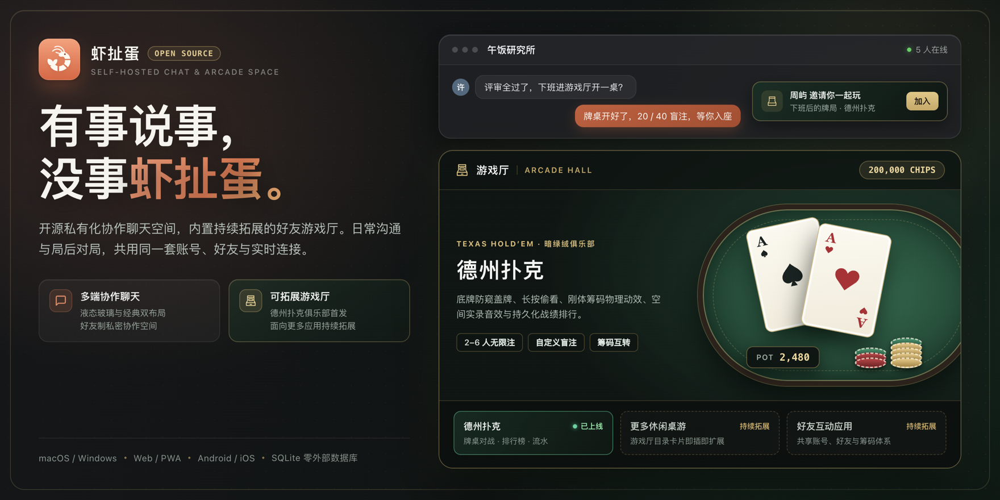
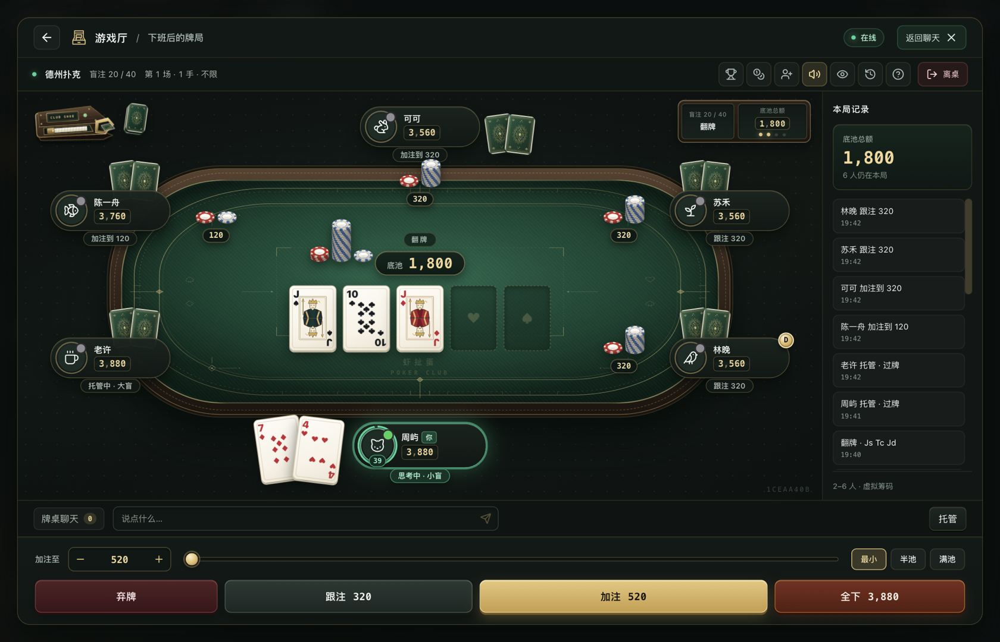
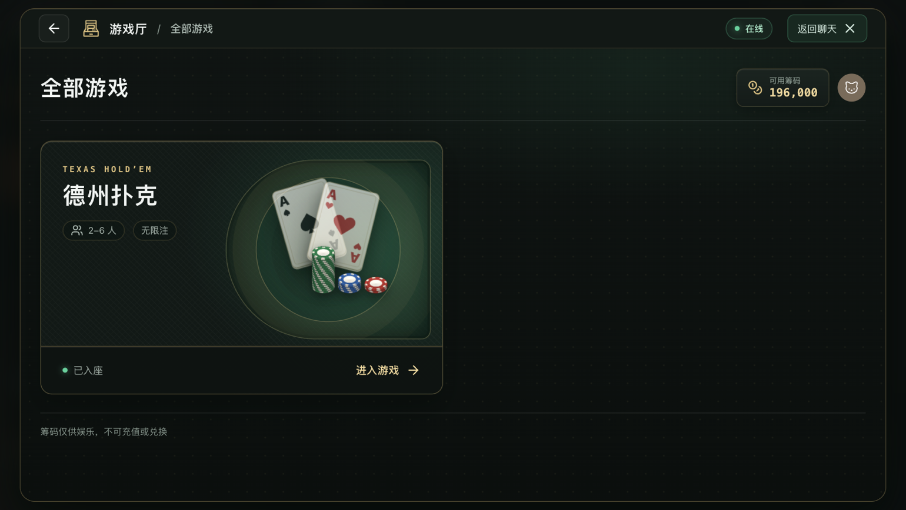
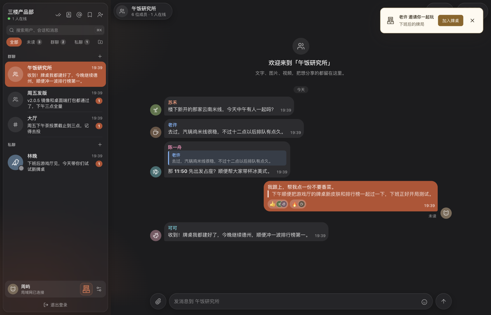

<div align="center">



# 虾扯蛋

**有事说事，没事虾扯蛋。**

开源私有化轻量协作聊天空间，内置持续拓展的好友**游戏厅**。<br />
单文件 SQLite 零外部数据库，支持 macOS / Windows 桌面端、Web / PWA 与 Android / iOS 客户端。

[](https://github.com/ayogggua/xiachedan/actions/workflows/build.yml)
[](https://github.com/ayogggua/xiachedan/releases)
[](package.json)
[](LICENSE)

**简体中文** · [English](#english) · [日本語](#日本語) · [한국어](#한국어) · [繁體中文](#繁體中文)

[核心亮点](#核心亮点) · [游戏厅](#游戏厅持续拓展的互动空间) · [界面预览](#界面预览) · [聊天与协作](#聊天与协作能力) · [快速自托管部署](#快速自托管部署) · [客户端打包](#客户端开发与打包) · [项目结构](#项目结构)

</div>

---

## 核心亮点

<table>
  <tr>
    <td width="50%" valign="top">
      <strong>克隆即部署，零外部数据库</strong><br />
      后端基于 Node.js 原生 <code>node:sqlite</code>，消息、好友关系、筹码账户与战绩全部落在单个 SQLite 文件中，附件直存本地目录。无需安装 MySQL、PostgreSQL 或 Redis，几分钟就能部署到自己的服务器或局域网主机。
    </td>
    <td width="50%" valign="top">
      <strong>聊天与游戏厅原生融合</strong><br />
      日常沟通与下班开局共用同一套账号、好友关系与 WebSocket 实时连接。游戏期间持续接收聊天消息，牌桌邀请直接在聊天界面顶部实时弹出，关闭游戏厅无缝回到原会话与草稿。
    </td>
  </tr>
  <tr>
    <td width="50%" valign="top">
      <strong>面向多应用拓展的游戏厅</strong><br />
      二级目录架构（全部游戏 → 房间大厅 → 实时对局），首发暗绿绒俱乐部<b>无限注德州扑克</b>。统一沉淀虚拟筹码银行、好友转账、排行榜与实时邀请底座，后续将持续拓展更多休闲桌游与好友互动应用。
    </td>
    <td width="50%" valign="top">
      <strong>克制耐看的全端体验</strong><br />
      提供<b>液态玻璃</b>与<b>经典三栏</b>双界面风格，支持浅色 / 深色 / 跟随系统。覆盖 macOS / Windows（Tauri 2）、Web / PWA（支持 Web Push 推送与系统分享）以及 Android / iOS（Capacitor）。
    </td>
  </tr>
</table>

> 桌面端与 Android 安装包可直接前往 [Releases](https://github.com/ayogggua/xiachedan/releases) 下载；如果你想自己搭一套私有空间，直接跳到 [快速自托管部署](#快速自托管部署)。

---

## 游戏厅：持续拓展的互动空间

游戏厅是虾扯蛋的重点互动模块，以独立街机图标常驻界面角落（桌面液态玻璃位于左下角设置旁、经典布局位于左侧导航栏下方、手机位于消息页右上角及「我」页面），在不打扰默认聊天流程的前提下随时一键进入。

### 可拓展的应用底座

- **两级目录卡片架构**：进入游戏厅先展示「全部游戏」目录卡片，点击进入对应应用的房间列表与实时对局。后续新增休闲桌游或好友互动应用时，直接以新卡片接入目录，沿用同一套空间连接与交互规范。
- **持久化虚拟筹码银行**：每位成员默认拥有 **200,000** 初始虚拟筹码，账户余额、牌桌托管筹码与完整流水均持久化保存在 SQLite（`server/arcadeBank.js`）。支持**好友间互转筹码**与总管理员发放筹码；服务重启时自动退回未完成牌局的托管筹码，不会吞币。
- **多维度排行榜与战绩卡**：支持按**净赢、总筹码、胜率、牌局数、累计赢得**切换排序；点击任意玩家展开完整数据卡（累计赢得 / 投入、最大单局净赢、主动入池率 VPIP、加注局数、全下 / 摊牌 / 弃牌 / 平分底池与最长连胜）。
- **站内实时邀请**：在房间内一键邀请好友，对方在聊天窗口顶部立即收到邀请卡片并一键入座；游戏与聊天共享实时连接，对局期间照常接收聊天消息，退出游戏厅即回到原会话与未发送草稿。

### 首发应用：无限注德州扑克（暗绿绒俱乐部）

- **俱乐部级视觉与物理手感**：暗绿绒牌桌、胡桃木缝线桌沿、精工黄铜发牌靴与机械计数器、雕花牌背与精绘人头牌；内置刚体筹码抛投物理动效与空间实录音效（可独立开关）。
- **底牌防窥盖牌**：单击自己的任意底牌即可盖牌防窥，长按临时偷看、松手自动扣回；顶栏提供持久化防窥开关，开启后每局默认盖牌、摊牌时自动亮牌。
- **服务端权威规则引擎**：支持 2–6 人无限注，开桌或局间可自定义**底分（小盲 1–1,000,000）**与**每场手数（0 为不限）**；服务端统一处理密码学洗牌、最小加注、全下边池、平分底池与无人跟注筹码返还，他人底牌仅在摊牌时下发。
- **流畅的多人局节奏**：40 秒行动倒计时与超时自动托管、5 秒自动连开下一手、实时观战、中途入座下一手自动参与、局中支持预约「本局后离桌」或立即离桌（结算后自动退回筹码），内置牌桌聊天气泡。

| 应用模块 | 当前状态 | 能力说明 |
| --- | --- | --- |
| **无限注德州扑克** | 已上线 | 2–6 人暗绿绒俱乐部、防窥盖牌、刚体筹码、空间音效、战绩排行 |
| **更多休闲桌游** | 持续拓展中 | 直接接入游戏厅目录卡片，复用房间、观战、邀请与筹码系统 |
| **好友互动小应用** | 持续拓展中 | 与聊天空间共用账号与好友关系，打造轻量团队 / 好友互动合集 |

> **说明**：虚拟筹码仅供娱乐，不可充值、交易或兑换。筹码余额、流水与战绩持久化存储于 SQLite；进行中的实时牌桌状态保存在服务进程内存中，服务重启后会清空牌桌并将未完成牌局的托管筹码自动退回各玩家账户。所有参局客户端须连接同一服务进程，暂不支持多实例共享牌桌。

---

## 界面预览

### 游戏厅 · 暗绿绒德州扑克俱乐部



### 游戏厅 · 可拓展应用目录



### 液态玻璃聊天界面与实时牌桌邀请



> 设置中可随时在「虾扯蛋」（液态玻璃）与「经典」（左侧导航 + 会话列表 + 聊天区三栏）风格间切换；窄屏与移动端自动切换为消息、通讯录、我三级布局。

---

## 聊天与协作能力

<details open>
<summary><strong>好友关系与私密边界</strong></summary>

- **好友申请制**：通讯录默认仅展示好友，支持通过昵称、完整手机号或邮箱搜索并发送好友申请，添加后可发起私聊、邀请进群与互转游戏筹码；普通成员不暴露全站用户列表，仅管理员可查看完整用户目录。
- **可控公共大厅**：新成员注册审核通过后不再自动加入公共大厅，大厅成员由管理员主动邀请或移除。
- **个人资料与状态**：支持自定义昵称、头像裁剪、名字颜色、部门、签名、备注（仅自己可见），以及可设定自动过期时间的自定义状态。

</details>

<details open>
<summary><strong>会话组织与高效检索</strong></summary>

- **多类型会话**：公共大厅、群聊、一对一私聊，WebSocket 实时收发，断线重连后自动补齐遗漏消息。
- **完整群管理**：群主转让、最多 10 位群管理员、群头像、群公告、全员禁言、群昵称、移出成员，以及可配置是否审批的邀请链接。
- **秩序与效率**：会话置顶拖拽排序、免打扰、标为已读 / 未读、跨设备同步自定义文件夹、按会话设置消息自动销毁周期（1 天 / 1 周 / 1 个月）、草稿标记、`⌘K` 快速切换、`⌘1–9` 跳转、`⌘/` 查看快捷键。
- **定位与归档**：全局多条件搜索（按发送人 / 类型 / 时间过滤并直达原消息）、「提到我的」汇总、按日期跳转、会话置顶消息、话题回复、收藏、定时发送、「提醒我」、媒体文件汇总，桌面端支持将单个会话弹出为独立窗口。

</details>

<details>
<summary><strong>富消息表达与互动（点击展开）</strong></summary>

- **多媒体与预览**：文字、图片（支持原图 / 压缩、裁剪与画笔标注、相册网格、全屏缩放翻看）、视频、普通文件；文本、代码与 PDF 支持直接预览。
- **完整 Markdown**：标题、表格、待办、列表、引用、代码块语法高亮与一键复制；输入 `/` 快速插入格式，粘贴网页或文档富文本自动转为 Markdown；支持切换 `Enter` 或 `⌘Enter` 发送。
- **引用、剧透与阅后即焚**：支持选中片段引用回复、`@成员` / `@所有人`；文字用 `||内容||` 或发图 / 视频前标记为剧透（通知、预览、搜索与导出均不泄露）；私聊支持 5 秒–1 分钟阅后即焚（对方点开后倒计时，到期正文与附件从服务端销毁，不可引用 / 转发 / 收藏 / 复制 / 下载）。
- **轻量协作互动**：消息编辑与历史记录、粉碎动画撤回与重新编辑、投票、群接龙、链接预览、拍一拍、推荐名片、复制消息直达链接、任意表情回应（气泡内展示回应者头像，双击点赞）、收藏图片为表情及 `:shortcode:` 短码、跨设备常用语、多选逐条 / 合并转发（单次最多 100 条、9 个会话）、断网离线队列自动重发、导出聊天记录为文本。

</details>

<details>
<summary><strong>外观、隐私、移动端与机器人（点击展开）</strong></summary>

- **界面与隐私**：液态玻璃与经典三栏双风格，浅色 / 深色 / 跟随系统，每种风格独立记忆主题色与聊天背景（6 种内置或自定义图片）；隐私模式隐藏消息内容、悬停才显示并计为已读；桌面端与 HTTPS 网页支持本机应用锁密码；应用开屏动画支持跳过及遵循系统减少动态效果。
- **桌面与移动能力**：桌面端支持菜单栏 / 托盘常驻、系统通知直达会话、提示音、关键词提醒、勿扰时段、Dock 未读数与原生右键菜单；PWA 在 HTTPS 下支持主屏幕安装、Web Push 后台推送与 Android Chrome 系统分享接收；Android 原生客户端支持附件下载与系统分享。
- **管理与机器人**：管理员审核注册、重置密码、禁言成员、删除消息、设置保留期限与撤回时限、查看存储占用与操作日志，成员可查看并下线自己的登录设备；支持群 Webhook 机器人及独立机器人账号（签名 JSON 回调 + 令牌回复），接入文档见 [`docs/bots.md`](docs/bots.md)。

</details>

---

## 快速自托管部署

克隆仓库后，根据你的使用场景选择最合适的方式即可部署上线：

| 部署方式 | 适用场景 | 外部依赖 | 预计耗时 |
| --- | --- | --- | --- |
| **方式一：本地 / 局域网模式（Local）** | 办公室、宿舍、家庭内网快速体验，免注册邀请码加入 | Node.js ≥ 22.13 | 1 分钟 |
| **方式二：单机公网自托管（Cloud + Node.js）** | 一台轻量云主机直接运行，账号审核登录，前后端一体 | Node.js ≥ 22.13 + Nginx / Caddy | 3 分钟 |
| **方式三：Docker + Nginx 生产部署** | 长期公网运行、容器隔离、前后端分离与原子切换 | Docker + Nginx | 5 分钟 |

### 0. 克隆仓库

```bash
git clone https://github.com/ayogggua/xiachedan.git
cd xiachedan
```

---

### 方式一：本地 / 局域网快速体验（零配置）

需要 **Node.js 22.13.0 或以上**与 npm：

```bash
npm ci
npm run build
CHAT_MODE=local CHAT_SERVE_WEB=true npm start
```

启动后终端会输出包含 `#setup=...` 的本机初始化链接（默认端口 `4318`）：

1. 在运行服务的电脑浏览器中打开该链接，创建空间与管理员昵称。
2. 在应用内复制局域网地址与邀请码发给同一局域网的朋友，对方在浏览器中打开即可加入聊天和游戏厅。

---

### 方式二：单机公网自托管（Cloud 账号模式 · 推荐个人 / 小团队）

正式公网服务采用手机号 / 邮箱 + 密码登录，新成员注册需经管理员审核。

#### 1. 修改初始超级管理员手机号（强烈建议）

打开 [`server/auth.js`](server/auth.js) 第 8 行，将 `ADMIN_PHONE` 改成你自己的手机号（用于首次初始化超级管理员账号）：

```js
const ADMIN_PHONE = '13800138000';
```

#### 2. 准备首次启动的管理员初始密码文件

将 10–128 位、同时包含字母和数字的初始密码写入仓库外的文件（初始化完成后，后续重启不再需要该文件）：

```bash
mkdir -p /etc/xiachedan
printf '%s\n' 'YourStrongPass2026' > /etc/xiachedan/admin-password
chmod 600 /etc/xiachedan/admin-password
```

#### 3. 安装依赖并构建前端（含 PWA 支持）

```bash
npm ci
npm run build:pwa
```

#### 4. 启动服务

**生产 HTTPS 环境**（配合下方 Nginx / Caddy 反向代理使用）：

```bash
NODE_ENV=production \
CHAT_MODE=cloud \
CHAT_SERVE_WEB=true \
HOST=127.0.0.1 \
PORT=4318 \
CHAT_DATA_DIR=/var/lib/xiachedan \
CHAT_SPACE_NAME=虾扯蛋 \
CHAT_PUBLIC_URL=https://chat.example.com \
CHAT_ALLOWED_ORIGINS=https://chat.example.com \
CHAT_TRUST_PROXY=1 \
CHAT_ADMIN_PASSWORD_FILE=/etc/xiachedan/admin-password \
npm start
```

> **本地 HTTP 预览账号模式？** `NODE_ENV=production` 会强制启用 `__Host-` + `Secure` Cookie（仅限 HTTPS）。如果在本地 `127.0.0.1` 用 HTTP 预览，去掉 `NODE_ENV=production` 和 `CHAT_TRUST_PROXY` 即可：
> ```bash
> CHAT_MODE=cloud CHAT_SERVE_WEB=true \
> CHAT_PUBLIC_URL=http://127.0.0.1:4318 \
> CHAT_ALLOWED_ORIGINS=http://127.0.0.1:4318 \
> CHAT_ADMIN_PASSWORD_FILE=/path/to/admin-password.txt \
> npm start
> ```

#### 5. 配置 HTTPS 反向代理（以 Caddy 或 Nginx 为例）

后端同时提供 HTTP API（`/api/`）与 WebSocket（`/socket`），反代务必放行大附件上传并开启 WebSocket 升级。

<details>
<summary><strong>使用 Caddy（最简，自动申请 HTTPS 证书）</strong></summary>

```caddyfile
chat.example.com {
    reverse_proxy 127.0.0.1:4318
}
```

</details>

<details>
<summary><strong>使用 Nginx（关键配置片段）</strong></summary>

```nginx
server {
    listen 443 ssl http2;
    server_name chat.example.com;
    # ssl_certificate / ssl_certificate_key 替换为你的证书路径
    client_max_body_size 101m;

    location = /socket {
        proxy_pass http://127.0.0.1:4318;
        proxy_http_version 1.1;
        proxy_set_header Host $host;
        proxy_set_header Origin $http_origin;
        proxy_set_header X-Forwarded-Proto $scheme;
        proxy_set_header X-Forwarded-For $remote_addr;
        proxy_set_header Upgrade $http_upgrade;
        proxy_set_header Connection "upgrade";
        proxy_read_timeout 75s;
    }

    location / {
        proxy_pass http://127.0.0.1:4318;
        proxy_http_version 1.1;
        proxy_set_header Host $host;
        proxy_set_header X-Forwarded-Proto $scheme;
        proxy_set_header X-Forwarded-For $remote_addr;
        proxy_read_timeout 90s;
    }
}
```

</details>

#### 6. 验证上线与首次登录

```bash
curl -s https://chat.example.com/api/health
# 返回 {"app":"linliao","version":"...","mode":"cloud","ok":true,...} 即运行正常
```

在浏览器打开 `https://chat.example.com`，用设置的 `ADMIN_PHONE` 和初始密码登录，按提示修改密码后即可进入空间。此后朋友注册账号，你在「设置 → 账号管理」中通过审核即可一起聊天与进游戏厅。

> 长期运行建议使用 `systemd` 或 `pm2` 托管 `node server/index.js` 进程。

---

### 方式三：Docker + Nginx 生产前后端分离部署

仓库 [`deploy/`](deploy/) 目录已内置完整的最小权限 Docker 容器配置与硬化 Nginx 配置，前后端可独立升级：

1. **按需修改 [`server/auth.js`](server/auth.js) 中的 `ADMIN_PHONE`**，然后构建后端镜像：
   ```bash
   docker build -f deploy/Dockerfile.backend -t xiachedan-backend:latest .
   ```
2. **准备宿主机配置、密钥与数据目录**（容器以 `uid 1000` 的 `node` 用户只读运行）：
   ```bash
   sudo mkdir -p /etc/xiachedan /var/lib/xiachedan /opt/xiachedan/frontend/current
   sudo cp deploy/backend.env.example /etc/xiachedan/backend.env
   # 编辑 /etc/xiachedan/backend.env，将 chat.example.com 替换为你的正式域名
   printf '%s\n' 'YourStrongPass2026' | sudo tee /etc/xiachedan/admin-password >/dev/null
   sudo chmod 600 /etc/xiachedan/admin-password
   sudo chown -R 1000:1000 /var/lib/xiachedan
   ```
3. **启动后端容器**：
   ```bash
   BACKEND_IMAGE=xiachedan-backend:latest RELEASE_SHA=local \
     docker compose -f deploy/compose.yml up -d
   ```
4. **构建并托管 PWA 前端静态文件**：
   ```bash
   npm ci && npm run build:pwa
   sudo cp -r dist/* /opt/xiachedan/frontend/current/
   ```
5. **套用 [`deploy/nginx.conf`](deploy/nginx.conf)**：将配置中的 `chat.example.com`（含 `Content-Security-Policy` 中的 `wss://chat.example.com`）与 SSL 证书路径替换为你的实际域名与证书路径后重载 Nginx。

---

### 环境变量速查

| 环境变量 | 默认值 | 说明 |
| --- | --- | --- |
| `CHAT_MODE` | `local`（`NODE_ENV=production` 时为 `cloud`） | 运行模式：`cloud`（账号审核模式）或 `local`（局域网邀请码模式） |
| `NODE_ENV` | — | 设为 `production` 时启用 HTTPS-only 安全 Cookie（`__Host-xiachedan_session`）与严格来源校验 |
| `CHAT_SERVE_WEB` | `local` 模式为 `true`，`cloud` 为 `false` | 是否由 Node 服务端直接托管 `dist/` 前端静态资源（单机一体部署请设为 `true`） |
| `HOST` / `PORT` | `0.0.0.0` / `4318` | 监听地址与端口；前有 Nginx 反代时建议设 `HOST=127.0.0.1` |
| `CHAT_DATA_DIR` | `./.data` | SQLite 数据库与附件存储目录 |
| `CHAT_SPACE_NAME` | `虾扯蛋` | 首次初始化时的空间名称（最多 32 字） |
| `CHAT_PUBLIC_URL` | — | 对外正式根地址（不带末尾 `/`），生产模式必填且须包含在 `CHAT_ALLOWED_ORIGINS` 中 |
| `CHAT_ALLOWED_ORIGINS` | 同 `CHAT_PUBLIC_URL` | 允许访问的精确 Origin，多个用逗号分隔 |
| `CHAT_TRUST_PROXY` | — | 反向代理跳数或可信 IP（经过一层 Nginx / Caddy 时设为 `1`） |
| `CHAT_COOKIE_SAME_SITE` | `lax` | 会话 Cookie 的 `SameSite` 策略（`lax` / `strict` / `none`） |
| `CHAT_ADMIN_PASSWORD_FILE` | — | 首次初始化超管密码的文件路径（优先于 `CHAT_ADMIN_INITIAL_PASSWORD`） |
| `CHAT_LINK_PREVIEW` | 开启 | 设为 `off` 关闭链接预览（服务端仅请求公网地址，不抓取图片） |
| `CHAT_MAX_STORAGE_BYTES` | `10737418240`（10 GB） | 空间附件总容量上限（字节） |
| `CHAT_MAX_USER_BYTES` | 不限制 | 每位成员的附件容量上限（字节） |

### 数据目录与备份

- **网页 / 自托管服务端**：默认位于 `./.data/`（或 `CHAT_DATA_DIR` 指定路径，Docker 默认 `/var/lib/xiachedan`）。
- **桌面端本地空间**：macOS 为 `~/Library/Application Support/邻聊/space/`，Windows 为 `%APPDATA%\邻聊\space\`。
- **安全备份**：请先停止服务或退出桌面应用，再打包复制整个数据目录（含 `chat.sqlite*` 与附件文件夹）。

---

## 客户端开发与打包

你可以将桌面端与移动端直接绑定到自己的自托管服务器地址。

### macOS / Windows 桌面端（Tauri 2）

需要安装 [Rust](https://www.rust-lang.org/tools/install)（1.90+）；macOS 需 Xcode 命令行工具，Windows 需 Visual Studio C++ 生成工具与 WebView2（Windows 11 已预装）。

```bash
# 本地桌面开发（首次运行会自动下载校验官方 Node.js 运行时）
npm run desktop

# 打包并绑定到你的自建 HTTPS 服务
LINLIAO_CLOUD_URL=https://chat.example.com npm run package:mac
LINLIAO_CLOUD_URL=https://chat.example.com npm run package:win
```

产物位于 `src-tauri/target/release/bundle/`。若不设置 `LINLIAO_CLOUD_URL`，默认打包为局域网模式。macOS 本地打包使用临时签名，不含 Apple 公证；交叉构建其他架构可先准备对应运行时：

```bash
npm run build
node scripts/prepare-desktop.mjs x86_64-apple-darwin
npx tauri build --target x86_64-apple-darwin --bundles app,dmg
```

### PWA 与手机推送

使用 `npm run build:pwa` 构建（仅运行 `npm run build` 不会生成应用清单和 Service Worker），部署到 HTTPS 域名后：

- **iPhone / iPad**：Safari 打开域名 → 分享 → 添加到主屏幕。
- **Android**：Chrome 打开域名 → 安装应用，支持系统分享菜单直接分享图片和文件到会话。
- **Web Push 推送**：登录后在设置中开启「手机推送」并授予通知权限，服务端首次使用时自动生成推送签名密钥。

### Android / iOS 原生客户端（Capacitor）

Android 打包需要 JDK 21、Android SDK 36 与 Build Tools 36.0.0：

```bash
# 打包指向你自建服务的 Android APK
VITE_API_BASE_URL=https://chat.example.com npm run package:android
```

产物输出在 `release/xiachedan-mobile-<版本号>-debug.apk`。也可以运行 `npm run mobile:android` 或 `npm run mobile:ios` 分别在 Android Studio / Xcode 中打开原生工程（iOS 真机分发需自行配置 Apple 签名；当前手机后台推送仅用于 PWA）。

---

## 自动构建与发布

仓库在 `.github/workflows/` 提供四条独立工作流，按变更路径自动触发，也支持在 Actions 页面手动运行：

| 工作流 | 用途与产物 |
| --- | --- |
| [Build Desktop](.github/workflows/build.yml) | 代码检查、测试与构建，产出 macOS arm64 / x64 与 Windows x64 安装包及签名更新清单 |
| [Build Android](.github/workflows/build-mobile.yml) | 构建 `xiachedan-android` APK，通过 `mobile-v<版本号>` 标签或手动触发发布预发布包 |
| [Deploy Web and PWA](.github/workflows/deploy-frontend.yml) | 构建 `production-web`，配置部署变量后自动发布网页与 PWA |
| [Deploy Backend](.github/workflows/deploy-backend.yml) | 独立检查并部署后端服务 |

- 桌面发布版本以 Git 标签为准，正式发布需配置 `CHAT_PUBLIC_URL`、`TAURI_SIGNING_PRIVATE_KEY` 与 `TAURI_UPDATER_PUBKEY`；Android 体验包保持签名一致需配置 `ANDROID_DEBUG_KEYSTORE`。
- 仅修改 `README.md` 与 `assets/` 不会触发上述自动构建与部署流程。

---

## 项目结构

| 目录 / 文件 | 内容说明 |
| --- | --- |
| `src/` | React 19 前端界面、聊天交互、液态玻璃 / 经典双风格、好友系统、移动端与 PWA |
| `src/arcade/` | 游戏厅核心模块：两级游戏目录（`ArcadeLobby.jsx`）、排行榜与筹码钱包面板（`ArcadePanels.jsx`）、暗绿绒德州扑克牌桌（`Arcade.jsx`）、刚体筹码物理与空间音效 |
| `src/ArcadeEntry.jsx` / `ArcadeInvitation.jsx` | 游戏厅街机入口按钮与聊天内实时牌桌邀请浮条 |
| `src/Opening.jsx` | 应用启动开屏动画 |
| `server/` | Express 5、WebSocket 服务、账号鉴权（`auth.js`）、SQLite 存储（`store.js`）、Web Push 与机器人投递 |
| `server/poker.js` / `arcadeBank.js` | 德州扑克权威规则引擎与持久化虚拟筹码 / 战绩银行 |
| `src-tauri/` | Tauri 2 桌面外壳：内置 Node sidecar、菜单栏 / 托盘、系统通知与 `window.desktop` 桥接 |
| `mobile/` | Capacitor Android 与 iOS 原生工程 |
| `deploy/` | 生产环境 Docker 后端镜像、Compose 编排、Nginx 硬化配置与原子发布脚本 |
| `scripts/` | 桌面运行时准备、版本解析、更新清单、PWA 与移动端构建脚本 |
| `shared/` | 邀请码解析、预设头像等前后端共用逻辑 |
| `docs/bots.md` | 机器人账号与回调接口开发文档 |
| `tests/` | 服务端自动化测试（`npm test`，覆盖局域网、账号、好友与游戏厅模式） |
| `assets/` | README 品牌海报与界面截图 |

---

## 使用与安全范围

- 局域网模式使用 HTTP / WebSocket，适用于可信内网；公网部署请始终使用 `cloud` 账号模式并通过 HTTPS / WSS 反向代理访问。
- 两种模式均未实现端到端加密（E2EE），聊天记录、附件与游戏筹码数据保存在空间主机或自托管服务器上；隐私模式与应用锁仅控制本机界面访问，不加密本机磁盘数据。
- 私聊阅后即焚会在倒计时结束后从服务端删除正文与附件，但无法阻止对方截屏、录屏或使用其他设备拍摄屏幕。

## 开源许可

本项目采用 [MIT License](LICENSE) 开源。欢迎提交 Issue 反馈问题、提出你想在**游戏厅**里玩到的新应用，或通过 Pull Request 一起完善虾扯蛋。

---

## English

[简体中文](#虾扯蛋) · **English** · [日本語](#日本語) · [한국어](#한국어) · [繁體中文](#繁體中文)

**Talk business when it matters; hang out when it doesn't.**

An open-source, self-hosted lightweight team chat space with an expandable **Arcade Hall** built right in.<br />
Zero external database (single-file SQLite), running across macOS, Windows, Web / PWA, Android, and iOS.

[Highlights](#highlights) · [Arcade Hall](#arcade-hall-an-expandable-interactive-space) · [Screenshots](#screenshots) · [Chat Features](#chat-and-collaboration) · [Self-Hosting Guide](#quick-self-hosting-guide) · [Client Builds](#building-clients) · [Project Structure](#project-structure)

### Highlights

<table>
  <tr>
    <td width="50%" valign="top">
      <strong>Clone &amp; Deploy, Zero External Database</strong><br />
      Powered by Node.js native <code>node:sqlite</code>. Messages, friends, chip wallets, and player stats live in a single SQLite database with local attachment storage. No MySQL, PostgreSQL, or Redis required — deploy to your own server or LAN in minutes.
    </td>
    <td width="50%" valign="top">
      <strong>Chat &amp; Arcade, Natively Connected</strong><br />
      Daily conversations and after-work games share the same accounts, friend graph, and live WebSocket connection. Chat messages keep arriving while you play, live table invites pop up right inside chat, and closing the Arcade returns straight to your active thread and draft.
    </td>
  </tr>
  <tr>
    <td width="50%" valign="top">
      <strong>Built as an Expandable Arcade Platform</strong><br />
      Two-level catalog architecture (All Games → Room Lobby → Live Table), launching with a dark-emerald club <b>No-Limit Texas Hold'em</b> experience. Shared virtual chip bank, friend transfers, leaderboards, and live invites are ready for more multiplayer games and mini-apps to plug in.
    </td>
    <td width="50%" valign="top">
      <strong>Refined Multi-Platform Craft</strong><br />
      Switch anytime between <b>Liquid Glass</b> and <b>Classic 3-Column</b> layouts with Light, Dark, and System themes. Ships for macOS / Windows (Tauri 2), Web / PWA (with Web Push &amp; Share Target), and Android / iOS (Capacitor).
    </td>
  </tr>
</table>

> Prebuilt desktop and Android packages are available on [Releases](https://github.com/ayogggua/xiachedan/releases). Ready to host your own instance? Jump to [Quick Self-Hosting Guide](#quick-self-hosting-guide).

---

### Arcade Hall: An Expandable Interactive Space

The Arcade Hall is a flagship pillar of Xiachedan, accessible via a dedicated arcade cabinet icon (next to Settings in Liquid Glass, below the left nav rail in Classic, or top-right of Messages and the Me tab on mobile) without disrupting the default chat-first workflow.

#### Extensible Platform Foundation

- **Two-Level Catalog Architecture**: Opening the Arcade Hall displays the **All Games** card catalog, drilling into each app's room list and live session. Upcoming tabletop games and lightweight friend apps plug directly into this catalog while inheriting the same auth, friend graph, and real-time transport.
- **Persistent Virtual Chip Bank (`server/arcadeBank.js`)**: Every member starts with **200,000** virtual chips. Balances, in-table escrow, and ledger history persist in SQLite. Supports **peer-to-peer chip transfers between friends** and super-admin minting; if the server restarts mid-hand, escrowed chips automatically recover back to players' wallets.
- **Multi-Dimensional Leaderboards & Stat Cards**: Sort players by **Net Profit, Total Chips, Win Rate, Hands Played, or Total Won**. Click any player to inspect detailed stats (total won/wagered, biggest single-hand profit, VPIP, raises, all-ins, showdowns, folds, split pots, and best win streak).
- **Live In-Chat Table Invites**: Invite friends straight from a table — they receive a live invitation toast inside their chat window and join with one click.

#### Launch Title: No-Limit Texas Hold'em (Dark Emerald Club)

- **Club-Grade Visuals & Tactile Physics**: Dark emerald velvet felt, stitched walnut-leather rail, brushed brass card shoe and mechanical counters, guilloche card backs, court-card linework, rigid-body chip throw physics, and spatial poker audio (independently toggleable).
- **Hole-Card Privacy Cover**: Click any hole card to flip it face-down; hold to peek and release to cover back up. A persistent top-bar privacy toggle auto-covers new hands and automatically reveals at showdown.
- **Authoritative Server Engine**: 2–6 players No-Limit Hold'em with customizable **blinds (small blind 1–1,000,000)** and **hand limits (0 for unlimited)**. The server handles cryptographic shuffling, minimum raises, all-in side pots, split pots, and uncalled bet returns; opponents' hole cards are only sent when showdown requires reveal.
- **Smooth Multiplayer Flow**: 40-second turn clock with timeout autoplay, 5-second auto-continue between hands, live spectating, seamless mid-hand join (auto-dealt next hand), scheduled "leave after hand" or instant leave with automatic post-hand chip refund, and in-table chat bubbles.

| Arcade Module | Status | Overview |
| --- | --- | --- |
| **No-Limit Texas Hold'em** | Live | 2–6 player emerald club table, card privacy cover, chip physics, spatial audio, rankings |
| **More Tabletop Games** | Expanding | Plugs into the catalog card grid, reusing lobbies, spectating, invites, and chip bank |
| **Interactive Friend Mini-Apps** | Expanding | Shares accounts and friend graph to grow a curated suite of lightweight group apps |

> **Note**: Virtual chips are strictly for entertainment and cannot be purchased, traded, or redeemed. Chip balances, ledgers, and stats persist in SQLite; active table state lives in server memory (restarts clear active tables and automatically refund escrowed chips). All players at a table must connect to the same server process; multi-instance shared tables are not yet supported.

---

### Screenshots

#### Arcade Hall · Dark Emerald Texas Hold'em Club


#### Arcade Hall · Expandable Game Catalog


#### Liquid Glass Chat & Live Table Invitation


> Switch freely between **Liquid Glass** and **Classic** 3-column layouts in Settings; narrow viewports and mobile devices automatically adapt to a clean Messages / Contacts / Me flow.

---

### Chat and Collaboration

<details open>
<summary><strong>Friend Graph &amp; Privacy Boundaries</strong></summary>

- **Friend-Request Model**: Contacts display friends by default. Search by nickname, exact phone number, or email to send friend requests before starting DMs, creating friend groups, or transferring Arcade chips. Full user directories are restricted to admins only.
- **Controlled Public Lobby**: Approved members are no longer auto-added to the public lobby; admins explicitly invite or remove lobby members.
- **Profiles &amp; Presence**: Custom nicknames, croppable avatars, name colors, departments, bios, private personal notes, and auto-expiring custom statuses.

</details>

<details open>
<summary><strong>Conversations &amp; Fast Navigation</strong></summary>

- **Real-Time Rooms**: Public lobby, group chats, and 1-on-1 DMs over WebSocket with automatic gap sync on reconnect.
- **Full Group Governance**: Owner transfer, up to 10 group admins, custom group avatars, announcements, mute-all, per-group nicknames, member removal, and invite links with optional approval.
- **Workflow Speed**: Drag-to-reorder pinned chats, mute, mark read/unread, cross-device custom folders, per-room auto-delete timers (1 day / 1 week / 1 month), draft indicators, `⌘K` quick switcher, `⌘1–9` jump, and `⌘/` shortcut reference.
- **Search &amp; Organization**: Global multi-filter search (sender, media type, date range) jumping straight to source messages, Mentions inbox, jump-by-date, pinned messages, threaded replies, favorites, scheduled send, reminders, room media gallery, and pop-out windows on desktop.

</details>

<details>
<summary><strong>Rich Messaging &amp; Interactions (Click to expand)</strong></summary>

- **Media &amp; Previews**: Text, images (compressed or original, built-in crop &amp; brush annotation, album grids, fullscreen zoom viewer), videos, files, and inline previews for text, code, and PDFs.
- **Full Markdown**: Headings, tables, task lists, quotes, syntax-highlighted code blocks with copy button, `/` slash formatting menu, automatic HTML-to-Markdown paste conversion, and configurable `Enter` / `⌘Enter` send key.
- **Quotes, Spoilers &amp; Burn-After-Reading**: Quote selected text snippets, `@mentions` and `@all`; wrap spoilers in `||text||` or mark images/videos as spoilers (hidden across notifications, previews, search, and exports); DM burn-after-reading messages (5s–1m countdown after opening, server-side deletion of content and attachments).
- **Interactive Tools**: Message editing with edit history, recall with dust animation &amp; re-edit, polls, group chains, link previews, nudge, contact cards, direct message links, arbitrary emoji reactions with responder avatars, saved custom stickers &amp; `:shortcode:` expansion, synced quick phrases, multi-select forward &amp; merged chat-record cards (up to 100 messages / 9 rooms), offline outbox auto-resend, and text transcript export.

</details>

<details>
<summary><strong>Appearance, Privacy, Mobile &amp; Bots (Click to expand)</strong></summary>

- **Appearance &amp; Security**: Liquid Glass and Classic layouts, Light / Dark / System themes, independent per-style accent colors &amp; chat wallpapers (6 built-in or custom), Privacy Mode (hover to reveal and mark read), local App Lock passcode (desktop &amp; HTTPS web), and skippable startup opening animation respecting `prefers-reduced-motion`.
- **Desktop &amp; Mobile**: Menu bar / tray resident mode, click-to-open native notifications, sounds, synced keyword alerts, quiet hours, Dock unread badge, native context menus; installable HTTPS PWA with Web Push notifications and Android Share Target; native Android client with attachment download &amp; system share.
- **Admin &amp; Bots**: Registration review, password reset, login device management, member muting, message moderation, storage quotas &amp; audit logs; group Webhook bots and dedicated Bot Accounts (signed JSON callbacks + token reply API — see [`docs/bots.md`](docs/bots.md)).

</details>

---

### Quick Self-Hosting Guide

Clone the repository and pick the deployment path that fits your environment:

| Method | Best For | Requirements | Time |
| --- | --- | --- | --- |
| **Option 1: Local / LAN Mode** | Instant office, dorm, or home LAN chat with invite codes | Node.js ≥ 22.13 | ~1 min |
| **Option 2: Single-Server Cloud (Node.js)** | Lightweight VPS hosting with account registration &amp; review | Node.js ≥ 22.13 + Nginx / Caddy | ~3 min |
| **Option 3: Docker + Nginx Production** | Long-term public hosting with container isolation &amp; split frontend | Docker + Nginx | ~5 min |

#### 0. Clone the Repository

```bash
git clone https://github.com/ayogggua/xiachedan.git
cd xiachedan
```

---

#### Option 1: Local / LAN Quick Start (Zero Config)

Requires **Node.js 22.13.0+** and npm:

```bash
npm ci
npm run build
CHAT_MODE=local CHAT_SERVE_WEB=true npm start
```

The terminal prints a local initialization link containing `#setup=...` (default port `4318`):

1. Open that link in a browser on the host machine to create your space and admin profile.
2. Copy the LAN address and invite code from inside the app and share it with friends on the same network.

---

#### Option 2: Single-Server Public Hosting (Cloud Account Mode)

Production deployments use phone/email + password authentication with admin approval for new registrations.

##### 1. Set Your Super Admin Phone (Recommended)

Edit line 8 of [`server/auth.js`](server/auth.js) and set `ADMIN_PHONE` to your own phone number before first initialization:

```js
const ADMIN_PHONE = '13800138000';
```

##### 2. Create the Initial Admin Password File

Write an initial password (10–128 characters, must contain both letters and digits) outside the repo. After first initialization, subsequent restarts no longer require this file:

```bash
mkdir -p /etc/xiachedan
printf '%s\n' 'YourStrongPass2026' > /etc/xiachedan/admin-password
chmod 600 /etc/xiachedan/admin-password
```

##### 3. Install Dependencies & Build Web / PWA Assets

```bash
npm ci
npm run build:pwa
```

##### 4. Start the Server

**Production HTTPS** (behind Nginx or Caddy):

```bash
NODE_ENV=production \
CHAT_MODE=cloud \
CHAT_SERVE_WEB=true \
HOST=127.0.0.1 \
PORT=4318 \
CHAT_DATA_DIR=/var/lib/xiachedan \
CHAT_SPACE_NAME=Xiachedan \
CHAT_PUBLIC_URL=https://chat.example.com \
CHAT_ALLOWED_ORIGINS=https://chat.example.com \
CHAT_TRUST_PROXY=1 \
CHAT_ADMIN_PASSWORD_FILE=/etc/xiachedan/admin-password \
npm start
```

> **Previewing Cloud Mode over local HTTP?** `NODE_ENV=production` enforces `__Host-` + `Secure` cookies (HTTPS only). For local HTTP testing on `127.0.0.1`, simply omit `NODE_ENV=production` and `CHAT_TRUST_PROXY`:
> ```bash
> CHAT_MODE=cloud CHAT_SERVE_WEB=true \
> CHAT_PUBLIC_URL=http://127.0.0.1:4318 \
> CHAT_ALLOWED_ORIGINS=http://127.0.0.1:4318 \
> CHAT_ADMIN_PASSWORD_FILE=/path/to/admin-password.txt \
> npm start
> ```

##### 5. Configure HTTPS Reverse Proxy (Caddy or Nginx)

Make sure your reverse proxy supports WebSocket upgrade on `/socket` and allows file uploads (`client_max_body_size 101m`).

<details>
<summary><strong>Caddy (Simplest — Automatic TLS)</strong></summary>

```caddyfile
chat.example.com {
    reverse_proxy 127.0.0.1:4318
}
```

</details>

<details>
<summary><strong>Nginx (Minimal Snippet)</strong></summary>

```nginx
server {
    listen 443 ssl http2;
    server_name chat.example.com;
    # Replace with your SSL certificate paths
    client_max_body_size 101m;

    location = /socket {
        proxy_pass http://127.0.0.1:4318;
        proxy_http_version 1.1;
        proxy_set_header Host $host;
        proxy_set_header Origin $http_origin;
        proxy_set_header X-Forwarded-Proto $scheme;
        proxy_set_header X-Forwarded-For $remote_addr;
        proxy_set_header Upgrade $http_upgrade;
        proxy_set_header Connection "upgrade";
        proxy_read_timeout 75s;
    }

    location / {
        proxy_pass http://127.0.0.1:4318;
        proxy_http_version 1.1;
        proxy_set_header Host $host;
        proxy_set_header X-Forwarded-Proto $scheme;
        proxy_set_header X-Forwarded-For $remote_addr;
        proxy_read_timeout 90s;
    }
}
```

</details>

##### 6. Verify & First Login

```bash
curl -s https://chat.example.com/api/health
# Expect: {"app":"linliao","version":"...","mode":"cloud","ok":true,...}
```

Visit `https://chat.example.com`, log in with `ADMIN_PHONE` and the initial password, and change your password as prompted. Use `systemd` or `pm2` to keep `node server/index.js` running persistently.

---

#### Option 3: Docker + Nginx Production Deployment

The [`deploy/`](deploy/) directory ships with a hardened, least-privilege backend container and Nginx config for decoupled frontend/backend releases:

1. **Optionally update `ADMIN_PHONE` in [`server/auth.js`](server/auth.js)**, then build the backend image:
   ```bash
   docker build -f deploy/Dockerfile.backend -t xiachedan-backend:latest .
   ```
2. **Prepare host config, secret, and data directories** (container runs read-only as `uid 1000`):
   ```bash
   sudo mkdir -p /etc/xiachedan /var/lib/xiachedan /opt/xiachedan/frontend/current
   sudo cp deploy/backend.env.example /etc/xiachedan/backend.env
   # Edit /etc/xiachedan/backend.env and replace chat.example.com with your domain
   printf '%s\n' 'YourStrongPass2026' | sudo tee /etc/xiachedan/admin-password >/dev/null
   sudo chmod 600 /etc/xiachedan/admin-password
   sudo chown -R 1000:1000 /var/lib/xiachedan
   ```
3. **Start the backend container**:
   ```bash
   BACKEND_IMAGE=xiachedan-backend:latest RELEASE_SHA=local \
     docker compose -f deploy/compose.yml up -d
   ```
4. **Build & deploy PWA static assets**:
   ```bash
   npm ci && npm run build:pwa
   sudo cp -r dist/* /opt/xiachedan/frontend/current/
   ```
5. **Apply [`deploy/nginx.conf`](deploy/nginx.conf)**: replace `chat.example.com` (including `wss://chat.example.com` in the CSP header) and SSL certificate paths, then reload Nginx.

---

#### Environment Variables Reference

| Variable | Default | Description |
| --- | --- | --- |
| `CHAT_MODE` | `local` (`cloud` when `NODE_ENV=production`) | `cloud` (account approval mode) or `local` (LAN invite-code mode) |
| `NODE_ENV` | — | Set to `production` for HTTPS-only `__Host-` session cookies and strict origin checks |
| `CHAT_SERVE_WEB` | `true` in `local`, `false` in `cloud` | Serve built `dist/` frontend directly from Node (set `true` for single-process deploys) |
| `HOST` / `PORT` | `0.0.0.0` / `4318` | Bind host and port (`127.0.0.1` recommended behind a local reverse proxy) |
| `CHAT_DATA_DIR` | `./.data` | Directory storing SQLite database and uploaded attachments |
| `CHAT_SPACE_NAME` | `虾扯蛋` | Default workspace name on first bootstrap (max 32 chars) |
| `CHAT_PUBLIC_URL` | — | Public HTTPS origin without trailing slash (required in production; must be in `CHAT_ALLOWED_ORIGINS`) |
| `CHAT_ALLOWED_ORIGINS` | Same as `CHAT_PUBLIC_URL` | Comma-separated exact allowed origins |
| `CHAT_TRUST_PROXY` | — | Proxy hop count or trusted IPs (set `1` behind a single Nginx / Caddy layer) |
| `CHAT_COOKIE_SAME_SITE` | `lax` | Session cookie `SameSite` policy (`lax` / `strict` / `none`) |
| `CHAT_ADMIN_PASSWORD_FILE` | — | Path to initial super-admin password file (takes precedence over `CHAT_ADMIN_INITIAL_PASSWORD`) |
| `CHAT_LINK_PREVIEW` | Enabled | Set `off` to disable server-side link previews |
| `CHAT_MAX_STORAGE_BYTES` | `10737418240` (10 GB) | Total workspace attachment storage cap in bytes |
| `CHAT_MAX_USER_BYTES` | Unlimited | Per-user attachment storage cap in bytes |

#### Data Storage & Backups

- **Web / Self-Hosted Server**: `./.data/` by default (or `CHAT_DATA_DIR`; `/var/lib/xiachedan` in Docker).
- **Desktop Local Space**: `~/Library/Application Support/邻聊/space/` on macOS, `%APPDATA%\邻聊\space\` on Windows.
- **Backup**: Stop the server or quit the desktop app before archiving the entire data directory (including `chat.sqlite*` and attachments).

---

### Building Clients

Point desktop and mobile builds directly to your own self-hosted HTTPS server.

#### macOS & Windows Desktop (Tauri 2)

Requires [Rust](https://www.rust-lang.org/tools/install) (1.90+), Xcode Command Line Tools on macOS, or Visual Studio C++ Build Tools + WebView2 on Windows.

```bash
# Local desktop dev (downloads & SHA-256 verifies bundled Node.js runtime on first run)
npm run desktop

# Package desktop installers bound to your own HTTPS server
LINLIAO_CLOUD_URL=https://chat.example.com npm run package:mac
LINLIAO_CLOUD_URL=https://chat.example.com npm run package:win
```

Artifacts output to `src-tauri/target/release/bundle/`. Omit `LINLIAO_CLOUD_URL` to build in LAN mode. For cross-architecture macOS builds:

```bash
npm run build
node scripts/prepare-desktop.mjs x86_64-apple-darwin
npx tauri build --target x86_64-apple-darwin --bundles app,dmg
```

#### PWA & Web Push

Build with `npm run build:pwa` (plain `npm run build` omits the manifest and Service Worker). Over HTTPS, add to the Home Screen in iOS Safari or Android Chrome and enable **Phone Push** in Settings.

#### Android & iOS (Capacitor)

Android packaging requires JDK 21, Android SDK 36, and Build Tools 36.0.0:

```bash
VITE_API_BASE_URL=https://chat.example.com npm run package:android
```

Generates `release/xiachedan-mobile-<version>-debug.apk`. Run `npm run mobile:android` or `npm run mobile:ios` to open Android Studio or Xcode (iOS device distribution requires your own Apple signing; background push is currently PWA-only).

---

### CI/CD Workflows

Four independent GitHub Actions workflows live in `.github/workflows/`:

| Workflow | Purpose &amp; Artifacts |
| --- | --- |
| [Build Desktop](.github/workflows/build.yml) | Lint, test, build web &amp; package macOS arm64/x64 and Windows x64 installers + signed update manifest |
| [Build Android](.github/workflows/build-mobile.yml) | Build `xiachedan-android` APK; publishes pre-releases on `mobile-v*` tags or manual dispatch |
| [Deploy Web and PWA](.github/workflows/deploy-frontend.yml) | Build `production-web` and deploy static web/PWA bundle when configured |
| [Deploy Backend](.github/workflows/deploy-backend.yml) | Check and deploy backend independently |

Modifying README files or `assets/` alone does not trigger automated builds or deployments.

---

### Project Structure

| Path | Description |
| --- | --- |
| `src/` | React 19 UI, chat interactions, Liquid Glass / Classic skins, friend graph, mobile &amp; PWA |
| `src/arcade/` | Expandable Arcade Hall: two-level game catalog (`ArcadeLobby.jsx`), leaderboards &amp; wallet (`ArcadePanels.jsx`), dark emerald Texas Hold'em club (`Arcade.jsx`), rigid-body chip physics &amp; spatial audio |
| `src/ArcadeEntry.jsx` / `ArcadeInvitation.jsx` | Arcade launcher icon and live in-chat table invitation toast |
| `src/Opening.jsx` | Skippable application startup opening animation |
| `server/` | Express 5, WebSocket server, authentication (`auth.js`), SQLite persistence (`store.js`), Web Push &amp; bot delivery |
| `server/poker.js` / `arcadeBank.js` | Authoritative Texas Hold'em engine and persistent SQLite chip wallet / stats bank |
| `src-tauri/` | Tauri 2 desktop shell: bundled Node sidecar, tray/menubar, native notifications, `window.desktop` bridge |
| `mobile/` | Capacitor Android and iOS native projects |
| `deploy/` | Production backend Dockerfile, Compose config, hardened Nginx config, atomic release script |
| `scripts/` | Desktop runtime preparation, versioning, updater manifest, PWA &amp; mobile build scripts |
| `shared/` | Shared invite parsing and preset avatar helpers |
| `docs/bots.md` | Bot Account webhook &amp; API integration guide |
| `tests/` | Automated server test suite (`npm test`, covering local, cloud, friends &amp; arcade flows) |
| `assets/` | README brand poster and application screenshots |

---

### Security Scope & License

- Use `local` mode only on trusted LANs; public deployments should always run `cloud` mode behind HTTPS / WSS.
- Neither mode implements end-to-end encryption (E2EE); messages, attachments, and chip ledgers are stored on your self-hosted server. Privacy Mode and App Lock protect on-screen access only and do not encrypt local disk data.
- Burn-after-reading messages delete content and media from the server upon expiry, but cannot prevent screenshots or external cameras.

Licensed under the [MIT License](LICENSE). Issues, Pull Requests, and ideas for new **Arcade Hall** games and mini-apps are warmly welcome.

---

## 日本語

[简体中文](#虾扯蛋) · [English](#english) · **日本語** · [한국어](#한국어) · [繁體中文](#繁體中文)

**用があるときは本題を、用がないときは気軽に雑談を。**

拡張可能なフレンド向け**ゲームホール**を内蔵した、オープンソースのセルフホスト型軽量チャット空間。<br />
外部データベース不要（単一 SQLite ファイル）で動作し、macOS / Windows デスクトップ、Web / PWA、Android / iOS に対応しています。

[特徴](#特徴) · [ゲームホール](#ゲームホール拡張し続けるインタラクティブ空間) · [スクリーンショット](#スクリーンショット) · [チャット機能](#チャットコラボレーション機能) · [セルフホスト手順](#セルフホスト導入ガイド) · [クライアントビルド](#クライアント開発ビルド) · [プロジェクト構成](#プロジェクト構成)

### 特徴

<table>
  <tr>
    <td width="50%" valign="top">
      <strong>クローンして即デプロイ・外部 DB 不要</strong><br />
      Node.js 標準の <code>node:sqlite</code> を採用。メッセージ、フレンド関係、仮想チップ残高、戦績はすべて単一の SQLite ファイルに保存され、添付ファイルもローカルディレクトリに格納されます。MySQL や Redis なしで数分で自分のサーバーに構築できます。
    </td>
    <td width="50%" valign="top">
      <strong>チャットとゲームホールのシームレスな融合</strong><br />
      普段の会話と仕事終わりの対戦が、同じアカウント・フレンド関係・WebSocket 接続を共有。プレイ中もチャット通知は届き、テーブル招待はチャット画面上部にリアルタイム表示され、閉じれば元の会話と下書きにそのまま戻れます。
    </td>
  </tr>
  <tr>
    <td width="50%" valign="top">
      <strong>アプリを追加拡張できるゲームホール基盤</strong><br />
      2 階層カタログ構造（全ゲーム → ルーム一覧 → リアルタイム対局）を採用し、第 1 弾としてダークエメラルド・クラブ仕様の<b>ノーリミット・テキサスホールデム</b>を搭載。チップ銀行・送金・ランキング・招待基盤を共通化し、今後もボードゲームやミニアプリを継続拡張します。
    </td>
    <td width="50%" valign="top">
      <strong>洗練されたマルチプラットフォーム体験</strong><br />
      <b>リキッドグラス</b>と<b>クラシック 3 カラム</b>の 2 スタイルを自由に切替可能（ライト／ダーク／システム連動）。macOS / Windows（Tauri 2）、Web / PWA（Web Push・共有ターゲット対応）、Android / iOS（Capacitor）を網羅します。
    </td>
  </tr>
</table>

> ビルド済みデスクトップ版・Android 版は [Releases](https://github.com/ayogggua/xiachedan/releases) から入手できます。自前サーバーへ導入したい方は [セルフホスト導入ガイド](#セルフホスト導入ガイド) をご覧ください。

---

### ゲームホール：拡張し続けるインタラクティブ空間

ゲームホールは本プロジェクトの中核機能です。専用のアーケードアイコン（リキッドグラスでは左下設定横、クラシックでは左ナビ下部、モバイルではメッセージ右上および「マイページ」）からいつでも起動でき、チャット中心の体験を妨げません。

#### 拡張可能なプラットフォーム基盤

- **2 階層ゲームカタログ**：まずは「全ゲーム」カード一覧を表示し、カードから各アプリのルーム一覧・対局へ遷移します。今後追加するカジュアルゲームやフレンド向けミニアプリも、カードを追加するだけで認証・フレンド関係・チップ基盤をそのまま共有できます。
- **永続化仮想チップ銀行（`server/arcadeBank.js`）**：各メンバーに初期 **200,000** 仮想チップを付与。残高・テーブル預かり分・取引履歴はすべて SQLite に永続保存されます。**フレンド間のチップ送金**や管理者による付与に対応し、サーバー再起動時も未完了ハンドの預かりチップを自動返還します。
- **多軸ランキング＆戦績カード**：**純利益・総チップ・勝率・プレイ数・累計獲得**で並び替え可能。任意のプレイヤーをクリックすると詳細戦績（累計獲得／投入、最大単局純利益、VPIP、レイズ数、オールイン、ショーダウン、フォールド、スプリットポット、最大連勝）を確認できます。
- **チャット内リアルタイム招待**：テーブルからフレンドを招待すると、相手のチャット画面上部に招待カードが即座に表示され、ワンクリックで着席できます。

#### 第 1 弾タイトル：ノーリミット・テキサスホールデム（ダークエメラルド・クラブ）

- **質感と物理演出**：深緑のクラブフェルト、ステッチ入りウォールナット調レール、真鍮カードシュー＆機械式カウンター、精巧なカード背面・絵札デザインに加え、剛体チップ物理アニメーションと空間オーディオを搭載（音声は個別オン／オフ可能）。
- **ハンド覗き見防止（カバー＆長押しピーク）**：自分の手札をタップして個別に伏せ、長押しで一時確認・離すと自動で伏せ戻しが可能。上部バーの防窺モードをオンにすると毎ハンド自動カバー＆ショーダウン時に自動公開されます。
- **サーバー権威の本格ルール**：2〜6 人対応、**ブラインド（スモールブラインド 1〜1,000,000）**および**ハンド上限（0 で無制限）**を自在に設定可能。暗号学的シャッフル、最小レイズ、オールイン時のサイドポット分配、スプリットポットをすべてサーバー側で厳密に処理します。
- **快適な対局テンポ**：40 秒アクションタイマーと自動代行、5 秒後の連続ハンド自動開始、リアルタイム観戦、途中着席（次ハンドから参加）、ハンド終了後の離席予約および即時離席（清算後に自動返金）、テーブル内チャット吹き出しに対応。

| ゲームホールモジュール | ステータス | 内容 |
| --- | --- | --- |
| **ノーリミット・テキサスホールデム** | 公開中 | 2〜6 人ダークエメラルド卓、防窺カバー、チップ物理演出、空間効果音、ランキング |
| **新作ボード・カードゲーム** | 順次拡張予定 | カタログカードへ直接追加し、ルーム・観戦・招待・チップ基盤を共通利用 |
| **フレンド向けミニアプリ** | 順次拡張予定 | チャットのアカウントとフレンド関係を活用した軽量インタラクティブ空間 |

> **補足**：仮想チップは娯楽専用であり、課金・売買・換金はできません。チップ残高・履歴・戦績は SQLite に永続保存されますが、進行中のテーブル状態はサーバープロセスのメモリ上に保持されます（再起動時は未完了分の預かりチップが自動返還されます）。同一テーブルの参加者は同じサーバープロセスへ接続する必要があります。

---

### スクリーンショット

#### ゲームホール · ダークエメラルド・テキサスホールデム


#### ゲームホール · 拡張可能なゲームカタログ


#### リキッドグラス・チャット画面とリアルタイム招待


> 設定画面から「リキッドグラス」と「クラシック 3 カラム」をいつでも切り替え可能。スマートフォンや狭い画面では「メッセージ・連絡先・マイページ」構成へ自動最適化されます。

---

### チャット・コラボレーション機能

<details open>
<summary><strong>フレンド制とプライバシー境界</strong></summary>

- **フレンド申請モデル**：連絡先はデフォルトでフレンドのみ表示。ニックネーム、完全一致の電話番号またはメールアドレスで検索してフレンド申請でき、承認後に DM・グループ招待・チップ送金が可能になります。全ユーザー一覧は管理者のみ閲覧可能です。
- **制御されたパブリックロビー**：新規登録承認後に自動でロビーへ追加されず、管理者が招待・退出を管理します。
- **プロフィール＆ステータス**：ニックネーム、トリミング対応アバター、名前カラー、部署、自己紹介、自分だけのメモ、期限付きカスタムステータスを設定できます。

</details>

<details open>
<summary><strong>ルーム管理と高速ナビゲーション</strong></summary>

- **リアルタイム通信**：パブリックロビー、グループチャット、1対1 DM を WebSocket で送受信し、再接続時に未取得メッセージを自動補完。
- **グループ権限管理**：オーナー移譲、最大 10 名の管理者、グループアイコン、お知らせ、全体ミュート、グループ専用ニックネーム、メンバー削除、承認有無を選べる招待リンク。
- **操作効率**：ピン留めドラッグ並び替え、ミュート、既読／未読切替、デバイス間同期フォルダ、ルーム別自動削除（1日／1週間／1ヶ月）、下書き表示、`⌘K` クイックスイッチャー、`⌘1–9` 切替、`⌘/` ショートカット一覧。
- **検索・整理**：送信者／種別／日付で絞り込める全体検索、メンション一覧、日付ジャンプ、ピン留めメッセージ、スレッド返信、お気に入り、予約送信、リマインダー、メディア一覧、デスクトップ版での別ウィンドウ表示。

</details>

<details>
<summary><strong>リッチメッセージ＆インタラクション（クリックで展開）</strong></summary>

- **メディアとプレビュー**：テキスト、画像（圧縮／原画選択、トリミング＆ペン注釈、アルバムグリッド、全画面ビューア）、動画、各種ファイル、およびテキスト・コード・PDF のインラインプレビュー。
- **フル Markdown**：見出し、テーブル、チェックリスト、引用、シンタックスハイライト＋コピーボタン付きコードブロック、`/` 入力メニュー、Web からのリッチテキスト貼り付け時の自動 Markdown 変換、`Enter`／`⌘Enter` 送信切替。
- **引用・スポイラー・閲覧後消滅**：選択箇所のみの引用返信、`@メンション`／`@全員`、`||テキスト||` や画像・動画のスポイラー保護（通知・検索・エクスポートでも非表示）、DM 専用の閲覧後消滅メッセージ（5秒〜1分、期限後に本文と添付をサーバーから削除）。
- **インタラクション**：編集＆編集履歴、パーティクル演出付き取り消し＆再編集、投票、グループリレー、リンクプレビュー、ナッジ、連絡先カード、メッセージ直リンク、自由な絵文字リアクション、画像のスタンプ登録＆`:shortcode:` 展開、同期定型文、複数選択転送＆まとめ転送（最大 100 件・9 ルーム）、オフライン送信キュー自動再送、テキストエクスポート。

</details>

<details>
<summary><strong>外観・プライバシー・モバイル・Bot（クリックで展開）</strong></summary>

- **外観と保護**：リキッドグラス／クラシック切替、ライト／ダーク／システム、スタイル別のアクセントカラーと背景設定（内蔵 6 種または任意画像）、プライバシーモード（ホバー時のみ表示＆既読化）、ローカルアプリロック（デスクトップおよび HTTPS Web）、スキップ＆視差効果軽減対応の起動画面アニメーション。
- **デスクトップ＆モバイル**：メニューバー／トレイ常駐、通知クリックで該当ルーム起動、通知音、キーワード通知、おやすみ時間、Dock 未読数、ネイティブ右クリックメニュー。HTTPS 環境の PWA ではホーム画面追加・Web Push バックグラウンド通知・Android 共有受け取りに対応。Android ネイティブ版は添付ダウンロード・システム共有に対応。
- **管理と Bot**：新規登録審査、パスワード初期化、ログイン端末管理、ミュート・メッセージ削除・保存期間設定・監査ログ。グループ Webhook および署名付き JSON コールバック対応の独立 Bot アカウント（詳細は [`docs/bots.md`](docs/bots.md)）。

</details>

---

### セルフホスト導入ガイド

リポジトリをクローン後、用途に合うデプロイ方式を選んでください。

| 方式 | おすすめ用途 | 必要な環境 | 目安時間 |
| --- | --- | --- | --- |
| **方式 1：ローカル／LAN モード** | 社内・自宅 LAN での即時利用（招待コード参加） | Node.js ≥ 22.13 | 約 1 分 |
| **方式 2：単体サーバー公開（Cloud + Node.js）** | VPS 1 台でアカウント承認制の公開運用 | Node.js ≥ 22.13 + Nginx / Caddy | 約 3 分 |
| **方式 3：Docker + Nginx 本番構成** | コンテナ分離・フロント／バック独立デプロイ | Docker + Nginx | 約 5 分 |

#### 0. リポジトリをクローン

```bash
git clone https://github.com/ayogggua/xiachedan.git
cd xiachedan
```

---

#### 方式 1：ローカル／LAN で今すぐ試す（設定不要）

**Node.js 22.13.0 以上** と npm が必要です：

```bash
npm ci
npm run build
CHAT_MODE=local CHAT_SERVE_WEB=true npm start
```

起動すると `#setup=...` を含む初期設定 URL（既定ポート `4318`）が表示されます。

1. ホスト PC のブラウザでその URL を開き、空間名と管理者名を設定します。
2. アプリ内で表示される LAN アドレスと招待コードを同じネットワークの仲間に共有すれば、すぐチャットとゲームホールを始められます。

---

#### 方式 2：単体サーバーでセルフホスト（Cloud アカウントモード）

##### 1. 初期スーパー管理者の電話番号を変更（推奨）

初回起動前に [`server/auth.js`](server/auth.js) の 8 行目 `ADMIN_PHONE` をご自身の電話番号へ書き換えてください：

```js
const ADMIN_PHONE = '13800138000';
```

##### 2. 初期管理者パスワードファイルを作成

英字と数字を含む 10〜128 文字の初期パスワードをリポジトリ外に保存します（初回初期化後、2 回目以降の起動では不要です）：

```bash
mkdir -p /etc/xiachedan
printf '%s\n' 'YourStrongPass2026' > /etc/xiachedan/admin-password
chmod 600 /etc/xiachedan/admin-password
```

##### 3. 依存導入と PWA 対応フロントエンドのビルド

```bash
npm ci
npm run build:pwa
```

##### 4. サーバー起動

**本番 HTTPS 環境**（Nginx / Caddy リバースプロキシ配下）：

```bash
NODE_ENV=production \
CHAT_MODE=cloud \
CHAT_SERVE_WEB=true \
HOST=127.0.0.1 \
PORT=4318 \
CHAT_DATA_DIR=/var/lib/xiachedan \
CHAT_SPACE_NAME=虾扯蛋 \
CHAT_PUBLIC_URL=https://chat.example.com \
CHAT_ALLOWED_ORIGINS=https://chat.example.com \
CHAT_TRUST_PROXY=1 \
CHAT_ADMIN_PASSWORD_FILE=/etc/xiachedan/admin-password \
npm start
```

> **ローカル HTTP でアカウントモードを確認したい場合**：`NODE_ENV=production` は HTTPS 専用の `__Host-` + `Secure` Cookie を有効化するため、ローカル検証時は `NODE_ENV=production` と `CHAT_TRUST_PROXY` を外して起動してください。

##### 5. HTTPS リバースプロキシ設定（Caddy または Nginx）

`/socket` の WebSocket アップグレードとファイルアップロード上限（`101m`）を設定します。

<details>
<summary><strong>Caddy（最短・自動 HTTPS）</strong></summary>

```caddyfile
chat.example.com {
    reverse_proxy 127.0.0.1:4318
}
```

</details>

<details>
<summary><strong>Nginx（最小構成例）</strong></summary>

```nginx
server {
    listen 443 ssl http2;
    server_name chat.example.com;
    # SSL 証明書パスを設定してください
    client_max_body_size 101m;

    location = /socket {
        proxy_pass http://127.0.0.1:4318;
        proxy_http_version 1.1;
        proxy_set_header Host $host;
        proxy_set_header Origin $http_origin;
        proxy_set_header X-Forwarded-Proto $scheme;
        proxy_set_header X-Forwarded-For $remote_addr;
        proxy_set_header Upgrade $http_upgrade;
        proxy_set_header Connection "upgrade";
        proxy_read_timeout 75s;
    }

    location / {
        proxy_pass http://127.0.0.1:4318;
        proxy_http_version 1.1;
        proxy_set_header Host $host;
        proxy_set_header X-Forwarded-Proto $scheme;
        proxy_set_header X-Forwarded-For $remote_addr;
        proxy_read_timeout 90s;
    }
}
```

</details>

##### 6. 疎通確認と初回ログイン

```bash
curl -s https://chat.example.com/api/health
# {"app":"linliao","version":"...","mode":"cloud","ok":true,...} が返れば起動完了
```

`https://chat.example.com` を開き、`ADMIN_PHONE` と初期パスワードでログインしてパスワード変更を行ってください。常駐運用には `systemd` や `pm2` の利用を推奨します。

---

#### 方式 3：Docker + Nginx 本番デプロイ（フロント／バック分離）

[`deploy/`](deploy/) に本番向けの最小権限 Dockerfile・Compose・Nginx 設定を同梱しています。

1. **必要に応じて [`server/auth.js`](server/auth.js) の `ADMIN_PHONE` を編集**し、バックエンドイメージをビルド：
   ```bash
   docker build -f deploy/Dockerfile.backend -t xiachedan-backend:latest .
   ```
2. **ホスト側の設定・シークレット・データディレクトリを準備**（コンテナは `uid 1000` の読み取り専用で実行）：
   ```bash
   sudo mkdir -p /etc/xiachedan /var/lib/xiachedan /opt/xiachedan/frontend/current
   sudo cp deploy/backend.env.example /etc/xiachedan/backend.env
   # /etc/xiachedan/backend.env 内の chat.example.com を自身のドメインへ置換
   printf '%s\n' 'YourStrongPass2026' | sudo tee /etc/xiachedan/admin-password >/dev/null
   sudo chmod 600 /etc/xiachedan/admin-password
   sudo chown -R 1000:1000 /var/lib/xiachedan
   ```
3. **バックエンドコンテナを起動**：
   ```bash
   BACKEND_IMAGE=xiachedan-backend:latest RELEASE_SHA=local \
     docker compose -f deploy/compose.yml up -d
   ```
4. **PWA フロントエンドをビルドして配置**：
   ```bash
   npm ci && npm run build:pwa
   sudo cp -r dist/* /opt/xiachedan/frontend/current/
   ```
5. **[`deploy/nginx.conf`](deploy/nginx.conf) を適用**：`chat.example.com`（CSP ヘッダー内の `wss://chat.example.com` を含む）と証明書パスを置換して Nginx をリロードします。

---

#### 環境変数一覧

| 変数名 | 既定値 | 説明 |
| --- | --- | --- |
| `CHAT_MODE` | `local`（`NODE_ENV=production` 時は `cloud`） | `cloud`（アカウント承認制）または `local`（LAN 招待コード制） |
| `NODE_ENV` | — | `production` 指定で HTTPS 専用 Cookie（`__Host-`）と厳格な Origin 検証を有効化 |
| `CHAT_SERVE_WEB` | `local` は `true`、`cloud` は `false` | Node サーバーから `dist/` 静的ファイルを直接配信するか（単体運用時は `true`） |
| `HOST` / `PORT` | `0.0.0.0` / `4318` | バインドアドレスとポート（リバースプロキシ併用時は `127.0.0.1` 推奨） |
| `CHAT_DATA_DIR` | `./.data` | SQLite データベースおよび添付ファイルの保存ディレクトリ |
| `CHAT_SPACE_NAME` | `虾扯蛋` | 初回初期化時のスペース名（最大 32 文字） |
| `CHAT_PUBLIC_URL` | — | 公開 HTTPS ルート URL（末尾 `/` なし、本番必須かつ `CHAT_ALLOWED_ORIGINS` に含めること） |
| `CHAT_ALLOWED_ORIGINS` | `CHAT_PUBLIC_URL` と同じ | 許可する正確な Origin（カンマ区切り） |
| `CHAT_TRUST_PROXY` | — | 信頼するプロキシ段数または IP（Nginx / Caddy 1 段の場合は `1`） |
| `CHAT_COOKIE_SAME_SITE` | `lax` | セッション Cookie の `SameSite` 属性（`lax` / `strict` / `none`） |
| `CHAT_ADMIN_PASSWORD_FILE` | — | 初回スーパー管理者パスワードファイルのパス（`CHAT_ADMIN_INITIAL_PASSWORD` より優先） |
| `CHAT_LINK_PREVIEW` | 有効 | `off` でリンクプレビューを無効化 |
| `CHAT_MAX_STORAGE_BYTES` | `10737418240`（10 GB） | スペース全体の添付ファイル容量上限（バイト） |
| `CHAT_MAX_USER_BYTES` | 無制限 | メンバーごとの添付ファイル容量上限（バイト） |

#### データ保存先とバックアップ

- **Web／セルフホスト**：既定 `./.data/`（または `CHAT_DATA_DIR`、Docker は `/var/lib/xiachedan`）。
- **デスクトップ版ローカル空間**：macOS は `~/Library/Application Support/邻聊/space/`、Windows は `%APPDATA%\邻聊\space\`。
- **バックアップ**：必ずサービスまたはデスクトップアプリを停止してから、データディレクトリ全体（`chat.sqlite*` と添付フォルダ）をコピーしてください。

---

### クライアント開発・ビルド

デスクトップ版およびモバイル版を、ご自身のセルフホストサーバーに向けてビルドできます。

#### macOS / Windows デスクトップ（Tauri 2）

[Rust](https://www.rust-lang.org/tools/install)（1.90 以上）、macOS は Xcode Command Line Tools、Windows は Visual Studio C++ ビルドツールと WebView2 が必要です。

```bash
# ローカル開発（初回のみ公式 Node.js ランタイムを自動取得・SHA-256 検証）
npm run desktop

# 自分の HTTPS サーバーに接続するインストーラーをビルド
LINLIAO_CLOUD_URL=https://chat.example.com npm run package:mac
LINLIAO_CLOUD_URL=https://chat.example.com npm run package:win
```

成果物は `src-tauri/target/release/bundle/` に生成されます。

#### PWA / Android / iOS

- **PWA**：`npm run build:pwa` でビルドし HTTPS 配信すると、iOS Safari / Android Chrome からホーム画面へインストールおよび Web Push 通知が利用可能です。
- **Android APK**（JDK 21・Android SDK 36・Build Tools 36.0.0 が必要）：
  ```bash
  VITE_API_BASE_URL=https://chat.example.com npm run package:android
  ```
- **IDE 起動**：`npm run mobile:android`（Android Studio）、`npm run mobile:ios`（Xcode）。

---

### プロジェクト構成

| ディレクトリ / ファイル | 内容 |
| --- | --- |
| `src/` | React 19 UI、チャット機能、リキッドグラス／クラシック切替、フレンド機能、モバイル＆PWA |
| `src/arcade/` | 拡張型ゲームホール：2階層カタログ（`ArcadeLobby.jsx`）、ランキング＆ウォレット（`ArcadePanels.jsx`）、ダークエメラルド・テキサスホールデム（`Arcade.jsx`）、チップ物理演出＆空間オーディオ |
| `src/ArcadeEntry.jsx` / `ArcadeInvitation.jsx` | ゲームホール入口ボタンおよびチャット内テーブル招待通知 |
| `src/Opening.jsx` | アプリ起動アニメーション |
| `server/` | Express 5、WebSocket、認証（`auth.js`）、SQLite 永続化（`store.js`）、Web Push、Bot 配信 |
| `server/poker.js` / `arcadeBank.js` | テキサスホールデム権威エンジンおよび SQLite 永続チップ・戦績銀行 |
| `src-tauri/` | Tauri 2 デスクトップシェル（Node サイドカー、トレイ常駐、システム通知） |
| `mobile/` | Capacitor Android / iOS ネイティブプロジェクト |
| `deploy/` | 本番用 Dockerfile、Docker Compose、Nginx 設定、リリーススクリプト |
| `docs/bots.md` | Bot アカウント開発・連携ドキュメント |
| `tests/` | サーバー自動テスト（`npm test`） |
| `assets/` | README ブランドポスターおよびスクリーンショット |

---

### セキュリティ範囲とライセンス

- LAN モードは信頼できるローカルネットワーク専用です。公開運用時は必ず `cloud` モード + HTTPS / WSS を使用してください。
- エンドツーエンド暗号化（E2EE）は実装しておらず、メッセージや添付ファイルはホストサーバーに保存されます。プライバシーモードやアプリロックは画面表示のみを保護します。
- 閲覧後消滅メッセージは期限後にサーバーから削除されますが、スクリーンショットや外部撮影を防ぐことはできません。

本プロジェクトは [MIT License](LICENSE) の下で公開されています。不具合報告、機能提案、**ゲームホールに追加してほしい新アプリ**のアイデア、Pull Request を歓迎します。

---

## 한국어

[简体中文](#虾扯蛋) · [English](#english) · [日本語](#日本語) · **한국어** · [繁體中文](#繁體中文)

**할 일 있을 땐 본론만, 여유 있을 땐 가볍게 수다와 한 판.**

확장 가능한 친구 전용 **게임 홀(Arcade Hall)** 을 내장한 오픈소스 셀프 호스팅 경량 협업 메신저입니다.<br />
외부 데이터베이스 없이 단일 SQLite 파일로 동작하며 macOS / Windows 데스크톱, Web / PWA, Android / iOS를 지원합니다.

[핵심 특징](#핵심-특징) · [게임 홀](#게임-홀-계속-확장되는-인터랙티브-공간) · [스크린샷](#스크린샷) · [채팅 기능](#채팅-및-협업-기능) · [셀프 호스팅 가이드](#빠른-셀프-호스팅-배포) · [클라이언트 빌드](#클라이언트-개발-및-패키징) · [프로젝트 구조](#프로젝트-구조)

### 핵심 특징

<table>
  <tr>
    <td width="50%" valign="top">
      <strong>클론 즉시 배포, 외부 DB 불필요</strong><br />
      Node.js 내장 <code>node:sqlite</code> 기반으로 메시지, 친구 목록, 가상 칩 계좌, 전적이 모두 단일 SQLite 파일에 저장되며 첨부 파일은 로컬 디렉터리에 보관됩니다. MySQL이나 Redis 없이 몇 분 만에 직접 배포할 수 있습니다.
    </td>
    <td width="50%" valign="top">
      <strong>채팅과 게임 홀의 자연스러운 통합</strong><br />
      일상 대화와 퇴근 후 한 판이 동일한 계정, 친구 관계, WebSocket 연결을 공유합니다. 게임 중에도 채팅 메시지가 실시간 수신되며 테이블 초대가 채팅창 상단에 즉시 표시되고, 닫으면 기존 대화와 초안으로 바로 돌아갑니다.
    </td>
  </tr>
  <tr>
    <td width="50%" valign="top">
      <strong>다중 앱 확장을 위한 게임 홀 아키텍처</strong><br />
      2단계 카탈로그 구조(전체 게임 → 방 목록 → 실시간 테이블)로 설계되었으며 첫 번째 타이틀로 다크 에메랄드 클럽 <b>노리밋 텍사스 홀덤</b>을 제공합니다. 공용 칩 은행·송금·랭킹·초대 기반 위에 더 많은 보드게임과 미니 앱을 계속 확장할 예정입니다.
    </td>
    <td width="50%" valign="top">
      <strong>절제되고 완성도 높은 멀티 플랫폼 UI</strong><br />
      <b>리퀴드 글래스</b>와 <b>클래식 3단</b> 레이아웃을 자유롭게 전환할 수 있으며 라이트 / 다크 / 시스템 테마를 지원합니다. macOS / Windows(Tauri 2), Web / PWA(Web Push 및 공유 타겟), Android / iOS(Capacitor)를 모두 지원합니다.
    </td>
  </tr>
</table>

> 미리 빌드된 데스크톱 및 Android 설치 파일은 [Releases](https://github.com/ayogggua/xiachedan/releases)에서 다운로드할 수 있습니다. 직접 서버를 구축하려면 [빠른 셀프 호스팅 배포](#빠른-셀프-호스팅-배포)로 이동하세요.

---

### 게임 홀: 계속 확장되는 인터랙티브 공간

게임 홀은 Xiachedan의 핵심 인터랙티브 공간입니다. 전용 아케이드 아이콘(리퀴드 글래스 좌측 하단 설정 옆, 클래식 좌측 네비게이션 하단, 모바일 메시지 우측 상단 및 '나' 탭)으로 기본 채팅 흐름을 해치지 않고 언제든 입장할 수 있습니다.

#### 확장 가능한 플랫폼 기반

- **2단계 게임 카탈로그**: 입장 시 '전체 게임' 카드 목록이 표시되며, 각 카드를 통해 해당 앱의 방 목록과 실시간 대국으로 이동합니다. 앞으로 추가되는 캐주얼 보드게임과 친구용 미니 앱은 새 카드로 손쉽게 플러그인되며 계정·친구·칩·랭킹 인프라를 그대로 공유합니다.
- **영구 가상 칩 은행 (`server/arcadeBank.js`)**: 모든 멤버에게 기본 **200,000** 가상 칩이 지급되며 잔액, 테이블 예치 칩, 전체 거래 내역이 SQLite에 영구 저장됩니다. **친구 간 칩 송금** 및 최고 관리자 칩 지급을 지원하며, 서버 재시작 시 미완료 핸드의 예치 칩을 자동으로 환불합니다.
- **다차원 랭킹 및 전적 카드**: **순이익, 총 칩, 승률, 플레이 수, 누적 획득** 기준으로 정렬할 수 있으며, 플레이어를 클릭하면 누적 획득/투입, 단일 핸드 최대 순이익, VPIP, 레이즈, 올인, 쇼다운, 폴드, 스플릿 팟, 최다 연승 등 상세 지표를 확인할 수 있습니다.
- **채팅창 실시간 테이블 초대**: 테이블에서 친구를 초대하면 상대방의 채팅창 상단에 초대 배너가 즉시 표시되어 원클릭으로 착석할 수 있습니다.

#### 첫 번째 타이틀: 노리밋 텍사스 홀덤 (다크 에메랄드 클럽)

- **클럽 감성과 물리적 손맛**: 짙은 에메랄드 펠트, 스티치 월넛 레더 레일, 브러시드 황동 카드 슈와 기계식 카운터, 정교한 카드 뒷면·코트 카드 아트워크, 강체 칩 투척 물리 애니메이션 및 공간 오디오(개별 토글 가능)를 제공합니다.
- **홀카드 훔쳐보기 방지(커버 & 길게 눌러 엿보기)**: 내 홀카드를 클릭해 개별적으로 덮을 수 있고, 길게 누르면 잠깐 확인했다가 손을 떼면 자동으로 다시 덮입니다. 상단 바의 프라이버시 스위치를 켜면 매 핸드 자동 커버되며 쇼다운 시 자동 공개됩니다.
- **서버 권한 기반 정식 규칙 엔진**: 2–6인 노리밋 홀덤, **블라인드(스몰 블라인드 1–1,000,000)** 및 **매치 핸드 수(0은 무제한)** 커스텀 설정, 암호학적 셔플, 최소 레이즈, 올인 사이드 팟, 스플릿 팟 계산을 모두 서버가 처리합니다.
- **매끄러운 멀티플레이 흐름**: 40초 턴 타이머 및 타임아웃 자동 대행, 핸드 종료 후 5초 자동 연속 시작, 실시간 관전, 중도 착석(다음 핸드 자동 참가), '이번 핸드 후 퇴장' 예약 또는 즉시 퇴장(정산 후 자동 칩 환불), 테이블 내 말풍선 채팅 지원.

| 게임 홀 모듈 | 상태 | 설명 |
| --- | --- | --- |
| **노리밋 텍사스 홀덤** | 출시됨 | 2–6인 다크 에메랄드 클럽, 카드 프라이버시 커버, 칩 물리 효과, 공간 오디오, 랭킹 |
| **추가 보드/카드 게임** | 확장 예정 | 게임 홀 카탈로그 카드에 플러그인하여 로비·관전·초대·칩 시스템 공유 |
| **친구 인터랙티브 미니 앱** | 확장 예정 | 메신저 계정과 친구 관계를 기반으로 가벼운 그룹 인터랙션 앱 확장 |

> **안내**: 가상 칩은 오락 전용이며 충전·거래·현금화가 불가능합니다. 칩 잔액·거래 내역·전적은 SQLite에 영구 저장되며, 진행 중인 테이블 상태는 서버 프로세스 메모리에 유지됩니다(재시작 시 미완료 예치 칩은 자동 환불).

---

### 스크린샷

#### 게임 홀 · 다크 에메랄드 텍사스 홀덤 클럽


#### 게임 홀 · 확장형 게임 카탈로그


#### 리퀴드 글래스 채팅 및 실시간 테이블 초대


> 설정에서 '리퀴드 글래스'와 '클래식 3단' 레이아웃을 언제든 전환할 수 있으며, 모바일에서는 메시지 / 연락처 / 나 3단 구성으로 자동 최적화됩니다.

---

### 채팅 및 협업 기능

<details open>
<summary><strong>친구 관계 및 프라이버시 경계</strong></summary>

- **친구 신청 모델**: 연락처는 기본적으로 친구만 표시하며 닉네임, 정확한 전화번호 또는 이메일로 검색해 친구 요청을 보낼 수 있습니다. 전체 사용자 목록 조회는 관리자에게만 허용됩니다.
- **관리형 공용 로비**: 가입 승인 후 자동으로 로비에 입장하지 않으며 관리자가 초대 및 제거를 관리합니다.
- **프로필 및 상태**: 닉네임, 아바타 크롭, 이름 색상, 부서, 소개, 나만 보는 메모, 자동 만료 커스텀 상태 지원.

</details>

<details open>
<summary><strong>대화방 구성 및 빠른 탐색</strong></summary>

- **실시간 대화방**: 공용 로비, 그룹 채팅, 1:1 DM을 WebSocket으로 실시간 송수신하며 재연결 시 누락 메시지를 자동 동기화합니다.
- **그룹 관리**: 방장 위임, 최대 10명의 관리자, 그룹 아바타, 공지, 전체 음소거, 그룹별 닉네임, 멤버 강퇴, 승인 여부 설정 가능한 초대 링크.
- **생산성 도구**: 고정 대화 드래그 정렬, 알림 끄기, 읽음/안읽음 표시, 기기 간 동기화 커스텀 폴더, 대화방별 메시지 자동 삭제(1일/1주/1개월), 초안 표시, `⌘K` 빠른 전환, `⌘1–9` 이동, `⌘/` 단축키 안내.
- **검색 및 정리**: 보낸 사람/유형/기간 필터 기반 전체 검색, 멘션 모아보기, 날짜별 이동, 공지 고정, 스레드 답장, 즐겨찾기, 예약 전송, 리마인더, 미디어 모아보기, 데스크톱 독립 팝아웃 창.

</details>

<details>
<summary><strong>리치 메시지 및 인터랙션 (펼치기)</strong></summary>

- **미디어 및 미리보기**: 텍스트, 이미지(압축/원본 선택, 크롭 및 브러시 주석, 앨범 그리드, 전체화면 뷰어), 동영상, 일반 파일, 텍스트/코드/PDF 인라인 미리보기.
- **완전한 Markdown**: 제목, 표, 체크리스트, 인용, 구문 강조 및 복사 버튼이 있는 코드 블록, `/` 서식 메뉴, 웹 리치 텍스트 붙여넣기 시 자동 Markdown 변환, `Enter` / `⌘Enter` 전송 키 설정.
- **인용·스포일러·열람 후 파기**: 일부 문장 선택 인용, `@멘션` / `@전체`, `||스포일러||` 및 이미지/동영상 스포일러 마스킹, 1:1 DM 전용 열람 후 파기 메시지(5초–1분, 만료 시 서버에서 본문 및 첨부 삭제).
- **협업 인터랙션**: 메시지 수정 및 이력, 분쇄 애니메이션 회수 및 재편집, 투표, 그룹 릴레이, 링크 미리보기, 톡톡(Nudge), 연락처 카드, 메시지 직접 링크, 자유 이모지 리액션, 이미지 스티커 저장 및 `:shortcode:`, 동기화 상용구, 다중 선택/병합 전달(최대 100건·9개 방), 오프라인 자동 재전송 큐, 텍스트 내보내기.

</details>

<details>
<summary><strong>테마, 보안, 모바일 및 봇 (펼치기)</strong></summary>

- **외관 및 보안**: 리퀴드 글래스 / 클래식 전환, 라이트 / 다크 / 시스템 테마, 스타일별 강조 색상 및 배경 이미지, 프라이버시 모드(마우스 오버 시 표시 및 읽음 처리), 로컬 앱 잠금 비밀번호, 스킵 가능한 오프닝 애니메이션.
- **데스크톱 및 모바일**: 메뉴바/트레이 상주, 시스템 알림, 키워드 알림, 방해 금지 시간, Dock 배지; HTTPS 환경 PWA 홈 화면 설치, Web Push 백그라운드 알림, Android 시스템 공유 수신; Android 네이티브 앱 첨부 다운로드 및 공유.
- **관리 및 봇**: 가입 승인, 비밀번호 초기화, 로그인 기기 관리, 음소거/감사 로그; 그룹 Webhook 봇 및 서명된 JSON 콜백 기반 독립 봇 계정(자세한 내용은 [`docs/bots.md`](docs/bots.md)).

</details>

---

### 빠른 셀프 호스팅 배포

저장소를 클론한 뒤 환경에 맞는 방식을 선택해 배포하세요.

| 배포 방식 | 추천 환경 | 필수 요구 사항 | 소요 시간 |
| --- | --- | --- | --- |
| **방식 1: 로컬 / LAN 모드** | 사무실·가정 내부망 즉시 체험(초대 코드 입장) | Node.js ≥ 22.13 | 약 1분 |
| **방식 2: 단일 서버 공개 배포 (Cloud + Node.js)** | 단일 VPS에서 계정 승인제 서비스 운영 | Node.js ≥ 22.13 + Nginx / Caddy | 약 3분 |
| **방식 3: Docker + Nginx 프로덕션 배포** | 컨테이너 격리 및 프론트/백엔드 분리 운영 | Docker + Nginx | 약 5분 |

#### 0. 저장소 클론

```bash
git clone https://github.com/ayogggua/xiachedan.git
cd xiachedan
```

---

#### 방식 1: 로컬 / LAN 30초 시작 (설정 불필요)

**Node.js 22.13.0 이상**과 npm이 필요합니다:

```bash
npm ci
npm run build
CHAT_MODE=local CHAT_SERVE_WEB=true npm start
```

터미널에 출력되는 `#setup=...` 포함 로컬 URL(기본 포트 `4318`)을 브라우저에서 열어 공간을 생성하고, 앱 내부의 LAN 주소와 초대 코드를 같은 네트워크 친구들에게 공유하세요.

---

#### 방식 2: 단일 서버 공개 배포 (Cloud 계정 모드)

##### 1. 초기 최고 관리자 전화번호 변경 (권장)

최초 초기화 전에 [`server/auth.js`](server/auth.js) 8번째 줄의 `ADMIN_PHONE`을 본인 번호로 변경하세요:

```js
const ADMIN_PHONE = '13800138000';
```

##### 2. 초기 관리자 비밀번호 파일 준비

영문과 숫자를 모두 포함한 10–128자 비밀번호를 저장소 외부에 저장합니다(초기화 완료 후 재시작 시에는 필요 없음):

```bash
mkdir -p /etc/xiachedan
printf '%s\n' 'YourStrongPass2026' > /etc/xiachedan/admin-password
chmod 600 /etc/xiachedan/admin-password
```

##### 3. 의존성 설치 및 PWA 프론트엔드 빌드

```bash
npm ci
npm run build:pwa
```

##### 4. 서버 실행

**프로덕션 HTTPS 환경** (Nginx / Caddy 리버스 프록시 뒤에서 실행):

```bash
NODE_ENV=production \
CHAT_MODE=cloud \
CHAT_SERVE_WEB=true \
HOST=127.0.0.1 \
PORT=4318 \
CHAT_DATA_DIR=/var/lib/xiachedan \
CHAT_SPACE_NAME=虾扯蛋 \
CHAT_PUBLIC_URL=https://chat.example.com \
CHAT_ALLOWED_ORIGINS=https://chat.example.com \
CHAT_TRUST_PROXY=1 \
CHAT_ADMIN_PASSWORD_FILE=/etc/xiachedan/admin-password \
npm start
```

> **로컬 HTTP로 계정 모드를 테스트하려면**: `NODE_ENV=production`은 HTTPS 전용 `__Host-` + `Secure` 쿠키를 강제하므로 로컬 테스트 시 `NODE_ENV=production`과 `CHAT_TRUST_PROXY`를 제외하고 실행하세요.

##### 5. HTTPS 리버스 프록시 설정 (Caddy 또는 Nginx)

`/socket` WebSocket 업그레이드와 업로드 크기(`client_max_body_size 101m`)를 허용해야 합니다.

<details>
<summary><strong>Caddy (가장 간단 · 자동 HTTPS)</strong></summary>

```caddyfile
chat.example.com {
    reverse_proxy 127.0.0.1:4318
}
```

</details>

<details>
<summary><strong>Nginx (핵심 설정 예시)</strong></summary>

```nginx
server {
    listen 443 ssl http2;
    server_name chat.example.com;
    # SSL 인증서 경로를 입력하세요
    client_max_body_size 101m;

    location = /socket {
        proxy_pass http://127.0.0.1:4318;
        proxy_http_version 1.1;
        proxy_set_header Host $host;
        proxy_set_header Origin $http_origin;
        proxy_set_header X-Forwarded-Proto $scheme;
        proxy_set_header X-Forwarded-For $remote_addr;
        proxy_set_header Upgrade $http_upgrade;
        proxy_set_header Connection "upgrade";
        proxy_read_timeout 75s;
    }

    location / {
        proxy_pass http://127.0.0.1:4318;
        proxy_http_version 1.1;
        proxy_set_header Host $host;
        proxy_set_header X-Forwarded-Proto $scheme;
        proxy_set_header X-Forwarded-For $remote_addr;
        proxy_read_timeout 90s;
    }
}
```

</details>

##### 6. 헬스체크 및 첫 로그인

```bash
curl -s https://chat.example.com/api/health
# {"app":"linliao","version":"...","mode":"cloud","ok":true,...} 확인
```

`https://chat.example.com`에서 설정한 `ADMIN_PHONE`과 초기 비밀번호로 로그인 후 비밀번호를 변경하세요. 상시 운영에는 `systemd` 또는 `pm2` 사용을 권장합니다.

---

#### 방식 3: Docker + Nginx 프로덕션 배포

[`deploy/`](deploy/) 디렉터리에 최소 권한 백엔드 Docker 설정과 강화된 Nginx 설정이 포함되어 있습니다.

1. **필요 시 [`server/auth.js`](server/auth.js)의 `ADMIN_PHONE`을 수정**하고 백엔드 이미지 빌드:
   ```bash
   docker build -f deploy/Dockerfile.backend -t xiachedan-backend:latest .
   ```
2. **호스트 설정, 비밀번호 파일 및 데이터 디렉터리 준비** (`uid 1000` 읽기 전용 컨테이너):
   ```bash
   sudo mkdir -p /etc/xiachedan /var/lib/xiachedan /opt/xiachedan/frontend/current
   sudo cp deploy/backend.env.example /etc/xiachedan/backend.env
   # /etc/xiachedan/backend.env에서 chat.example.com을 실제 도메인으로 변경
   printf '%s\n' 'YourStrongPass2026' | sudo tee /etc/xiachedan/admin-password >/dev/null
   sudo chmod 600 /etc/xiachedan/admin-password
   sudo chown -R 1000:1000 /var/lib/xiachedan
   ```
3. **백엔드 컨테이너 실행**:
   ```bash
   BACKEND_IMAGE=xiachedan-backend:latest RELEASE_SHA=local \
     docker compose -f deploy/compose.yml up -d
   ```
4. **PWA 정적 파일 빌드 및 배포**:
   ```bash
   npm ci && npm run build:pwa
   sudo cp -r dist/* /opt/xiachedan/frontend/current/
   ```
5. **[`deploy/nginx.conf`](deploy/nginx.conf) 적용**: `chat.example.com`(CSP의 `wss://chat.example.com` 포함)과 인증서 경로를 수정한 뒤 Nginx를 리로드합니다.

---

#### 환경 변수 참고표

| 변수명 | 기본값 | 설명 |
| --- | --- | --- |
| `CHAT_MODE` | `local` (`NODE_ENV=production` 시 `cloud`) | `cloud`(계정 승인 모드) 또는 `local`(LAN 초대 코드 모드) |
| `NODE_ENV` | — | `production` 설정 시 HTTPS 전용 `__Host-` 쿠키 및 엄격한 Origin 검증 활성화 |
| `CHAT_SERVE_WEB` | `local`은 `true`, `cloud`는 `false` | Node 서버가 `dist/` 정적 파일을 직접 제공할지 여부 |
| `HOST` / `PORT` | `0.0.0.0` / `4318` | 바인딩 주소 및 포트(리버스 프록시 뒤에서는 `127.0.0.1` 권장) |
| `CHAT_DATA_DIR` | `./.data` | SQLite DB 및 첨부 파일 저장 경로 |
| `CHAT_SPACE_NAME` | `虾扯蛋` | 초기 공간 이름(최대 32자) |
| `CHAT_PUBLIC_URL` | — | 공개 HTTPS 루트 URL(끝 `/` 제외, 프로덕션 필수) |
| `CHAT_ALLOWED_ORIGINS` | `CHAT_PUBLIC_URL`과 동일 | 허용 Origin 목록(쉼표 구분) |
| `CHAT_TRUST_PROXY` | — | 신뢰할 프록시 홉 수 또는 IP(단일 Nginx/Caddy 환경은 `1`) |
| `CHAT_COOKIE_SAME_SITE` | `lax` | 세션 쿠키 `SameSite` 정책 (`lax` / `strict` / `none`) |
| `CHAT_ADMIN_PASSWORD_FILE` | — | 초기 관리자 비밀번호 파일 경로 |
| `CHAT_LINK_PREVIEW` | 활성화 | `off` 설정 시 링크 미리보기 비활성화 |
| `CHAT_MAX_STORAGE_BYTES` | `10737418240` (10 GB) | 전체 첨부 파일 용량 상한(바이트) |
| `CHAT_MAX_USER_BYTES` | 무제한 | 사용자별 첨부 파일 용량 상한(바이트) |

---

### 클라이언트 개발 및 패키징

- **macOS / Windows 데스크톱 (Tauri 2 · Rust 1.90+)**:
  ```bash
  npm run desktop
  LINLIAO_CLOUD_URL=https://chat.example.com npm run package:mac
  LINLIAO_CLOUD_URL=https://chat.example.com npm run package:win
  ```
- **PWA**: `npm run build:pwa`로 빌드 후 HTTPS 도메인에 배포하면 iOS Safari / Android Chrome 홈 화면 추가 및 Web Push를 지원합니다.
- **Android / iOS (Capacitor)**:
  ```bash
  VITE_API_BASE_URL=https://chat.example.com npm run package:android
  # 또는 IDE 열기: npm run mobile:android / npm run mobile:ios
  ```

---

### 프로젝트 구조

| 경로 | 설명 |
| --- | --- |
| `src/` | React 19 UI, 채팅, 리퀴드 글래스/클래식 스킨, 친구 시스템, 모바일 & PWA |
| `src/arcade/` | 확장형 게임 홀: 2단계 카탈로그(`ArcadeLobby.jsx`), 랭킹/지갑(`ArcadePanels.jsx`), 다크 에메랄드 텍사스 홀덤(`Arcade.jsx`), 칩 물리 & 공간 오디오 |
| `src/ArcadeEntry.jsx` / `ArcadeInvitation.jsx` | 게임 홀 런처 아이콘 및 실시간 채팅 내 테이블 초대 토스트 |
| `server/` | Express 5, WebSocket, 인증(`auth.js`), SQLite(`store.js`), Web Push, 봇 전송 |
| `server/poker.js` / `arcadeBank.js` | 텍사스 홀덤 서버 엔진 및 영구 가상 칩/전적 은행 |
| `src-tauri/` / `mobile/` | Tauri 2 데스크톱 셸 및 Capacitor Android / iOS 네이티브 프로젝트 |
| `deploy/` | 프로덕션 Docker, Compose, 강화 Nginx 설정 및 배포 스크립트 |
| `docs/bots.md` | 봇 계정 연동 개발 가이드 |
| `tests/` | 서버 자동화 테스트 (`npm test`) |

---

### 보안 범위 및 라이선스

- LAN 모드는 신뢰할 수 있는 내부망 전용이며, 외부 공개 배포 시 반드시 `cloud` 모드와 HTTPS / WSS를 사용하세요.
- 종단간 암호화(E2EE)는 제공하지 않으며 메시지·첨부·칩 데이터는 직접 운영하는 서버에 저장됩니다.

[MIT License](LICENSE)로 배포됩니다. 버그 제보, Pull Request, **게임 홀에 추가하고 싶은 새로운 게임/앱 아이디어**를 언제든 환영합니다.

---

## 繁體中文

[简体中文](#虾扯蛋) · [English](#english) · [日本語](#日本語) · [한국어](#한국어) · **繁體中文**

**有事說事，沒事蝦扯蛋。**

開源私有化輕量協作聊天空間，內建持續拓展的好友**遊戲廳**。<br />
單檔 SQLite 零外部資料庫，支援 macOS / Windows 桌面端、Web / PWA 與 Android / iOS 行動端。

[核心亮點](#核心亮點) · [遊戲廳](#遊戲廳持續拓展的互動空間) · [介面預覽](#介面預覽) · [聊天與協作](#聊天與協作能力) · [快速自託管部署](#快速自託管部署) · [用戶端打包](#用戶端開發與打包) · [專案結構](#專案結構)

### 核心亮點

<table>
  <tr>
    <td width="50%" valign="top">
      <strong>Clone 即部署，零外部資料庫</strong><br />
      後端採用 Node.js 原生 <code>node:sqlite</code>，訊息、好友關係、籌碼帳戶與戰績全數存於單一 SQLite 檔案，附件直存本機目錄。無須安裝 MySQL、PostgreSQL 或 Redis，幾分鐘即可部署到自己的伺服器或區域網路主機。
    </td>
    <td width="50%" valign="top">
      <strong>聊天與遊戲廳原生融合</strong><br />
      日常溝通與下班開局共用同一套帳號、好友關係與 WebSocket 即時連線。遊玩期間持續接收聊天訊息，牌桌邀請直接於聊天視窗頂部即時彈出，關閉遊戲廳即無縫回到原對話與草稿。
    </td>
  </tr>
  <tr>
    <td width="50%" valign="top">
      <strong>面向多應用拓展的遊戲廳平台</strong><br />
      兩級目錄架構（全部遊戲 → 房間大廳 → 即時對局），首發暗綠絨俱樂部<b>無限注德州撲克</b>。統一沉澱虛擬籌碼銀行、好友轉帳、排行榜與即時邀請底座，後續將持續拓展更多休閒桌遊與好友互動應用。
    </td>
    <td width="50%" valign="top">
      <strong>克制耐看的全端體驗</strong><br />
      提供<b>液態玻璃</b>與<b>經典三欄</b>雙介面風格，支援淺色 / 深色 / 跟隨系統。涵蓋 macOS / Windows（Tauri 2）、Web / PWA（含 Web Push 推播與系統分享）以及 Android / iOS（Capacitor）。
    </td>
  </tr>
</table>

> 桌面端與 Android 安裝包可直接至 [Releases](https://github.com/ayogggua/xiachedan/releases) 下載；若想自行架設私有空間，請直接查看 [快速自託管部署](#快速自託管部署)。

---

### 遊戲廳：持續拓展的互動空間

遊戲廳是蝦扯蛋的重點互動模組，以獨立街機圖示常駐介面角落（桌面液態玻璃位於左下角設定旁、經典版面位於左側導覽列下方、手機位於訊息頁右上角及「我」頁面），不打擾預設聊天體驗，隨時一鍵進入。

#### 可拓展的應用底座

- **兩級目錄卡片架構**：進入遊戲廳先顯示「全部遊戲」目錄卡片，點擊進入對應應用的房間列表與即時對局。後續新增休閒桌遊或好友互動應用時，直接以新卡片接入目錄，沿用同一套空間連線與互動規範。
- **持久化虛擬籌碼銀行（`server/arcadeBank.js`）**：每位成員預設擁有 **200,000** 初始虛擬籌碼，帳戶餘額、牌桌託管籌碼與完整流水皆持久化儲存於 SQLite。支援**好友間互轉籌碼**與總管理員發放籌碼；服務重啟時自動退回未完成牌局的託管籌碼。
- **多維度排行榜與戰績卡**：可依**淨贏、總籌碼、勝率、牌局數、累計贏得**排序；點擊任意玩家展開詳細戰績（累計贏得 / 投入、最大單局淨贏、主動入池率 VPIP、加注局數、全下 / 攤牌 / 棄牌 / 平分底池與最長連勝）。
- **站內即時邀請**：於房間內一鍵邀請好友，對方在聊天視窗頂部立即收到牌桌邀請卡片並一鍵入座；對局期間照常接收聊天訊息，離開遊戲廳即返回原對話與未送出草稿。

#### 首發應用：無限注德州撲克（暗綠絨俱樂部）

- **俱樂部級視覺與物理手感**：暗綠絨牌桌、胡桃木縫線桌沿、精工黃銅發牌靴與機械計數器、雕花牌背與精繪人頭牌；內建剛體籌碼拋投物理動效與空間實錄音效（可獨立開關）。
- **底牌防窺蓋牌**：單擊任一張底牌即可蓋牌防窺，長按臨時偷看、放開自動扣回；頂欄提供持久化防窺開關，開啟後每局預設蓋牌、攤牌時自動亮牌。
- **伺服器端權威規則引擎**：支援 2–6 人無限注，開桌或局間可自訂**底分（小盲 1–1,000,000）**與**每場手數（0 為不限）**；伺服器統一處理密碼學洗牌、最小加注、全下邊池、平分底池與無人跟注籌碼返還。
- **流暢的多人節奏**：40 秒行動倒數與超時自動託管、5 秒自動連開下一手、即時觀戰、中途入座下一手自動加入、局中可預約「本局後離桌」或立即離桌（結算後自動退回籌碼），內建牌桌聊天氣泡。

| 應用模組 | 目前狀態 | 能力說明 |
| --- | --- | --- |
| **無限注德州撲克** | 已上線 | 2–6 人暗綠絨俱樂部、防窺蓋牌、剛體籌碼、空間音效、戰績排行 |
| **更多休閒桌遊** | 持續拓展中 | 直接接入遊戲廳目錄卡片，共用房間、觀戰、邀請與籌碼系統 |
| **好友互動小應用** | 持續拓展中 | 與聊天空間共用帳號與好友關係，打造輕量團隊 / 好友互動合集 |

> **說明**：虛擬籌碼僅供娛樂，不可儲值、交易或兌換。籌碼餘額、流水與戰績持久化儲存於 SQLite；進行中的即時牌桌狀態保留在服務進程記憶體中（重啟後自動退回未完成牌局的託管籌碼）。

---

### 介面預覽

#### 遊戲廳 · 暗綠絨德州撲克俱樂部


#### 遊戲廳 · 可拓展應用目錄


#### 液態玻璃聊天介面與即時牌桌邀請


> 設定中可隨時於「蝦扯蛋」（液態玻璃）與「經典」（三欄版面）間切換；行動裝置自動切換為訊息、通訊錄、我三頁配置。

---

### 聊天與協作能力

<details open>
<summary><strong>好友關係與私密邊界</strong></summary>

- **好友申請制**：通訊錄預設僅顯示好友，可透過暱稱、完整手機號碼或信箱搜尋並送出好友申請；一般成員不暴露全站用戶列表，僅管理員可檢視完整成員目錄。
- **可控公共大廳**：新成員註冊審核通過後不再自動加入大廳，由管理員主動邀請或移除。
- **個人資料與狀態**：自訂暱稱、頭像裁切、名字顏色、部門、簽名、僅自己可見的備註，以及可設定到期自動清除的自訂狀態。

</details>

<details open>
<summary><strong>對話組織與高效檢索</strong></summary>

- **多類型對話**：公共大廳、群組、一對一私聊，WebSocket 即時收發，斷線重連自動補齊遺漏訊息。
- **完整群組治理**：群主轉讓、最多 10 位管理員、群頭像、群公告、全員禁言、群暱稱、移出成員與可選審批的邀請連結。
- **效率與秩序**：對話置頂拖曳排序、免打擾、跨裝置同步資料夾、自動銷毀訊息（1 天 / 1 週 / 1 個月）、草稿標記、`⌘K` 快速切換、`⌘1–9` 跳轉、`⌘/` 快捷鍵總覽。
- **搜尋與整理**：全域多條件搜尋、「提到我的」彙總、按日期跳轉、置頂訊息、話題回覆、收藏、定時傳送、提醒、媒體檔案總覽與桌面端獨立視窗。

</details>

<details>
<summary><strong>富訊息表達與互動（點擊展開）</strong></summary>

- **多媒體與預覽**：文字、圖片（壓縮 / 原圖、裁切與畫筆標註、相簿網格、全螢幕檢視器）、影片、檔案，以及文字、程式碼與 PDF 直接預覽。
- **完整 Markdown**：標題、表格、待辦、引用、程式碼語法高亮與複製按鈕、`/` 快捷格式選單、貼上網頁富文本自動轉 Markdown、自訂 `Enter` 或 `⌘Enter` 傳送。
- **引用、劇透與閱後即焚**：選取片段引用、`@成員` / `@所有人`、`||劇透遮罩||`（支援圖片 / 影片劇透）、私聊閱後即焚（5 秒–1 分鐘，到期從伺服器刪除內文與附件）。
- **輕量互動**：訊息編輯與紀錄、粉碎動畫收回重編、投票、群接龍、連結預覽、拍一拍、名片推薦、訊息連結、任意表情回應、自訂貼圖與 `:shortcode:`、跨裝置常用語、多選逐條 / 合併轉發、離線自動重送與文字匯出。

</details>

<details>
<summary><strong>外觀、隱私、行動端與機器人（點擊展開）</strong></summary>

- **外觀與隱私**：液態玻璃 / 經典三欄、淺色 / 深色 / 跟隨系統、各風格獨立主題色與背景、隱私模式（懸停顯示並計為已讀）、本機應用鎖密碼、可略過開屏動畫。
- **桌面與行動端**：選單列 / 系統匣常駐、系統通知、關鍵字提醒、勿擾時段、Dock 未讀數；HTTPS 下 PWA 主畫面安裝、Web Push 背景推播與 Android 系統分享接收；Android 原生用戶端附件下載與分享。
- **管理與機器人**：註冊審核、重設密碼、登入裝置管理、禁言與操作日誌；群 Webhook 機器人與獨立機器人帳號（簽名 JSON 回呼 + 權杖回覆，詳見 [`docs/bots.md`](docs/bots.md)）。

</details>

---

### 快速自託管部署

Clone 專案後，依需求選擇合適的部署方式：

| 部署方式 | 適用場景 | 外部依賴 | 預計耗時 |
| --- | --- | --- | --- |
| **方式一：本機 / 區域網路模式（Local）** | 辦公室、家庭內網快速體驗，邀請碼直接加入 | Node.js ≥ 22.13 | 1 分鐘 |
| **方式二：單機公網自託管（Cloud + Node.js）** | 單台 VPS 執行，帳號審核登入，前後端一體 | Node.js ≥ 22.13 + Nginx / Caddy | 3 分鐘 |
| **方式三：Docker + Nginx 生產部署** | 長期公網營運、容器隔離、前後端分離部署 | Docker + Nginx | 5 分鐘 |

#### 0. 複製專案

```bash
git clone https://github.com/ayogggua/xiachedan.git
cd xiachedan
```

---

#### 方式一：本機 / 區域網路快速體驗（零設定）

需安裝 **Node.js 22.13.0 以上** 與 npm：

```bash
npm ci
npm run build
CHAT_MODE=local CHAT_SERVE_WEB=true npm start
```

啟動後於本機瀏覽器開啟終端機輸出的 `#setup=...` 初始化連結（預設埠 `4318`）建立空間，再將應用內的區網位址與邀請碼分享給同網段好友即可使用。

---

#### 方式二：單機公網自託管（Cloud 帳號模式）

##### 1. 修改預設超級管理員手機號碼（建議）

於首次啟動前編輯 [`server/auth.js`](server/auth.js) 第 8 行 `ADMIN_PHONE`：

```js
const ADMIN_PHONE = '13800138000';
```

##### 2. 建立初始管理員密碼檔

將 10–128 位且同時包含英文字母與數字的初始密碼寫入專案外檔案（首次初始化後，後續重啟不再需要此檔）：

```bash
mkdir -p /etc/xiachedan
printf '%s\n' 'YourStrongPass2026' > /etc/xiachedan/admin-password
chmod 600 /etc/xiachedan/admin-password
```

##### 3. 安裝依賴並建置 PWA 前端

```bash
npm ci
npm run build:pwa
```

##### 4. 啟動服務

**正式 HTTPS 環境**（搭配 Nginx / Caddy 反向代理）：

```bash
NODE_ENV=production \
CHAT_MODE=cloud \
CHAT_SERVE_WEB=true \
HOST=127.0.0.1 \
PORT=4318 \
CHAT_DATA_DIR=/var/lib/xiachedan \
CHAT_SPACE_NAME=蝦扯蛋 \
CHAT_PUBLIC_URL=https://chat.example.com \
CHAT_ALLOWED_ORIGINS=https://chat.example.com \
CHAT_TRUST_PROXY=1 \
CHAT_ADMIN_PASSWORD_FILE=/etc/xiachedan/admin-password \
npm start
```

> **若需於本機 HTTP 預覽帳號模式**：因 `NODE_ENV=production` 會強制啟用 HTTPS 專用 `__Host-` + `Secure` Cookie，本機預覽時請移除 `NODE_ENV=production` 與 `CHAT_TRUST_PROXY`。

##### 5. 設定 HTTPS 反向代理（Caddy 或 Nginx）

反代須支援 `/socket` 的 WebSocket 升級並放行大檔上傳（`101m`）。

<details>
<summary><strong>Caddy（最簡，自動 HTTPS 憑證）</strong></summary>

```caddyfile
chat.example.com {
    reverse_proxy 127.0.0.1:4318
}
```

</details>

<details>
<summary><strong>Nginx（關鍵設定片段）</strong></summary>

```nginx
server {
    listen 443 ssl http2;
    server_name chat.example.com;
    # 請填入你的 SSL 憑證路徑
    client_max_body_size 101m;

    location = /socket {
        proxy_pass http://127.0.0.1:4318;
        proxy_http_version 1.1;
        proxy_set_header Host $host;
        proxy_set_header Origin $http_origin;
        proxy_set_header X-Forwarded-Proto $scheme;
        proxy_set_header X-Forwarded-For $remote_addr;
        proxy_set_header Upgrade $http_upgrade;
        proxy_set_header Connection "upgrade";
        proxy_read_timeout 75s;
    }

    location / {
        proxy_pass http://127.0.0.1:4318;
        proxy_http_version 1.1;
        proxy_set_header Host $host;
        proxy_set_header X-Forwarded-Proto $scheme;
        proxy_set_header X-Forwarded-For $remote_addr;
        proxy_read_timeout 90s;
    }
}
```

</details>

##### 6. 驗證與首次登入

```bash
curl -s https://chat.example.com/api/health
# 回傳 {"app":"linliao","version":"...","mode":"cloud","ok":true,...} 即代表啟動成功
```

開啟 `https://chat.example.com`，使用 `ADMIN_PHONE` 與初始密碼登入並依提示變更密碼。長期運作建議以 `systemd` 或 `pm2` 託管程序。

---

#### 方式三：Docker + Nginx 生產前後端分離部署

[`deploy/`](deploy/) 已內建最小權限容器映像與強化 Nginx 設定：

1. **視需求修改 [`server/auth.js`](server/auth.js) 中的 `ADMIN_PHONE`**，接著建置後端映像：
   ```bash
   docker build -f deploy/Dockerfile.backend -t xiachedan-backend:latest .
   ```
2. **準備主機設定檔、密碼檔與資料目錄**（容器以 `uid 1000` 唯讀執行）：
   ```bash
   sudo mkdir -p /etc/xiachedan /var/lib/xiachedan /opt/xiachedan/frontend/current
   sudo cp deploy/backend.env.example /etc/xiachedan/backend.env
   # 編輯 /etc/xiachedan/backend.env，將 chat.example.com 替換為你的正式網域
   printf '%s\n' 'YourStrongPass2026' | sudo tee /etc/xiachedan/admin-password >/dev/null
   sudo chmod 600 /etc/xiachedan/admin-password
   sudo chown -R 1000:1000 /var/lib/xiachedan
   ```
3. **啟動後端容器**：
   ```bash
   BACKEND_IMAGE=xiachedan-backend:latest RELEASE_SHA=local \
     docker compose -f deploy/compose.yml up -d
   ```
4. **建置並發佈 PWA 前端靜態資源**：
   ```bash
   npm ci && npm run build:pwa
   sudo cp -r dist/* /opt/xiachedan/frontend/current/
   ```
5. **套用 [`deploy/nginx.conf`](deploy/nginx.conf)**：替換 `chat.example.com`（含 CSP 中的 `wss://chat.example.com`）與憑證路徑並重載 Nginx。

---

#### 環境變數速查

| 環境變數 | 預設值 | 說明 |
| --- | --- | --- |
| `CHAT_MODE` | `local`（`NODE_ENV=production` 時為 `cloud`） | `cloud`（帳號審核模式）或 `local`（區網邀請碼模式） |
| `NODE_ENV` | — | 設為 `production` 啟用 HTTPS 專用 `__Host-` Cookie 與嚴格來源驗證 |
| `CHAT_SERVE_WEB` | `local` 為 `true`，`cloud` 為 `false` | 是否由 Node 服務直接託管 `dist/` 前端資源 |
| `HOST` / `PORT` | `0.0.0.0` / `4318` | 監聽位址與埠號（搭配本機反代建議設 `127.0.0.1`） |
| `CHAT_DATA_DIR` | `./.data` | SQLite 資料庫與附件目錄 |
| `CHAT_SPACE_NAME` | `虾扯蛋` | 首次初始化空間名稱（最多 32 字） |
| `CHAT_PUBLIC_URL` | — | 對外正式 HTTPS 根網址（不含尾端 `/`） |
| `CHAT_ALLOWED_ORIGINS` | 同 `CHAT_PUBLIC_URL` | 允許存取的精確 Origin，逗號分隔 |
| `CHAT_TRUST_PROXY` | — | 反向代理層數或可信 IP（單層 Nginx / Caddy 設為 `1`） |
| `CHAT_COOKIE_SAME_SITE` | `lax` | Session Cookie `SameSite` 策略（`lax` / `strict` / `none`） |
| `CHAT_ADMIN_PASSWORD_FILE` | — | 首次初始化超管密碼檔路徑 |
| `CHAT_LINK_PREVIEW` | 開啟 | 設為 `off` 關閉連結預覽 |
| `CHAT_MAX_STORAGE_BYTES` | `10737418240`（10 GB） | 空間附件總容量上限（位元組） |
| `CHAT_MAX_USER_BYTES` | 不限制 | 每位成員附件容量上限（位元組） |

---

### 用戶端開發與打包

- **macOS / Windows 桌面端（Tauri 2 · Rust 1.90+）**：
  ```bash
  npm run desktop
  LINLIAO_CLOUD_URL=https://chat.example.com npm run package:mac
  LINLIAO_CLOUD_URL=https://chat.example.com npm run package:win
  ```
- **PWA 與手機推播**：以 `npm run build:pwa` 建置並部署至 HTTPS 網域，即可加入主畫面並開啟 Web Push。
- **Android / iOS 原生用戶端（Capacitor）**：
  ```bash
  VITE_API_BASE_URL=https://chat.example.com npm run package:android
  # 或開啟原生專案：npm run mobile:android / npm run mobile:ios
  ```

---

### 專案結構

| 目錄 / 檔案 | 內容說明 |
| --- | --- |
| `src/` | React 19 前端介面、聊天互動、液態玻璃 / 經典雙風格、好友系統、行動端與 PWA |
| `src/arcade/` | 遊戲廳核心模組：兩級目錄（`ArcadeLobby.jsx`）、排行榜與錢包（`ArcadePanels.jsx`）、暗綠絨德州撲克牌桌（`Arcade.jsx`）、剛體籌碼物理與空間音效 |
| `src/ArcadeEntry.jsx` / `ArcadeInvitation.jsx` | 遊戲廳街機入口按鈕與聊天內即時牌桌邀請浮條 |
| `server/` | Express 5、WebSocket、帳號鑑權（`auth.js`）、SQLite 儲存（`store.js`）、Web Push 與機器人投遞 |
| `server/poker.js` / `arcadeBank.js` | 德州撲克權威規則引擎與持久化虛擬籌碼 / 戰績銀行 |
| `src-tauri/` / `mobile/` | Tauri 2 桌面外殼與 Capacitor Android / iOS 原生工程 |
| `deploy/` | 生產環境 Docker 映像、Compose 編排、Nginx 強化設定與原子發佈腳本 |
| `docs/bots.md` | 機器人帳號與回呼介面開發文件 |
| `tests/` | 伺服器端自動化測試（`npm test`） |

---

### 使用與安全範圍

- 區域網路模式僅適用於可信內網；公網部署請始終使用 `cloud` 模式搭配 HTTPS / WSS。
- 兩種模式皆未實作端對端加密（E2EE），聊天資料、附件與籌碼紀錄存於自託管伺服器上；隱私模式與應用鎖僅保護本機畫面存取。

本專案採用 [MIT License](LICENSE) 開源。歡迎透過 Issue 回報問題、提出你想在**遊戲廳**體驗的新應用，或提交 Pull Request 一起完善蝦扯蛋。

