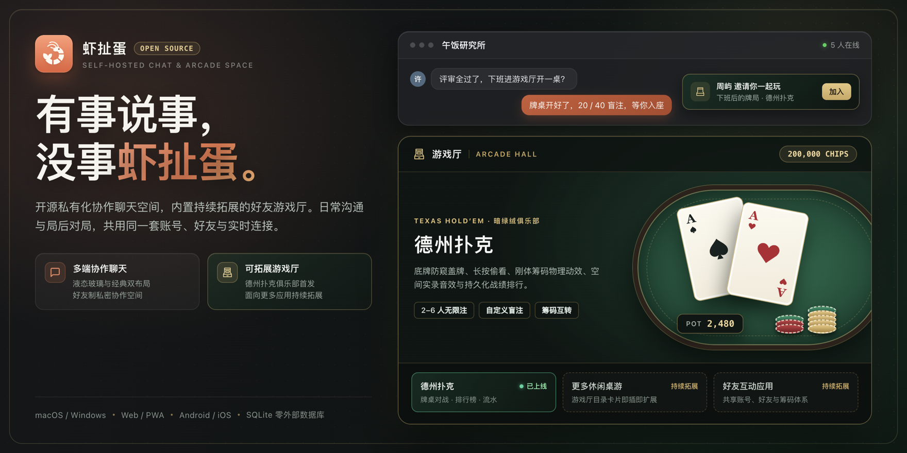
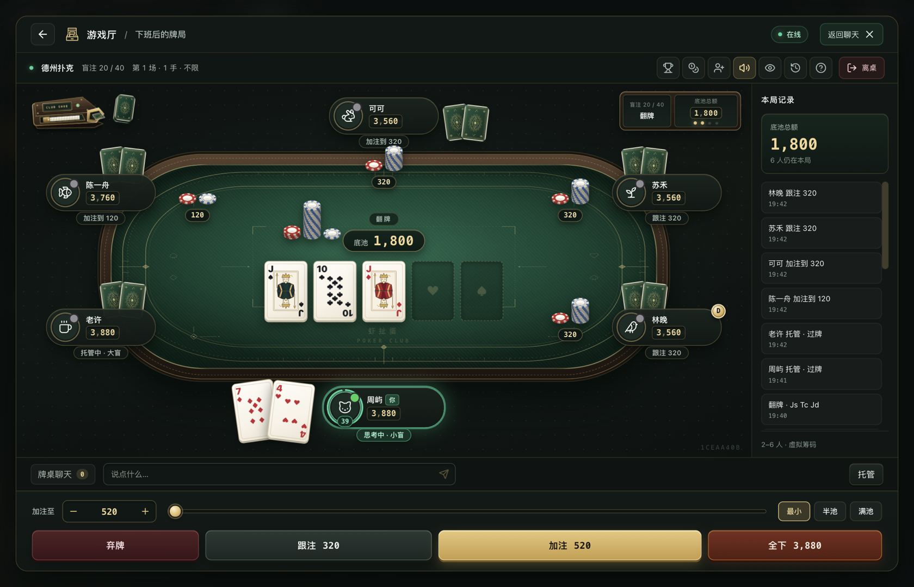
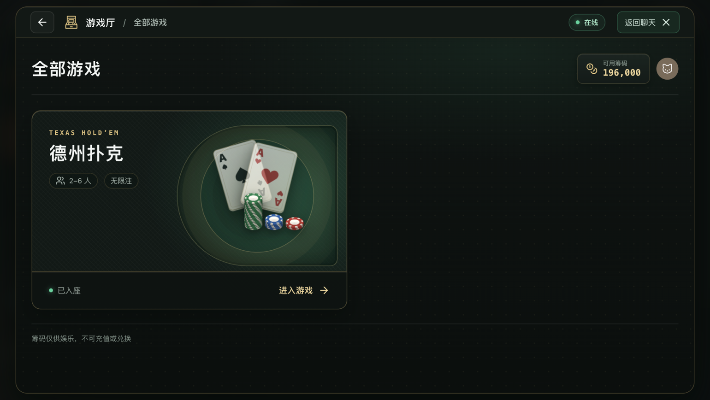
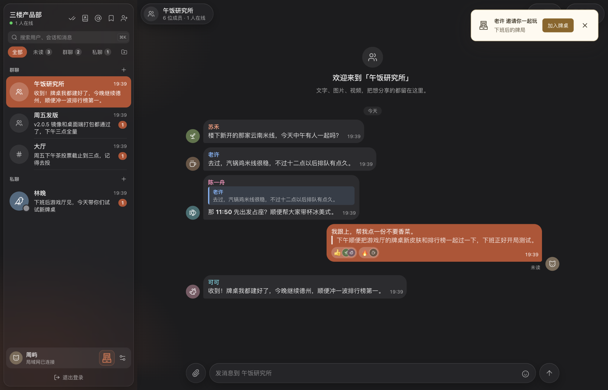

<div align="center">



# 蝦扯蛋（Xiachedan）

**有事說事，沒事蝦扯蛋。**

開源私有化輕量協作聊天空間，內建持續拓展的好友**遊戲廳**。<br />
單檔 SQLite 零外部資料庫，支援 macOS / Windows 桌面端、Web / PWA 與 Android / iOS 行動端。

[](https://github.com/ayogggua/xiachedan/actions/workflows/build.yml)
[](https://github.com/ayogggua/xiachedan/releases)
[](package.json)
[](LICENSE)

<p>
  <a href="README.md">简体中文</a> · <a href="README.en.md">English</a> · <a href="README.ja.md">日本語</a> · <a href="README.ko.md">한국어</a> · <strong>繁體中文</strong>
</p>

[核心亮點](#核心亮點) · [遊戲廳](#遊戲廳持續拓展的互動空間) · [介面預覽](#介面預覽) · [聊天與協作](#聊天與協作能力) · [快速自託管部署](#快速自託管部署) · [用戶端打包](#用戶端開發與打包) · [專案結構](#專案結構)

</div>

---

## 核心亮點

<table>
  <tr>
    <td width="50%" valign="top">
      <strong>Clone 即部署，零外部資料庫</strong><br />
      後端採用 Node.js 原生 <code>node:sqlite</code>，訊息、好友關係、籌碼帳戶與戰績全數存於單一 SQLite 檔案，附件直存本機目錄。無須安裝 MySQL、PostgreSQL 或 Redis，幾分鐘即可部署到自己的伺服器或區域網路主機。
    </td>
    <td width="50%" valign="top">
      <strong>聊天與遊戲廳原生融合</strong><br />
      日常溝通與下班開局共用同一套帳號、好友關係與 WebSocket 即時連線。遊玩期間持續接收聊天訊息，牌桌邀請直接於聊天視窗頂部即時彈出，關閉遊戲廳即無縫回到原對話與草稿。
    </td>
  </tr>
  <tr>
    <td width="50%" valign="top">
      <strong>面向多應用拓展的遊戲廳平台</strong><br />
      兩級目錄架構（全部遊戲 → 房間大廳 → 即時對局），首發暗綠絨俱樂部<b>無限注德州撲克</b>。統一沉澱虛擬籌碼銀行、好友轉帳、排行榜與即時邀請底座，後續將持續拓展更多休閒桌遊與好友互動應用。
    </td>
    <td width="50%" valign="top">
      <strong>克制耐看的全端體驗</strong><br />
      提供<b>液態玻璃</b>與<b>經典三欄</b>雙介面風格，支援淺色 / 深色 / 跟隨系統。涵蓋 macOS / Windows（Tauri 2）、Web / PWA（含 Web Push 推播與系統分享）以及 Android / iOS（Capacitor）。
    </td>
  </tr>
</table>

> 桌面端與 Android 安裝包可直接至 [Releases](https://github.com/ayogggua/xiachedan/releases) 下載；若想自行架設私有空間，請直接查看 [快速自託管部署](#快速自託管部署)。

---

## 遊戲廳：持續拓展的互動空間

遊戲廳是蝦扯蛋的重點互動模組，以獨立街機圖示常駐介面角落（桌面液態玻璃位於左下角設定旁、經典版面位於左側導覽列下方、手機位於訊息頁右上角及「我」頁面），不打擾預設聊天體驗，隨時一鍵進入。

### 可拓展的應用底座

- **兩級目錄卡片架構**：進入遊戲廳先顯示「全部遊戲」目錄卡片，點擊進入對應應用的房間列表與即時對局。後續新增休閒桌遊或好友互動應用時，直接以新卡片接入目錄，沿用同一套空間連線與互動規範。
- **持久化虛擬籌碼銀行（`server/arcadeBank.js`）**：每位成員預設擁有 **200,000** 初始虛擬籌碼，帳戶餘額、牌桌託管籌碼與完整流水皆持久化儲存於 SQLite。支援**好友間互轉籌碼**與總管理員發放籌碼；服務重啟時自動退回未完成牌局的託管籌碼。
- **多維度排行榜與戰績卡**：可依**淨贏、總籌碼、勝率、牌局數、累計贏得**排序；點擊任意玩家展開詳細戰績（累計贏得 / 投入、最大單局淨贏、主動入池率 VPIP、加注局數、全下 / 攤牌 / 棄牌 / 平分底池與最長連勝）。
- **站內即時邀請**：於房間內一鍵邀請好友，對方在聊天視窗頂部立即收到牌桌邀請卡片並一鍵入座；對局期間照常接收聊天訊息，離開遊戲廳即返回原對話與未送出草稿。

### 首發應用：無限注德州撲克（暗綠絨俱樂部）

- **俱樂部級視覺與物理手感**：暗綠絨牌桌、胡桃木縫線桌沿、精工黃銅發牌靴與機械計數器、雕花牌背與精繪人頭牌；內建剛體籌碼拋投物理動效與空間實錄音效（可獨立開關）。
- **底牌防窺蓋牌**：單擊任一張底牌即可蓋牌防窺，長按臨時偷看、放開自動扣回；頂欄提供持久化防窺開關，開啟後每局預設蓋牌、攤牌時自動亮牌。
- **伺服器端權威規則引擎**：支援 2–6 人無限注，開桌或局間可自訂**底分（小盲 1–1,000,000）**與**每場手數（0 為不限）**；伺服器統一處理密碼學洗牌、最小加注、全下邊池、平分底池與無人跟注籌碼返還。
- **流暢的多人節奏**：40 秒行動倒數與超時自動託管、5 秒自動連開下一手、即時觀戰、中途入座下一手自動加入、局中可預約「本局後離桌」或立即離桌（結算後自動退回籌碼），內建牌桌聊天氣泡。

| 應用模組 | 目前狀態 | 能力說明 |
| --- | --- | --- |
| **無限注德州撲克** | 已上線 | 2–6 人暗綠絨俱樂部、防窺蓋牌、剛體籌碼、空間音效、戰績排行 |
| **更多休閒桌遊** | 持續拓展中 | 直接接入遊戲廳目錄卡片，共用房間、觀戰、邀請與籌碼系統 |
| **好友互動小應用** | 持續拓展中 | 與聊天空間共用帳號與好友關係，打造輕量團隊 / 好友互動合集 |

> **說明**：虛擬籌碼僅供娛樂，不可儲值、交易或兌換。籌碼餘額、流水與戰績持久化儲存於 SQLite；進行中的即時牌桌狀態保留在服務進程記憶體中（重啟後自動退回未完成牌局的託管籌碼）。

---

## 介面預覽

### 遊戲廳 · 暗綠絨德州撲克俱樂部



### 遊戲廳 · 可拓展應用目錄



### 液態玻璃聊天介面與即時牌桌邀請



> 設定中可隨時於「蝦扯蛋」（液態玻璃）與「經典」（三欄版面）間切換；行動裝置自動切換為訊息、通訊錄、我三頁配置。

---

## 聊天與協作能力

<details open>
<summary><strong>好友關係與私密邊界</strong></summary>

- **好友申請制**：通訊錄預設僅顯示好友，可透過暱稱、完整手機號碼或信箱搜尋並送出好友申請；一般成員不暴露全站用戶列表，僅管理員可檢視完整成員目錄。
- **可控公共大廳**：新成員註冊審核通過後不再自動加入大廳，由管理員主動邀請或移除。
- **個人資料與狀態**：自訂暱稱、頭像裁切、名字顏色、部門、簽名、僅自己可見的備註，以及可設定到期自動清除的自訂狀態。

</details>

<details open>
<summary><strong>對話組織與高效檢索</strong></summary>

- **多類型對話**：公共大廳、群組、一對一私聊，WebSocket 即時收發，斷線重連自動補齊遺漏訊息。
- **完整群組治理**：群主轉讓、最多 10 位管理員、群頭像、群公告、全員禁言、群暱稱、移出成員與可選審批的邀請連結。
- **效率與秩序**：對話置頂拖曳排序、免打擾、跨裝置同步資料夾、自動銷毀訊息（1 天 / 1 週 / 1 個月）、草稿標記、`⌘K` 快速切換、`⌘1–9` 跳轉、`⌘/` 快捷鍵總覽。
- **搜尋與整理**：全域多條件搜尋、「提到我的」彙總、按日期跳轉、置頂訊息、話題回覆、收藏、定時傳送、提醒、媒體檔案總覽與桌面端獨立視窗。

</details>

<details>
<summary><strong>富訊息表達與互動（點擊展開）</strong></summary>

- **多媒體與預覽**：文字、圖片（壓縮 / 原圖、裁切與畫筆標註、相簿網格、全螢幕檢視器）、影片、檔案，以及文字、程式碼與 PDF 直接預覽。
- **完整 Markdown**：標題、表格、待辦、引用、程式碼語法高亮與複製按鈕、`/` 快捷格式選單、貼上網頁富文本自動轉 Markdown、自訂 `Enter` 或 `⌘Enter` 傳送。
- **引用、劇透與閱後即焚**：選取片段引用、`@成員` / `@所有人`、`||劇透遮罩||`（支援圖片 / 影片劇透）、私聊閱後即焚（5 秒–1 分鐘，到期從伺服器刪除內文與附件）。
- **輕量互動**：訊息編輯與紀錄、粉碎動畫收回重編、投票、群接龍、連結預覽、拍一拍、名片推薦、訊息連結、任意表情回應、自訂貼圖與 `:shortcode:`、跨裝置常用語、多選逐條 / 合併轉發、離線自動重送與文字匯出。

</details>

<details>
<summary><strong>外觀、隱私、行動端與機器人（點擊展開）</strong></summary>

- **外觀與隱私**：液態玻璃 / 經典三欄、淺色 / 深色 / 跟隨系統、各風格獨立主題色與背景、隱私模式（懸停顯示並計為已讀）、本機應用鎖密碼、可略過開屏動畫。
- **桌面與行動端**：選單列 / 系統匣常駐、系統通知、關鍵字提醒、勿擾時段、Dock 未讀數；HTTPS 下 PWA 主畫面安裝、Web Push 背景推播與 Android 系統分享接收；Android 原生用戶端附件下載與分享。
- **管理與機器人**：註冊審核、重設密碼、登入裝置管理、禁言與操作日誌；群 Webhook 機器人與獨立機器人帳號（簽名 JSON 回呼 + 權杖回覆，詳見 [`docs/bots.md`](docs/bots.md)）。

</details>

---

## 快速自託管部署

Clone 專案後，依需求選擇合適的部署方式：

| 部署方式 | 適用場景 | 外部依賴 | 預計耗時 |
| --- | --- | --- | --- |
| **方式一：本機 / 區域網路模式（Local）** | 辦公室、家庭內網快速體驗，邀請碼直接加入 | Node.js ≥ 22.13 | 1 分鐘 |
| **方式二：單機公網自託管（Cloud + Node.js）** | 單台 VPS 執行，帳號審核登入，前後端一體 | Node.js ≥ 22.13 + Nginx / Caddy | 3 分鐘 |
| **方式三：Docker + Nginx 生產部署** | 長期公網營運、容器隔離、前後端分離部署 | Docker + Nginx | 5 分鐘 |

### 0. 複製專案

```bash
git clone https://github.com/ayogggua/xiachedan.git
cd xiachedan
```

---

### 方式一：本機 / 區域網路快速體驗（零設定）

需安裝 **Node.js 22.13.0 以上** 與 npm：

```bash
npm ci
npm run build
CHAT_MODE=local CHAT_SERVE_WEB=true npm start
```

啟動後於本機瀏覽器開啟終端機輸出的 `#setup=...` 初始化連結（預設埠 `4318`）建立空間，再將應用內的區網位址與邀請碼分享給同網段好友即可使用。

---

### 方式二：單機公網自託管（Cloud 帳號模式）

#### 1. 修改預設超級管理員手機號碼（建議）

於首次啟動前編輯 [`server/auth.js`](server/auth.js) 第 8 行 `ADMIN_PHONE`：

```js
const ADMIN_PHONE = '13800138000';
```

#### 2. 建立初始管理員密碼檔

將 10–128 位且同時包含英文字母與數字的初始密碼寫入專案外檔案（首次初始化後，後續重啟不再需要此檔）：

```bash
mkdir -p /etc/xiachedan
printf '%s\n' 'YourStrongPass2026' > /etc/xiachedan/admin-password
chmod 600 /etc/xiachedan/admin-password
```

#### 3. 安裝依賴並建置 PWA 前端

```bash
npm ci
npm run build:pwa
```

#### 4. 啟動服務

**正式 HTTPS 環境**（搭配 Nginx / Caddy 反向代理）：

```bash
NODE_ENV=production \
CHAT_MODE=cloud \
CHAT_SERVE_WEB=true \
HOST=127.0.0.1 \
PORT=4318 \
CHAT_DATA_DIR=/var/lib/xiachedan \
CHAT_SPACE_NAME=蝦扯蛋 \
CHAT_PUBLIC_URL=https://chat.example.com \
CHAT_ALLOWED_ORIGINS=https://chat.example.com \
CHAT_TRUST_PROXY=1 \
CHAT_ADMIN_PASSWORD_FILE=/etc/xiachedan/admin-password \
npm start
```

> **若需於本機 HTTP 預覽帳號模式**：因 `NODE_ENV=production` 會強制啟用 HTTPS 專用 `__Host-` + `Secure` Cookie，本機預覽時請移除 `NODE_ENV=production` 與 `CHAT_TRUST_PROXY`。

#### 5. 設定 HTTPS 反向代理（Caddy 或 Nginx）

反代須支援 `/socket` 的 WebSocket 升級並放行大檔上傳（`101m`）。

<details>
<summary><strong>Caddy（最簡，自動 HTTPS 憑證）</strong></summary>

```caddyfile
chat.example.com {
    reverse_proxy 127.0.0.1:4318
}
```

</details>

<details>
<summary><strong>Nginx（關鍵設定片段）</strong></summary>

```nginx
server {
    listen 443 ssl http2;
    server_name chat.example.com;
    # 請填入你的 SSL 憑證路徑
    client_max_body_size 101m;

    location = /socket {
        proxy_pass http://127.0.0.1:4318;
        proxy_http_version 1.1;
        proxy_set_header Host $host;
        proxy_set_header Origin $http_origin;
        proxy_set_header X-Forwarded-Proto $scheme;
        proxy_set_header X-Forwarded-For $remote_addr;
        proxy_set_header Upgrade $http_upgrade;
        proxy_set_header Connection "upgrade";
        proxy_read_timeout 75s;
    }

    location / {
        proxy_pass http://127.0.0.1:4318;
        proxy_http_version 1.1;
        proxy_set_header Host $host;
        proxy_set_header X-Forwarded-Proto $scheme;
        proxy_set_header X-Forwarded-For $remote_addr;
        proxy_read_timeout 90s;
    }
}
```

</details>

#### 6. 驗證與首次登入

```bash
curl -s https://chat.example.com/api/health
# 回傳 {"app":"linliao","version":"...","mode":"cloud","ok":true,...} 即代表啟動成功
```

開啟 `https://chat.example.com`，使用 `ADMIN_PHONE` 與初始密碼登入並依提示變更密碼。長期運作建議以 `systemd` 或 `pm2` 託管程序。

---

### 方式三：Docker + Nginx 生產前後端分離部署

[`deploy/`](deploy/) 已內建最小權限容器映像與強化 Nginx 設定：

1. **視需求修改 [`server/auth.js`](server/auth.js) 中的 `ADMIN_PHONE`**，接著建置後端映像：
   ```bash
   docker build -f deploy/Dockerfile.backend -t xiachedan-backend:latest .
   ```
2. **準備主機設定檔、密碼檔與資料目錄**（容器以 `uid 1000` 唯讀執行）：
   ```bash
   sudo mkdir -p /etc/xiachedan /var/lib/xiachedan /opt/xiachedan/frontend/current
   sudo cp deploy/backend.env.example /etc/xiachedan/backend.env
   # 編輯 /etc/xiachedan/backend.env，將 chat.example.com 替換為你的正式網域
   printf '%s\n' 'YourStrongPass2026' | sudo tee /etc/xiachedan/admin-password >/dev/null
   sudo chmod 600 /etc/xiachedan/admin-password
   sudo chown -R 1000:1000 /var/lib/xiachedan
   ```
3. **啟動後端容器**：
   ```bash
   BACKEND_IMAGE=xiachedan-backend:latest RELEASE_SHA=local \
     docker compose -f deploy/compose.yml up -d
   ```
4. **建置並發佈 PWA 前端靜態資源**：
   ```bash
   npm ci && npm run build:pwa
   sudo cp -r dist/* /opt/xiachedan/frontend/current/
   ```
5. **套用 [`deploy/nginx.conf`](deploy/nginx.conf)**：替換 `chat.example.com`（含 CSP 中的 `wss://chat.example.com`）與憑證路徑並重載 Nginx。

---

### 環境變數速查

| 環境變數 | 預設值 | 說明 |
| --- | --- | --- |
| `CHAT_MODE` | `local`（`NODE_ENV=production` 時為 `cloud`） | `cloud`（帳號審核模式）或 `local`（區網邀請碼模式） |
| `NODE_ENV` | — | 設為 `production` 啟用 HTTPS 專用 `__Host-` Cookie 與嚴格來源驗證 |
| `CHAT_SERVE_WEB` | `local` 為 `true`，`cloud` 為 `false` | 是否由 Node 服務直接託管 `dist/` 前端資源 |
| `HOST` / `PORT` | `0.0.0.0` / `4318` | 監聽位址與埠號（搭配本機反代建議設 `127.0.0.1`） |
| `CHAT_DATA_DIR` | `./.data` | SQLite 資料庫與附件目錄 |
| `CHAT_SPACE_NAME` | `虾扯蛋` | 首次初始化空間名稱（最多 32 字） |
| `CHAT_PUBLIC_URL` | — | 對外正式 HTTPS 根網址（不含尾端 `/`） |
| `CHAT_ALLOWED_ORIGINS` | 同 `CHAT_PUBLIC_URL` | 允許存取的精確 Origin，逗號分隔 |
| `CHAT_TRUST_PROXY` | — | 反向代理層數或可信 IP（單層 Nginx / Caddy 設為 `1`） |
| `CHAT_COOKIE_SAME_SITE` | `lax` | Session Cookie `SameSite` 策略（`lax` / `strict` / `none`） |
| `CHAT_ADMIN_PASSWORD_FILE` | — | 首次初始化超管密碼檔路徑 |
| `CHAT_LINK_PREVIEW` | 開啟 | 設為 `off` 關閉連結預覽 |
| `CHAT_MAX_STORAGE_BYTES` | `10737418240`（10 GB） | 空間附件總容量上限（位元組） |
| `CHAT_MAX_USER_BYTES` | 不限制 | 每位成員附件容量上限（位元組） |

---

## 用戶端開發與打包

- **macOS / Windows 桌面端（Tauri 2 · Rust 1.90+）**：
  ```bash
  npm run desktop
  LINLIAO_CLOUD_URL=https://chat.example.com npm run package:mac
  LINLIAO_CLOUD_URL=https://chat.example.com npm run package:win
  ```
- **PWA 與手機推播**：以 `npm run build:pwa` 建置並部署至 HTTPS 網域，即可加入主畫面並開啟 Web Push。
- **Android / iOS 原生用戶端（Capacitor）**：
  ```bash
  VITE_API_BASE_URL=https://chat.example.com npm run package:android
  # 或開啟原生專案：npm run mobile:android / npm run mobile:ios
  ```

---

## 專案結構

| 目錄 / 檔案 | 內容說明 |
| --- | --- |
| `src/` | React 19 前端介面、聊天互動、液態玻璃 / 經典雙風格、好友系統、行動端與 PWA |
| `src/arcade/` | 遊戲廳核心模組：兩級目錄（`ArcadeLobby.jsx`）、排行榜與錢包（`ArcadePanels.jsx`）、暗綠絨德州撲克牌桌（`Arcade.jsx`）、剛體籌碼物理與空間音效 |
| `src/ArcadeEntry.jsx` / `ArcadeInvitation.jsx` | 遊戲廳街機入口按鈕與聊天內即時牌桌邀請浮條 |
| `server/` | Express 5、WebSocket、帳號鑑權（`auth.js`）、SQLite 儲存（`store.js`）、Web Push 與機器人投遞 |
| `server/poker.js` / `arcadeBank.js` | 德州撲克權威規則引擎與持久化虛擬籌碼 / 戰績銀行 |
| `src-tauri/` / `mobile/` | Tauri 2 桌面外殼與 Capacitor Android / iOS 原生工程 |
| `deploy/` | 生產環境 Docker 映像、Compose 編排、Nginx 強化設定與原子發佈腳本 |
| `docs/bots.md` | 機器人帳號與回呼介面開發文件 |
| `tests/` | 伺服器端自動化測試（`npm test`） |

---

## 使用與安全範圍

- 區域網路模式僅適用於可信內網；公網部署請始終使用 `cloud` 模式搭配 HTTPS / WSS。
- 兩種模式皆未實作端對端加密（E2EE），聊天資料、附件與籌碼紀錄存於自託管伺服器上；隱私模式與應用鎖僅保護本機畫面存取。

本專案採用 [MIT License](LICENSE) 開源。歡迎透過 Issue 回報問題、提出你想在**遊戲廳**體驗的新應用，或提交 Pull Request 一起完善蝦扯蛋。
